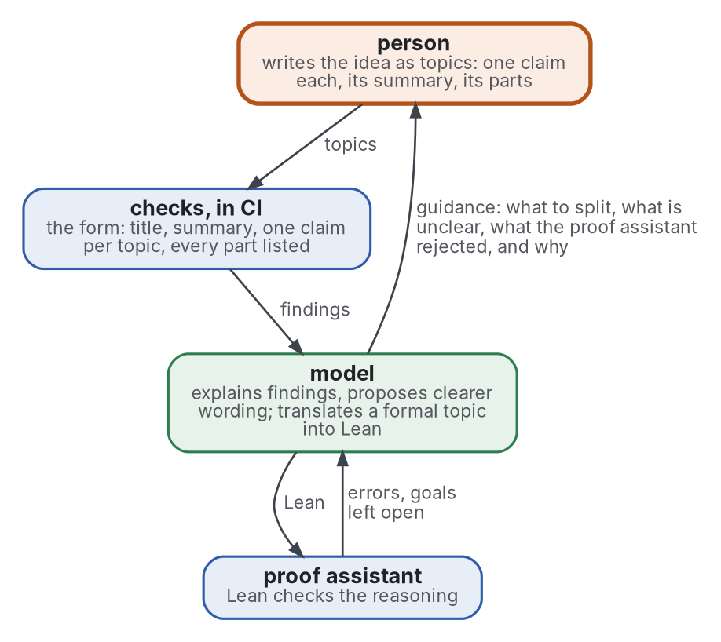

# AI-augmented topic

The topic as the one format a person, a language model and a checking program all work on. The person writes the
reasoning; programs check the writing and, where the reasoning is formal, the logic; the model helps between them.

> **Status:** branch `ai-augmented-topic`, opened 2026-10-29. Scope only, and a grey literature review begun; nothing
> here is on master. It is this repository's extension, and joins master once its review names a baseline.

## The loop

Graphviz source

The figure reads from the person downward; what comes back, errors and goals to the model and guidance to the person, runs upward. Each part has one role:

| Part | Role | Decides |
|---|---|---|
| **person** | owns the reasoning; writes each step as a topic | what is claimed |
| **checks** | programs: the [topic check](../checks/local/topic.py) and the reader-ergonomics checks | whether the form is clear |
| **model** | a language model: explains, proposes, translates | nothing: its output is always checked |
| **proof assistant** | Lean, for what is formalized | whether the reasoning is valid |

The topic is the shared unit: what the person writes, what the checks read, what the model translates, and what one
Lean declaration mirrors.

## Scope

| | What | Why |
|---|---|---|
| in | the topic as the interface between a person, a model and a checker | the one problem of this extension |
| in | proofs written as topics and checked in Lean, as the first instance | a checker whose verdict is exact exists |
| in | what the model may do (explain, propose, translate) and what it may not (decide) | a model's output is checked, never trusted |
| in | the evidence, grey literature first: how practice joins informal writing, models and proof assistants | the tools move faster than papers |
| out | building a prover or training a model | others do it; this uses them |
| out | other formal targets, such as TLA+ or tests for code, for now | one instance first; named, not reviewed |
| out | AI writing assistants with no checker behind them | without an exact verdict, nothing closes the loop |

## Questions the review must answer

- **Prior art.** Who already joins structured informal writing to a proof assistant, and what does each way ask of
  the writer?
- **Translation.** How faithful is a model's translation of an informal statement into Lean, and how is a wrong
  translation caught, a correct proof of the wrong statement?
- **Feedback.** How is a proof assistant's output turned into guidance a person can act on?
- **Form.** Does a format that obliges the writer to split reasoning into small claims help the person think, or only
  the machine check?
- **Limits.** Where does the loop fail: a wrong translation, reliance on the model, claims no checker can decide?

## The baseline, named by the grey review

The grey pass of the review, [autoformalization](../evidence/autoformalization/), named one baseline:

- **B1, the audited blueprint**: a blueprint of small lemmas, each copied from its source. A model may write proofs
  and decides nothing. Lean checks every submission in CI, and comparator checks that the proof proves the stated
  claim. A person audits each statement against its source.
- It confirms the first candidate named before the review, a blueprint project built in CI. Neither side found
  practice naming the other two, a controlled natural language or plain Lean with a model, as a baseline.
- The formal pass and an audit of every number come next; the [baseline](../evidence/autoformalization/baseline.md)
  says how a comparison with the loop would be measured.

## Where it sits

- It builds on the [topic](../shapes/topic.md) and its check. A node template drafted earlier, unpublished, already
  gave each claim a Lean file; it is the starting point, not the baseline.
- Structured proofs are reviewed in reader-ergonomics-academic, `evidence/mathematical-writing`; this extension links
  that review and does not repeat it.

## See also

The [repository's front page](../README.md), the parent of this folder.
