# Baseline: what the loop is compared against

Step 5 of the review: the baseline the loop must beat, named from both sides of the grey pass and checked against the formal pass, and how fidelity and guidance would be measured. Terms are defined in [frame](frame.md); the findings behind each line are in [review](review.md).

## Two proposals, one baseline

The formal side names a blueprint project whose statements sit in a comparator challenge file with a formalization.yaml, checked in CI, with fidelity left to a human audit.
The human side names the PNT+ workflow.
Drawn as two sets, they share their core and differ only at the edges:

```dot
// The two sides' proposals for the baseline, as sets: each holds the shared core and its own edge. A figure of baseline.md.
// Colours, as in every figure of this review: a program blue for the formal side's checks, a person orange for the
// human side's rules, white for the core both hold; an arrow means "holds".
digraph two_proposals {
  graph [rankdir=TB, nodesep=0.5, ranksep=0.55, bgcolor="white", pad=0.2, fontname="Inter"];
  node  [shape=box, style="rounded,filled", fontname="Inter", fontsize=13, margin="0.2,0.1", penwidth=1.5, fontcolor="#1F2328"];
  edge  [fontname="Inter", fontsize=11, color="#3D434B", fontcolor="#55575F", penwidth=1.3, arrowsize=0.8];
  FP [label=<<b>formal side's proposal</b>>, fillcolor="#FFFFFF", color="#3D434B"];
  HP [label=<<b>human side's proposal</b>>, fillcolor="#FFFFFF", color="#3D434B"];
  FE [label=<<b>program checks of the statement</b><br/><font point-size="11" color="#55575F">challenge file, short and read by a person</font><br/><font point-size="11" color="#55575F">comparator in CI: the same statement,</font><br/><font point-size="11" color="#55575F">permitted axioms</font><br/><font point-size="11" color="#55575F">formalization.yaml table</font><br/><font point-size="11" color="#55575F">model judge as a filter only</font>>, fillcolor="#E8EEF8", color="#2F5DA8"];
  SC [label=<<b>the shared core: in both</b><br/><font point-size="11" color="#55575F">a blueprint: one node per statement, tied</font><br/><font point-size="11" color="#55575F">to its Lean name</font><br/><font point-size="11" color="#55575F">a model may write the proofs</font><br/><font point-size="11" color="#55575F">Lean decides them, in CI</font><br/><font point-size="11" color="#55575F">a person audits each statement against its</font><br/><font point-size="11" color="#55575F">source</font>>, fillcolor="#FFFFFF", color="#3D434B", penwidth=2.6];
  HE [label=<<b>rules of a running project for the</b><br/><b>person's side</b><br/><font point-size="11" color="#55575F">statements copy the paper and keep its</font><br/><font point-size="11" color="#55575F">citation</font><br/><font point-size="11" color="#55575F">bite-sized lemmas, each claimed as a task</font><br/><font point-size="11" color="#55575F">AI use disclosed, labelled in CI</font><br/><font point-size="11" color="#55575F">a cap on open AI pull requests</font>>, fillcolor="#FBEDE4", color="#B4541A"];
  FP -> FE [label=" holds"];
  FP -> SC [label=" holds"];
  HP -> SC [label=" holds"];
  HP -> HE [label=" holds"];
  {rank=same; FP; HP}
  {rank=same; FE; SC; HE}
}
```

Graphviz source

- They are one baseline, not two: both are a blueprint project in which a model may write proofs, Lean decides them in CI, and a person audits each statement against its source.
- The formal side's edge checks by program that the statement proved is the statement claimed; the human side's edge sets what the person does around it. Neither excludes the other.
- PNT+ already enforces LeanArchitect's `@[blueprint]` attribute (PNT-plus 2026, sections 6 and 12).
- PNT+ runs no comparator and keeps no formalization.yaml: its CI builds the blueprint and requires `checkdecls`, which checks that each named declaration exists, not what it states (GitHub 2026i). The Palomar minimum is what B1 adds to it.

## The named baseline

**B1, the audited blueprint**: the PNT+ workflow (PNT-plus 2026; Tao 2026e) with the Palomar minimum, a challenge file checked by comparator and a formalization.yaml (Palomar 2026; Lean FRO 2026a; Mathlib Initiative 2026; MathOverflow 2026).

| Part of the loop | What B1 does | Source, with where |
|---|---|---|
| person writes | a blueprint of small lemmas, each statement copied from the paper with its citation, each lemma claimed as a task | PNT-plus 2026, section 3; Tao 2026e |
| model | writes proofs, with its use disclosed in the pull request; decides nothing | PNT-plus 2026, section 13, rule 1 |
| checks in CI | Lean typechecks every submission; the blueprint is built, by `checkdecls` with leanblueprint or by `lake build :blueprint` with LeanArchitect; comparator checks the solution module proves exactly the challenge file's statements, with permitted axioms; a job labels AI-assisted pull requests | Tao 2026e; Massot 2026; Zhu 2026; Lean FRO 2026a; PNT-plus 2026, section 13, rule 1 |
| statement fidelity | a person audits each statement against its source, definitions included; a model judge only filters | Hales 2026; Buzzard 2025; Paulson 2026; Palomar 2026 |
| guidance to the person | mechanisms written ahead of time: named errors, `Try this` suggestions | Lean FRO 2025; Lean FRO 2026d |
| review load | at most 3 open AI-assisted pull requests per contributor | PNT-plus 2026, section 13, rule 7 |

- It confirms the README's first candidate, a Lean blueprint project with a dependency graph built in CI. It adds the challenge file, comparator and the alignment table (formal side), and the project's rules for the person (human side).
- The README's two other candidates were named as baselines by neither side: a controlled natural language a machine checks, and plain Lean with a model in the editor. The grey pass holds no measure of either for a writer (review Q1, Q3).

## B1 holds after the formal pass

The formal pass names no workflow measured against B1, so B1 stays the baseline. It names, for three parts of the loop, the closest research to compare a part against:

| Part | Closest in research | Why it does not replace B1 |
|---|---|---|
| fidelity | BEq+ against a vetted reference statement: precision 98.0%, recall 48.3% on 3,752 human-labelled pairs (Poiroux 2025, Table 1) | it needs a reference; B1's challenge file is one, so BEq+ can run inside B1 before the person's audit, a comparison B1 makes possible and no study has run |
| guidance | LeanSide, students' prose formalized into Lean and the verdict informalized back, coded in 23 sessions (Guo 2026b) | one preprint, descriptive, one course, with no comparison against a workflow |
| review load | Lean Atlas, which selects the nodes a person must review for meaning: average node reductions of 94-99% in proof-heavy projects, 27.3% in a definition-heavy one (Yanahama 2026, abstract, secondary) | a tool inside a workflow, evaluated by its owners on six projects |

- The person's audit, on which B1 rests, is itself fallible: experienced mathematicians repaired misstated problems in their heads (Collins 2024, appendix on errors in task specification).
- A model audit found mistakes in 11 of 50 formalizations that experts had written and reviewed (Browning 2026, section 2.5).

## How fidelity and guidance would be measured

The formal measures give instruments for each question; each comes with its known accuracy.

| Question | Instrument | Its known accuracy, with where |
|---|---|---|
| Is the statement faithful? Reference | human evaluation: experts read the formal statement against its source, at least two per item | experts agree at kappa 0.81 (Mohammad 2026, section 11.3); people match reference labels on 79.58% of 80 items (Lu 2025, section 4.4) |
| Is it equivalent to the vetted statement? | BEq+ against the challenge file | precision 98.0%, recall 48.3%; across models, Pearson 0.974 with human accuracy, against 0.655 for the type-check rate (Poiroux 2025, Tables 1 and 2) |
| Can a model judge stand in for the person? | a model judge, or two judges of different families, reported with their accuracy | the best single judge 85.8% on a binary task of 859 items (Chen 2025, section 4.5); two judges agree with the human majority on 54 of 59 cases, 91.5%, 95% CI 81.6% to 96.3% (Zhang 2026, section 1); an implication certifier reaches kappa 0.77 against experts' 0.81 (Mohammad 2026, section 11.3) |
| Does the loop catch what B1 lets through? | statements misformalized on purpose, planted among real ones, as the canaries of Collins 2024 and the false statements of BrokenMath | experienced mathematicians repaired the two misstated problems in their heads (Collins 2024); the best model, GPT-5, answered false statements sycophantically 29.0% of the time, judged by a model with 95% agreement with people (Petrov 2025b, sections 3.1, 3.2) |
| Does the guidance reflect the error? | experts code each message as accurate about the mistake, or not | 61 of 97 step messages, 3 of 13 continuation errors, 11 of 13 next-step hints reflected it (Guo 2026b, section 7.2.2) |
| Does the guidance help the person act? | outcomes measured on the person: repeats of an error and attempts to resolve it; time to fix; progress per revision | 23.1% fewer repeats and 34.8% fewer additional attempts in a randomised trial (Wang 2024b, Figure 3, p. 1398); model messages beat stock ones on time to fix in 1 of 6 tasks (Santos 2024, secondary); 58% of 87 revisions progressed (Guo 2026b, section 8) |
| Does writing small claims change proofs on paper? | proofs written without the tool, graded and coded for explicit steps, against a control group | no grade effect where a control existed, p = 0.101 (Otte 2026, Table 3); every positive comparison is between self-selected groups (Thoma 2022; Bottoni 2025) |

- Preference is recorded, never used as the outcome: students preferred model explanations without fixing faster (Santos 2024, section 1).
- Grades are compared with a control group, assigned at random where possible; no randomised trial of a proof assistant on paper proofs was found.

## How a comparison would be measured

| Question | What the grey pass proposed | Records that exist |
|---|---|---|
| Does the loop catch what B1 lets through? | whether the loop's topic check and model audit find misformalizations that this workflow lets through (human side) | the misformalization label and its counts (GitHub 2026f); the audit's flagged files and trivially settled statements (Adamczewski 2026); the planted-statement designs above |
| Can a model judge stand in for the person? | an agreement rate of a model judge against people, which Palomar does not publish (formal side) | Palomar's two runs of one repository, scored 5 then 4 (Palomar 2026); the research judges' accuracies above |
| Does guidance help the person? | any measure of guidance given to a person (formal side) | on programming languages, controlled studies (review Q3); on proofs, one descriptive classroom study (Guo 2026b); none on Lean's own mechanisms |

- No source of either pass ran any of these comparisons against B1.
