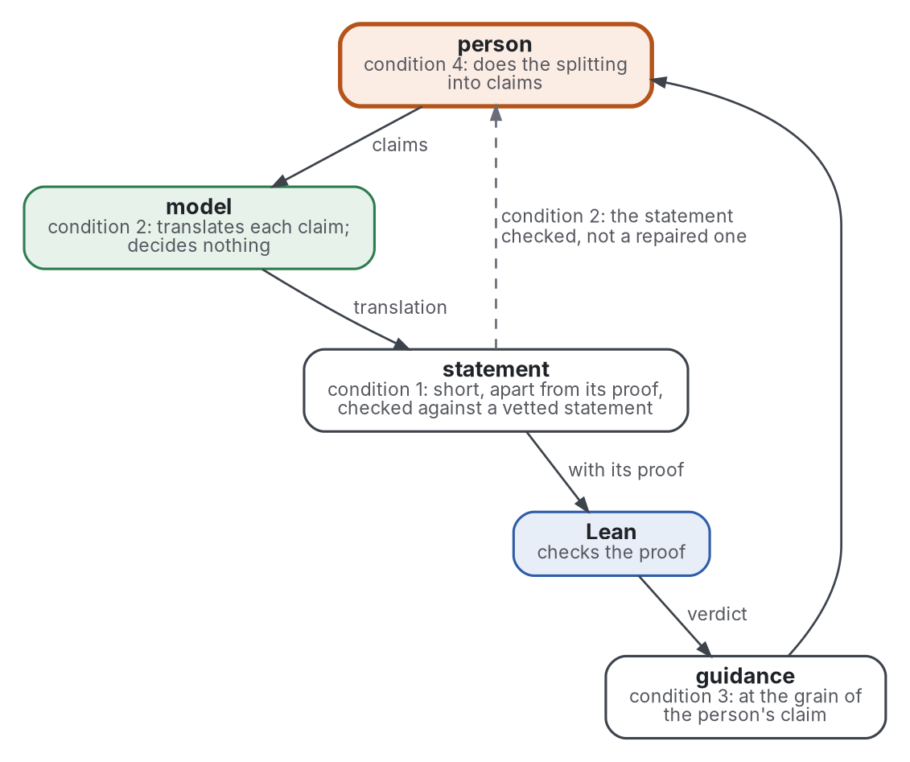

# Position

Step 4 of the review: where the AI-augmented topic stands against the existing reviews and the state of the art, what the evidence allows it to claim, and what this repository would add. Each "not found" below is a statement about these searches, not about the world. Terms are defined in [frame](frame.md).

## Against the existing reviews

- The autoformalization surveys (Weng 2025; Li 2024b; Raiyan 2026) and position papers (Yang 2024; Min 2026) cover the machine side: methods, benchmarks, provers. They list results and pool none.
- Ringer 2019 maps proof engineering and asks for more user studies (7.1.5); Becker 2019 maps error messages of programming languages, not of proof assistants.
- Tran Minh 2025 and Ouvrier-Buffet 2026 review proof assistants in teaching, with no model in the loop.
- Zhai 2024, Goddard 2012 and Parasuraman 2010 review over-reliance on automation, outside proofs.
- No review found here treats the loop as one object: a person's writing, a model's translation, a checker's verdict and the guidance back. This review joins them, with the practice of 2025 and 2026 beside the research.

## Known

- No program decides whether a formal statement means what its source means: research measures it against people or against a vetted reference (Azerbayev 2023, section 4.1.1; Poiroux 2025).
- Translations judged correct by a model judge are often wrong when people read them: 97.5% against 62.7% for one translator (Ospanov 2025, Table 2).
- Human-written benchmark statements are wrong too, in 16.4% and 38.5% of two benchmarks (Chen 2025, section 4.5).
- For a model, the checker's error message is what makes repair work (First 2023; Lin 2025b); Lean feedback repairs form more than meaning (Dai 2026; Zhang 2026).
- For people, better error messages help in some controlled studies and not in others, on programming languages (review Q3); no controlled study of a proof assistant's messages read by people was found.
- People read the statement they expect: experts repaired misstated problems in their heads (Collins 2024), and students missed unfaithful steps shown as verified (Guo 2026b, section 8.1.2).
- Practice keeps a short challenge file for the person and lets comparator check the rest (Lean FRO 2026a; Palomar 2026); it names one baseline, B1 ([baseline](baseline.md)).

## The repository's question: the topic as the interface

- **What the evidence allows:** a topic-shaped loop, built as B1 with the topic as its unit, under four conditions. Supported with caveat as a design; none of it is measured as such.

The figure places the four conditions on the loop; the bullets below give their evidence.

Graphviz source

- Why it is allowed:
  - B1, the closest practice, already ties one statement to one Lean declaration and keeps the trusted statement short (review Q1);
  - the statement is where translation fails, and research measures that failure against a vetted statement and a person (review Q2);
  - a model corrects itself where reliable external feedback exists, which a proof assistant gives (Kamoi 2024, abstract, secondary).
- Condition 1: the statement the person audits stays short and apart from the proof, and is checked against a vetted statement where one exists. People repair what they read (Collins 2024), and BEq+ is precise against a reference (Poiroux 2025, Table 1).
- Condition 2: the model decides nothing, and the person sees the statement that was checked, not a repaired one. A compile loop silently corrected students' mistakes in 12 cases (Guo 2026b, section 7.1); model explanations were correct for 48% of inputs (Leinonen 2023).
- Condition 3: guidance speaks at the grain of the person's claim, not the checker's. Messages at the checker's granularity stopped students (Guo 2026b, sections 7.2.2 and 8.3.1; Carl 2022, section 5).
- Condition 4: the person does the splitting into claims. Practice reports it helps thinking only where the person did it (review Q4; Kirov 2026a), and the transfer evidence comes from self-selected groups (Thoma 2022; Otte 2026).
- What is not allowed: claiming that writing as topics helps the person think or learn. No randomised study of it was found, and the one controlled comparison found no grade effect (Otte 2026, Table 3).

## Not known

- Whether a loop of this kind catches misformalizations that B1 lets through: no comparison against B1 was found.
- Whether guidance from the loop helps a person reason, not only fix: no study measured it on proofs.
- Whether Lean's named errors, hints or suggestions help any user: no study was found.
- Whether writing reasoning as topics transfers to proofs on paper: no randomised trial was found.
- How often a registry's model judge agrees with people: Palomar publishes no rate.
- What the person's audit of a model's statements costs: no source measured it (review Q5, C7).
- Whether a topic's summary and parts help a model translate faithfully: no study was found.

## Where practice runs ahead of the evidence

- A registry runs a model judge of fidelity with no published agreement rate; research measures such judges on benchmarks only, with errors of 14.2% or more (Chen 2025).
- Controlled languages run in courses (Verbose Lean, Waterproof); the one controlled comparison of a course tool found no significant grade effect (Otte 2026).
- AI-written libraries reach millions of lines (Avigad 2026), while no source measured the cost of reviewing them.
- Practitioners estimate large savings of time; the one measurement found no significant time effect, with 7 people (Collins 2026).

## Where evidence is ignored by practice

- Owners report prover scores on miniF2F and PutnamBench (review Q2); research finds those benchmarks wrong in part and exploitable (Chen 2025; Ammanamanchi 2026).
- Practice reports satisfaction with model feedback on writing (Google 2025); research finds preference and performance apart (Santos 2024; Moraru 2026).
- Practice limits the volume of model output, by labels and caps (PNT-plus 2026); research finds over-reliance resists training and yields to designs that force engagement (Parasuraman 2010; Buçinca 2021).

## What this repository adds

- A reading of the loop from the person's side, with the four conditions above as candidate rules, each graded convention, untested until compared ([baseline](baseline.md)):
  - a statement short enough to audit, kept apart from its proof and checked against a vetted statement;
  - a record that keeps the person's statement apart from any statement the loop repaired;
  - guidance at the grain of the person's claim, measured on what the person does next, not on preference;
  - the splitting into claims left to the person.
- A comparison not found here: the loop against B1 on misformalizations planted among real statements, with the cost of the audit measured.
- It does not claim a new result or the state of the art.
