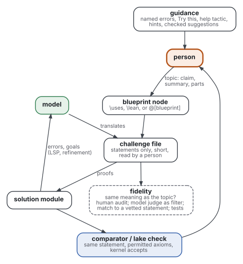
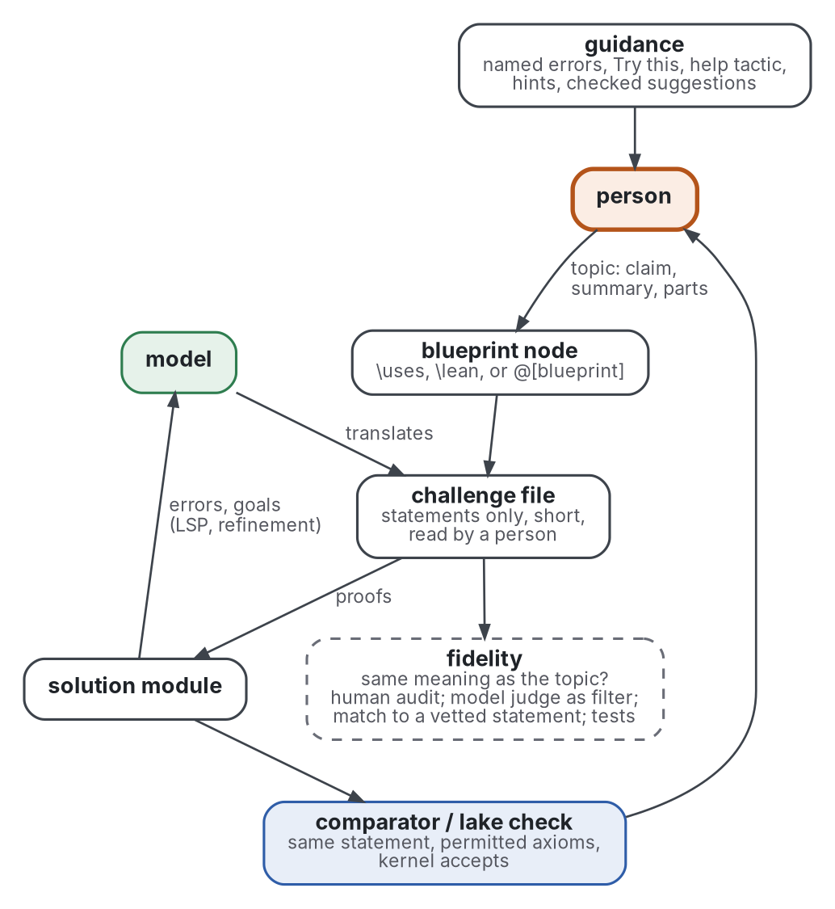
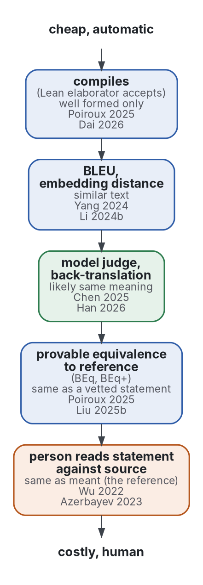
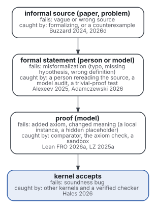
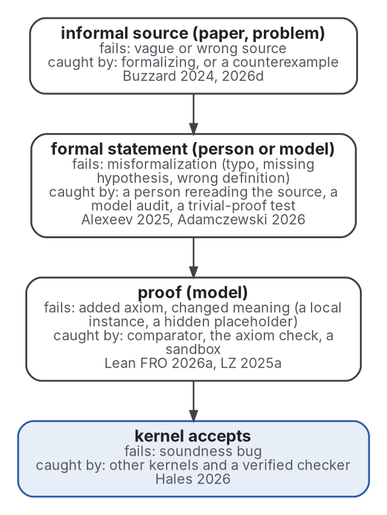
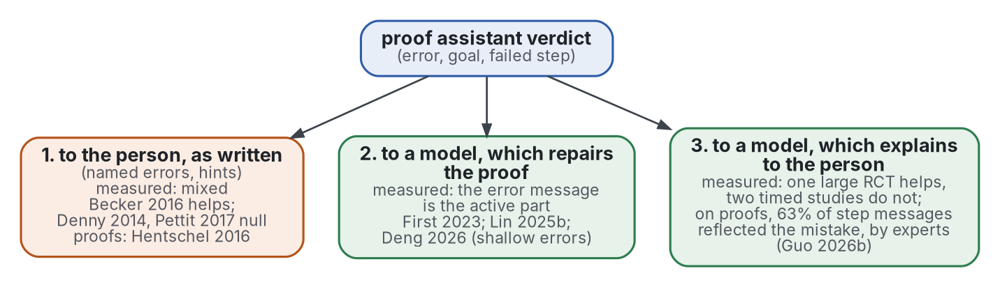
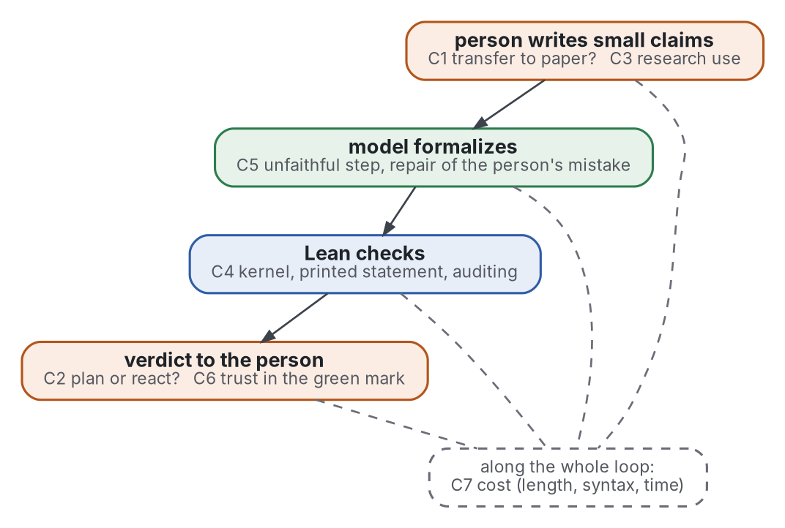

# Review: autoformalization, grey and formal, by the scope's five questions

The findings of both passes, read on 2026-10-29 and merged by the questions Q1 to Q5 of [frame](frame.md): practice from the grey pass, research from the formal pass in its three strands. Each finding keeps its key and where in the source a number is.

- Markings: owner, a claim a source makes about itself; **count**, the reviewer's count on a public record. Also: independent, a check by someone other than the owner; example only, a grey source below 10 of 20 ([sources](sources.md)).
- Grade for practice: convention, untested, unless a line says measured. The formal grades are defined in [protocol](protocol.md), section 9.
- A benchmark number holds on its benchmark, split, metric and budget only; a number read in an abstract or another work is marked "(secondary)".
- Terms are defined in [frame](frame.md).

## Answer first

| Id | Question | Answer from practice (grey pass) | Answer from research (formal pass) |
|---|---|---|---|
| Q1 | Prior art | Blueprint projects join informal statements to Lean declarations, checked in CI; the closest to the loop keeps its statements in a short challenge file checked by comparator, with a formalization.yaml mapping each source statement to its Lean name (Tao 2026f; Lean FRO 2026a; Mathlib Initiative 2026); the person's work moves from writing proofs to scoping tasks, checking statements and digesting output. | Declarative proof languages (Mizar from 1973, Isar from 1999) and the mathematical controlled languages (ForTheL from 2000, Naproche from 2010) are well described, but no study found here measured their effect on a writer or reader; blueprints are studied as tools and case reports, and the only controlled numbers on structure come from machines (Jiang 2023c; Xu 2025; Kung 2026), where two comparisons disagree on whether an informal proof helps. |
| Q2 | Translation | Lean decides the proof, and no program decides whether the statement means what the person meant; wrong statements are common, pass Lean, and are caught by a person rereading the source, by a counterexample, or by a model audit whose claim Lean then checks. | Faithfulness is measured by people on small samples, by provable equivalence to a reference, and by model judges; none is both complete and automatic. Judged by people, the best system per benchmark is right on 13.4% to 90.6% of statements, and 16.4% to 38.5% of two benchmarks' human-written statements are wrong. |
| Q3 | Feedback | Guidance reaches models in full (errors, goals) and people through mechanisms written ahead of time; model feedback on informal writing is measured only by satisfaction surveys. | For people, better error messages help in some controlled studies and not in others; model-written explanations help in one large trial (Wang 2024b) and not in two timed ones (Santos 2024; Moraru 2026). For models, the checker's error message is what makes repair work (First 2023; Lin 2025b). One study measured the whole loop on students (Guo 2026b). Model feedback on research papers is measured against human reviews, by overlap with them (Liang 2024c) and in one owner's case study judged by a model (Wu 2026); neither measures whether a draft improved. |
| Q4 | Form | Splitting into small claims is reported to help checking and sharing every time, and to help thinking only where a person did or followed the splitting. | Self-selected students who used a proof assistant scored higher or wrote more explicit proofs; the one quasi-experiment with a control found no significant grade effect, and no randomised trial was found. In one study of 7 people, model access raised correct formalizations. |
| Q5 | Limits | A misformalized statement passes Lean, a model judge is not repeatable, kernels have bugs, and model output is long enough that review becomes the bottleneck. | Belief in a checked proof rests on the kernel, the printed statement and the person, each with known failures; people read the statement they expect; over-reliance on automation is robust in experts; formal text is several times longer than the informal one. |

The figure maps each part of the scope's loop to the practice read; the sections below give the sources.

Graphviz source

- The person writes a topic (claim, summary, parts), which becomes a blueprint node, with `\uses`, `\lean`, or `@[blueprint]`.
- The model translates it into the challenge file: statements only, short, read by a person.
- From the challenge file, fidelity is checked against the topic: a human audit; a model judge as filter; a match to a vetted statement; tests.
- The proofs go into the solution module, whose errors and goals (LSP, refinement) return to the model.
- Comparator or `lake check` asks for the same statement, permitted axioms, and a kernel that accepts; the person then receives guidance: named errors, Try this, help tactic, hints, checked suggestions.

## 0. Existing reviews

- The grey pass found no grey review of the whole loop; two grey overviews of practice were used, Hales 2026 and Avigad 2026 ([protocol](protocol.md), section 3).
- The formal pass found the reviews below; each strand searched for its own first ([protocol](protocol.md), section 4).

| Review | Kind, what was read | What it says for the loop |
|---|---|---|
| Weng 2025 | survey, sections 1 and 4 | splits the workflow into preprocessing, modelling, postprocessing and evaluation; evaluation is syntactic accuracy plus semantic equivalence (section 4.2.4); postprocessing includes rejecting statements whose hypotheses prove False (section 4.2.3) |
| Li 2024b | survey, sections 3.1 and 5; full text searched | manual evaluation is costly and most automated metrics are inaccurate: compile rate checks syntax only, BLEU misses statements similar but not equivalent (section 5, Caveats); a text search found no passage on error messages or proof repair |
| Yang 2024 | position paper, sections 4.2 and 5.3 | neither BLEU nor compile success correlates with human evaluation, and human evaluation does not scale (section 4.2); defines capability levels for autoformalization (section 5.3, Table 3) |
| Mensfelt 2025 | framework paper, abstract | the term now covers translation into any verifiable logic, not only proof assistants |
| Raiyan 2026 | integrated survey, abstract | places autoformalization among neuro-symbolic provers and verified discovery |
| Min 2026 | position paper, abstract | argues for formalizing whole theories with their dependencies, not isolated statements |
| Ringer 2019 | survey of proof engineering for program correctness, sections 5.1.2, 7.1 and 7.2 in full | few usability studies of proof assistants exist (7.1.3, four named); more user studies are needed (7.1.5); proof repair has only a few techniques (7.2.4) |
| Becker 2019 | text-based programming error messages over half a century, with ten guidelines, full text | 307 articles (section 4, p. 183); the papers, not the guidelines, are classed as historical (before 2000), anecdotal or empirical (Table 2, p. 197); every guideline has some empirical papers, an evidence the authors call often weak and not repeatable (p. 204) |
| Kuhn 2014 | 100 English-based controlled natural languages, 1930 onward, abstract and appendix entries | ForTheL, Naproche CNL and CLM are the mathematical ones, all three classed P5 E3 N3 S3 (appendix) |
| Blanchette 2016 | hammers, abstract and introduction | quotes Hales: fully automated procedures prove 40% of the Mizar library and 47% of HOL Light/Flyspeck (introduction, secondary) |
| Kamoi 2024 | when language models correct their own mistakes, abstract; held by reader-ergonomics llm-readers | self-correction works where reliable external feedback exists, which a proof assistant gives |
| Tran Minh 2025 | narrative survey of proof assistants in teaching, full text; held by mathematical-writing | relatively few analyses of the effect on writing proofs on paper (section 1.2); it reports Hanna 2021 regretting the lack of evidence that the tools improve learning (introduction) |
| Ouvrier-Buffet 2026 | systematic review of proof assistants in undergraduate mathematics teaching, working paper, method and synthesis | an ERIC search on 2026-06-02 gave 34 articles, 4 kept, 9 after snowballing (section 2); transfer to paper is highly complex and often partial; students lose the global goal and fall into trial and error (section 3) |
| Stylianides 2024; Lessing 2025 | systematic reviews of proof in education, held by mathematical-writing | no layout or tool question; linked, not repeated |
| Zhai 2024 | systematic review of over-reliance on AI dialogue systems, methods | 14 articles from four databases (section on selection) |
| Goddard 2012 | systematic review of automation bias, abstract | 74 of 13,821 papers met its criteria (secondary) |
| Parasuraman 2010 | integrative review of complacency and automation bias, abstract | automation bias appears in naive and expert users and is not prevented by training or instructions (secondary) |
| Gleirscher 2023 | SWOT analysis of qualifying proof assistants and checkers for high-integrity software, abstract | the one review met on trusting the checker as a tool |

- Two benchmark audits act as reviews of one object each: Ospanov 2025 (miniF2F) and Ammanamanchi 2026 (five Lean benchmarks), in Q2.
- No systematic review, mapping study or meta-analysis was found of faithfulness measures, of proof assistant error messages, of controlled languages for mathematics, of blueprints, or of the person's side of the loop.
- The surveys list methods and do not pool results. Each "not found" is a statement about these searches, not a proof that none exists.

## Q1. Prior art: who joins informal writing to Lean, and what each way asks

### Projects and workflows

| Practice | What the person gives | What a program checks | Numbers, with where | Source |
|---|---|---|---|---|
| leanblueprint | LaTeX statements with `\uses`, `\lean`, `\leanok`; the tool is little tied to Lean, a practitioner estimating two days to port its core (PASE 2024, top answer) | dependency graph built in CI; `checkdecls` checks every named Lean declaration exists | 37 distinct projects listed (README, list after the origin paragraph); **count**: 394 stars; 31,309 downloads last month, not a count of users | Massot 2026; PASE 2024; GitHub 2026e; PyPI 2026 |
| LeanArchitect | a `@[blueprint]` tag on Lean declarations, with `uses`, exported to LaTeX; enforced in PNT+ (PNT-plus 2026, sections 6 and 12) | `lake build :blueprint` | **count**: 94 stars | Zhu 2026; PNT-plus 2026; GitHub 2026e |
| side-by-side blueprint | the informal text inside the Lean attribute; one node per declaration | rendered beside the code in the editor | a prototype, 2026-02 | Vergo 2026 |
| PNT+ and IEANTN | a blueprint of bite-sized lemmas, each claimed as a task sized XS to XL; AI use disclosed; the person writes, scopes and reviews the blueprint | every submission must typecheck in CI; `checkdecls` checks that each named declaration exists; no comparator step | the label counts below | Tao 2026e; PNT-plus 2026; GitHub 2026i |
| ETP | a crowd of contributors; models play no major role | Lean, and automated provers | 4694 laws (Tao 2024, first paragraph) | Tao 2024; Tao 2025d |
| Erdős problems | statements from Formal Conjectures; one model explains the proof, another formalizes it; the person picks the problem, checks and posts | Lean, CI on GitHub | about 240 statements and 17 solutions formalized on 2025-12-05 (Alexeev 2025, section Background); 975 statements and 318 solutions of 1,221 problems by 2026-10-29 (Erdős DB 2026, STATISTICS page, the database's own count); the pipeline ran about ten times, with occasional manual repair (Alexeev 2025, section Human formalization with AI) | Alexeev 2025; Erdős DB 2026 |
| statement graph with prose | each statement keeps a natural-language description; statements and proofs in separate files | Lean; comparator against mathlib's statement | owner: an 86-page human blueprint for the initial phase | Anthropic 2026c |
| challenge file, comparator, formalization.yaml | statements, proofs, and an alignment table from source statements to Lean names; the bare minimum advised to a mathematician, with the challenge file as simple and readable as possible (MathOverflow 2026, top answer) | comparator, a program; a model judge, as a filter; comparator entered Lean 4.35.0 (2026-10-12) as `lake comparator` and `lake check` (Lean FRO 2026b, Highlights; Lean FRO 2026a, Deprecation) | **count**: 845 registered results from 660 projects at the formal side's read on 2026-10-29; 847 from 661 at the audit later that day | Palomar 2026; Palomar 2026b; Mathlib Initiative 2026; MathOverflow 2026 |
| statements only | formal statements of open problems or of journal theorems; unit-test statements for new definitions | human review; prover runs over the statements | 50 Annals theorems stated, about 20% of Annals papers since 2020 (Buzzard 2026b, section A challenge for humans) | Google DeepMind 2026; Buzzard 2026b |
| AI-written, AI-reviewed libraries | human roadmaps; AI writes; other AIs review against rubrics | Lean | Tau Ceti about 3 million lines; Formal Frontier 41 libraries, about 200k lines (Avigad 2026, section Lessons so far) | Avigad 2026 |
| textbook exercises | a numbered sketch of each proof, for Anthropic's coding agent run as two agents | Lean | three textbook sections in a weekend, about two hours at the computer; he estimates ten times more without AI (Kirov 2026a, section Results) | Kirov 2026a; Kirov 2026b |

- **count**: mathlib holds 291,665 theorems, 139,769 definitions and 772 contributors (Mathlib 2026b); Avigad 2026 gives 950 contributors and 65 reviewers; the counts differ by method.
- Grade: convention, untested; the counts are measured, descriptive.

### What the person's work becomes

| Change | Source, with where |
|---|---|
| The plan comes first: natural-language scaffolding and expert guidance from the person, the agent formalizing (owner); a sketch numbered by placeholder, the model asked to align its proof with it; tasks scoped smaller and in advance, expecting an AI proof to arrive | Math Inc 2025, fifth paragraph; Kirov 2026b, case 8.2.5; Tao 2026i, post 3 |
| Statements copy the paper verbatim and keep the citation, as the audit trail; each AI-assisted pull request names its tool, and a CI job reads the line and adds a label | PNT-plus 2026, section 3; section 13, rule 1 |
| The agent is configured: style preferences learned from model drafts go in a skills file; skills files, an MCP server for the Lean language server, a second model asked for review | Tao 2026h; LZ 2025d (example only); LZ 2026a; Kirov 2026a |
| Checking is fast: the community checked the Erdős 707 proof within thirty minutes, which Tao calls instant refereeing; once a claim is formalized, disputes about it stop and discussion moves to method | Tao 2025b, post 3 of 3; Tao 2024, paragraph on the project's progress |
| Time drops, by the practitioners' own estimates, with no control: IEANTN lemmas that took volunteers weeks were done by AI within hours by 2026-06; a vibe-coded formalization took two or three hours of attention against an estimated six by hand | Tao 2026i, posts 1 and 2 of 3; Tao 2025c, post 4 of 4 |
| **count**, descriptive: in PNT+, 362 of 1,399 pull requests carry the ai label, 291 merged and 58 closed unmerged; without it, 896 merged and 130 closed unmerged; labels began on 2026-01-05, so the two groups cover different periods | GitHub 2026g |

### Readable formal languages: what they ask of the writer

| Language | Asked of the writer | What the machine does | Stars (**count**, GitHub 2026e) | Source |
|---|---|---|---|---|
| Naproche (ForTheL) | a controlled language inside LaTeX; where the prover fails, a list of intermediate statements | turns each step into an obligation for ATPs; a failed goal is underlined in red after a timeout | 53, read by both sides | Naproche 2026 |
| Verbose Lean | fixed English or French phrasings, which are Lean tactics; the teacher configures them | Lean checks; a help tactic and a suggestion widget | 162 | Massot 2026b |
| Waterproof (Rocq) | a declarative style that reads like mathematical text | Rocq checks; its team calls the feedback hard to interpret | 44 | PASE 2022; TUe 2026 |
| Isar (Isabelle) | a structured proof text, which the owner calls understandable by people and machines; explicit premises and locales, a guard against false context | continuous checking; Sledgehammer calls external provers | not counted | Isabelle 2026; Paulson 2026 |
| Lurch | the meaningful parts of the text marked | checks the marked claims | not counted | Lurch 2026 (example only); Carter 2013 |

- Naproche's own tutorial warns that complete, unambiguous text in a readable language is subtle and needs ample exercise (Naproche 2026, introduction).
- Verbose Lean's stated aim is Lean code easier to transfer to a paper proof, not easier to write (owner; Massot 2026b, README, first paragraph, read again at the merge). The human side gave the contrast as not teaching Lean, citing LZ 2025f as well.
- A controlled language without editor support was dropped: Coq's declarative mode was removed, and the accepted answer calls its exact phrasing almost impossible to remember (PASE 2022).
- Two families appear (the formal side's synthesis): prover-backed languages let the writer skip obvious steps and ask for more only where the prover fails; tactic-backed ones ask for every step in fixed words.
- Lurch's owners report that marking the meaningful parts taught proof structure, and felt a burden once learned (Carter 2013, section 2); it misgraded work twice in their last semester (section 3, footnote 6). Their classroom survey is in Q4, C2.
- Grade: convention, untested; effects on writers are reported only by owners, and the formal pass found no study that measured them (below). One owner's report is a survey with no sample size and no comparison (Carter 2013).

### Controlled natural languages, in research

| Work | What it asks of the writer | What the machine does | Evidence | Grade |
|---|---|---|---|---|
| Verchinine 2007 | a text in ForTheL: axioms, definitions, theorems, proofs | SAD checks the text with a first-order prover; the authors place it beside Mizar, as declarative (section 1) | system description | convention |
| Cramer 2010 | Naproche CNL, close to textbook prose | proof checking of the text | title and venue only | not graded |
| Cramer 2013 | Naproche CNL, in its full account, a dissertation; indefinite noun phrases get only an existential reading, and "thus" is reserved for retracting assumptions | proof checking of the text | coverage never evaluated quantitatively: two texts were adapted, Landau's Grundlagen chapter 1 and Euclid's first five theorems, and the language was extended to fit them (section 7.7, pp. 248-249; chapter 8; appendix B) | convention |
| De Lon 2021 | ForTheL, also as a LaTeX dialect | automatic provers fill implicit or obvious steps; checking runs in the editor, with a cache (section 1) | system description; no user measure | convention |
| Massot 2024 | fixed English or French phrasings, a CNL layer the author calls slightly harder to write than plain tactics (introduction) | Lean checks; a help tactic offers suggestions the student can click (section on levels of assistance) | design paper from five years of work; no measured evaluation found in the text | convention |
| Carl 2020 | exercises in a controlled German fragment | an "anti-ATP" applies common fallacies to diagnose a mistake (abstract) | method | convention |
| Carl 2020b | a formula the student writes for a sentence, in formalization exercises | a tableau prover checks it against reference formalizations in both directions, universal instantiations capped at 3; the feedback names the direction that fails (section 2) | method, with no evaluation with students; the author calls equivalence alone a weak test of adequacy (section 2) | convention |
| Carl 2022 | the same, in a first-semester lecture of 228 participants | immediate feedback on each attempt | number theory: 184 attempts by teams of two, 104 (57%) judged correct, 29 (16%) flagged as minor mistakes; set theory: 86 attempts, 44 (51%) correct; 127 of 228 (56%) answered the questionnaire (sections 5.1, 5.2) | measured, descriptive |
| Carl 2024 | free text instead of the fixed fragment | a language model formalizes into the CNL; "encouraging first results" (abstract) | preliminary | supported with caveat |

- Kuhn's entry for Naproche reports its authors' claim that most textbook text can be rewritten in it so as to resemble the original (appendix, secondary).
- No study read here measured whether writing in a CNL changes the writer's reasoning or a reader's understanding.
- Coverage itself is argued, not measured: the wider a CNL's coverage, the harder it is for an author to know the system reads the text as meant (Cramer 2013, section 7.7, pp. 255-256).

### Declarative proof languages, in research

| Work | Claim | Evidence | Grade |
|---|---|---|---|
| Harrison 1998 | the bias toward a procedural or a declarative style matters as much as the degree of automation (abstract) | essay with experiments of the author | convention |
| Wenzel 1999 | Isar, readable formal proof documents | held by mathematical-writing | link only |
| Wenzel 2002 | Mizar and Isar compared | title and venue only | not graded |
| Wiedijk 2004 | formal proof sketches | title and venue only | not graded |
| Corbineau 2008 | a declarative language for Coq | title and venue only; the grey pass records that mode's removal | not graded |
| Wiedijk 2012b | a declarative interface (miz3) on a procedural prover; a procedural proof converts to a declarative one of similar size (abstract) | implementation | convention |
| Grabowski 2010; Bancerek 2017 | Mizar's language, and its library kept with the language and checker (abstracts) | manual; history with usage data | convention |
| Pąk 2014 | readability is a criterion for acceptance into the Mizar library; reordering a proof to maximise references to the previous step is NP-complete (abstract) | method and proof | convention |
| Pit-Claudel 2020 | plain proof scripts are essentially incomprehensible without an interface showing the states (abstract) | tool | convention |
| Ringer 2019 | proof languages aim to convey key proof ideas and borrow from mathematical vernacular (section 5.1.2) | survey | convention |
| Binder 2026 | apply-style Isabelle proofs convert automatically to Isar, evaluated on the Archive of Formal Proofs (abstract) | tool evaluation; counts not read | convention |
| Xu 2025 | a 10-operation proof language for models: ~340K Isar proofs translated at ~85% success; pass@1 on the PISA benchmark up by up to 20 or 29 points over Isar, with or without Sledgehammer, reaching 69.1% (abstract, secondary) | benchmark | measured, for models |

- The one controlled comparison of proof-language form read here concerns models, not people (Xu 2025).
- Ringer 2019 (7.1.5) asks for more user studies; none comparing declarative and procedural proofs for a human reader was found.

### Blueprints and structured workflows, in research

| Work | Workflow | Number, with where | Grade |
|---|---|---|---|
| Massot 2026 | leanblueprint | held by mathematical-writing; the grey pass's row above | link only |
| Commelin 2024 | abstraction boundaries and spec-driven development; the proof assistant adds qualitative benefits (abstract) | essay from the Liquid Tensor Experiment | convention |
| Becker 2024 | a 144-page blueprint for Carleson's theorem; an early version started the formalization, then contributors corrected and extended it (abstract, secondary) | case report | convention, a case report |
| Bolan 2025 | a crowd project: 22,028,942 implications among 4694 laws settled by human and automated proofs, all checked in Lean (abstract, secondary) | case report | measured, descriptive |
| Zhu 2026b | LeanArchitect: blueprint data written as annotations on Lean declarations, dependencies inferred; converting existing projects exposed latent inconsistencies in their blueprints (abstract) | tool and case study | supported with caveat |
| Uskuplu 2026 | dependency graphs drawn from LaTeX alone | held by mathematical-writing | link only |
| Yanahama 2026 | Lean Atlas: selects the nodes a person must review for meaning; review set cut by 94-99% in proof-heavy projects, 59.8% on an FLT subset, 27.3% in a definition-heavy one, as average node reductions (abstract, secondary) | tool evaluation on six projects | measured, descriptive |
| Chen 2026b | Prove2Me: missions to which agents contribute proofs (abstract) | platform description, owners' account | convention |
| Jiang 2023c | **Draft, Sketch, and Prove**: an informal proof becomes a formal sketch whose gaps a prover fills | Isabelle, miniF2F test, success rate within 100 autoformalization attempts per problem: 20.9% for the prover with heuristics, 39.3% with human informal proofs, 38.9% with the best model's; without informal proofs, 34.0% (Table 1) | measured |
| Hu 2025 | sentence-level verification of informal proofs; small manual edits to the proofs improved it (abstract) | benchmark | supported with caveat |
| Varambally 2025; Chung 2026 | recursive decomposition into subgoals, or a generated blueprint refined on failure | miniF2F test 99.2%: Chung 2026 at pass@1; Varambally 2025 as an agentic pass rate on its 244 problems under a budget of thousands of calls, no pass@k. PutnamBench: 462 of 660 (Varambally 2025, Table 1); 597 of 672 (88.8%) with a seeding informal proof (Chung 2026, abstract, secondary) | measured, on saturated benchmarks |
| Kung 2026 | LEAP: a direct proof is tried first, with compiler feedback; on failure, an informal blueprint of lemmas becomes a Lean sketch, accepted only if it compiles with placeholders in the new lemmas alone, the lemmas kept in a shared graph (section 2.2) | Putnam (2025): 12 of 12 with two rollouts, where its model alone (Gemini 3.1 Pro) and Goedel-Prover-V2 solved none at one-shot pass@128, Hilbert 4 and Aristotle 9 (Table 2). Lean-IMO-Bench, 60 problems whose statements Lean experts formalized: 83.3% basic, 56.7% advanced (section 3.1; Table 4); without the shared lemma memory, 73.3% and 40.0% (Table 6). A correct informal proof left one-shot pass@128 unchanged, 20.0% basic and 3.3% advanced (Table 1) | measured, on 12 and 60 problems, the authors' own model family, at unequal budgets |
| Poiroux 2025b | RLMEval: 613 theorems from 6 real blueprint projects | best model 10.3% pass@128 on proof autoformalization and 8.8% on theorem proving, normal mode (section 4, Figure 1) | measured |
| Gloeckle 2026 | a 500-page textbook formalized by agents in one week: 130K lines, 5900 declarations, a side-by-side blueprint (abstract, secondary) | owners' account | convention |
| Rammal 2026 | ATLAS, Gloeckle 2026's successor: 26 textbooks formalized by agents, each target judged by a model for faithfulness, proof integrity and code quality, passing at 3 of 5 on all three (section 3; Appendix D) | 2,855 of 4,007 target statements (71.3%), 483,918 lines (Table 1); on one book of 39 targets, 77% of targets done at 600M tokens, 51% without the target-level supervisor (section 5.2, Figure 6); the expert check of one book is in Q2, A1 | measured, descriptive: the owners' model judges, one book checked by experts, no agreement rate |

- Two comparisons read disagree on the informal proof. Removing it costs 5.3 points on miniF2F test in Isabelle, within 100 attempts, where a prover fills the sketch (Jiang 2023c, Table 1). Adding a correct one left one-shot pass@128 in Lean unchanged on Lean-IMO-Bench, 20.0% and 3.3%, for one model (Kung 2026, Table 1).
- Decomposition into checked lemmas helped in one framework: on Putnam (2025), its model alone solved none at one-shot pass@128, and the framework 12 of 12 with two rollouts (Kung 2026, Table 2). The budgets differ.
- The gap between saturated benchmarks and blueprint projects is wide: the same 7B prover scores over 75% on MiniF2F and 10.3% pass@128 on RLMEval (Poiroux 2025b, section 4).

## Q2. Translation: how faithful, and how a wrong statement is caught

The formal pass's strand A answered four sub-questions:

| Id | Question | Answer from the formal literature |
|---|---|---|
| A1 | How is faithfulness measured? | By people on small samples, by provable equivalence to a reference (precise, low recall), and by model judges (scalable, wrong on 14% or more of a binary task); no measure is both complete and automatic. |
| A2 | How often is a translation wrong? | Most of the time on hard statements, and often on easy ones: the best system per benchmark, judged by people, scores from 13.4% (Codex, ProofNet) to 90.6% (Kimina, miniF2F v1 test, 128 samples), and 16.4% to 38.5% of the human-written statements of two standard benchmarks are wrong. |
| A3 | How is misformalization detected? | By programs that catch a vacuous or false statement (proving False from the hypotheses, a disproof, test lemmas), then by a person or a model reading the statement against its source. |
| A4 | Which methods and benchmarks? | Statement translation by prompted or trained models with compile, back-translation and judge filters; benchmarks miniF2F, ProofNet, PutnamBench and later, all now known to hold defects. |

### Seminal works and benchmarks

| Key | Contribution | Number, with where |
|---|---|---|
| Wang 2018 | first neural translation of informal into formal mathematics, Mizar | correct Mizar statements on 65.73% of the inference data, on LaTeX generated from Mizar, not written by people (abstract, secondary) |
| Wang 2020b | three neural translation models, four informal-formal datasets, Mizar | abstract only |
| Szegedy 2020 | autoformalization proposed as a path to general reasoning | title and venue only |
| Wu 2022 | large language models translate competition problems into Isabelle | Codex: 38 of 150 random MATH problems translated perfectly, 25.3%, judged by the authors; most failures misalign informal and formal definitions (section 4.4) |
| Zheng 2022 | miniF2F | 488 statements from AIME, AMC, IMO and courses, in Metamath, Lean, and partly Isabelle and HOL Light (abstract, secondary) |
| Azerbayev 2023 | ProofNet | 371 undergraduate statements in Lean 3 (abstract, secondary); correctness judged by a human expert, since no general method decides equivalence of statements not definitionally equal (section 4.1.1) |
| Tsoukalas 2024 | PutnamBench | 1,692 hand-written formalizations of 640 Putnam theorems (abstract, secondary) |

### What the products claim, and who checked

| Product | Claim | Who checked |
|---|---|---|
| Aristotle | 90% on MiniF2F; many benchmark statements fixed, some having become trivial or impossible in Lean; a user describes a sorry-filling mode, then an informal mode that formalizes LaTeX, used in the Erdős pipeline | owner (Harmonic 2024, section 90% on MiniF2F); the modes, Alexeev 2025 |
| Gauss | the strong prime number theorem in three weeks; about 25,000 lines; over 1,000 theorems and definitions | owner (Math Inc 2025, third and fourth paragraphs) |
| an Anthropic model, on Prove2Me | Fermat's Last Theorem in 11 days; 13 million lines; 29,500 theorems used; comparator matched mathlib's statement | owner (Anthropic 2026c); independent: Buzzard compiled it and ran comparator, which passed; over 13.4 million lines, formalized in an 11 day period; nearly 20 times mathlib's compile time on 96 cores (Buzzard 2026a, sections The code base and What this work is). Checked again against the post: the proof follows the 1995 Darmon, Diamond and Taylor account of the Wiles and Taylor-Wiles argument, not the modern proof; it covers primes p at least 17, the smaller ones handled before; and Buzzard writes that it tells us essentially nothing new mathematically (Buzzard 2026a) |
| Leanstral | on FLTEval, built from pull requests to the FLT project: 26.3 at pass@2, 31.9 at pass@16 | owner (Mistral 2026, benchmark paragraph) |
| AxiomProver | 12 of 12 Putnam (2025) problems, 8 within exam time; Lean files released | owner (Axiom 2026, second paragraph) |
| DeepSeek-Prover-V2 | 88.9% on MiniF2F-test; 49 of 658 PutnamBench problems | owner (DeepSeek 2025, model card summary) |
| Goedel-Prover-V2 | 84.6% (8B) and 88.0% (32B) on MiniF2F at pass@32 | owner (Goedel-LM 2025, introduction) |
| StepFun-Formalizer, Kimina-Autoformalizer | statement translators; StepFun scored with BEq; Kimina ends each statement with `by sorry` | owner, each (StepFun 2025; Numina 2025, example only) |
| LeanAide | in the editor, `#theorem "..." >> translate_theorem`, and `#doc` for the reverse | none (Gadgil 2026) |
| a prover on 823 problems | 97.6% sorry-free, 67.3% judged faithful by a single model arbiter, no human check | example only (Rivin 2026, headline list) |

- Prover scores are measured on formal statements someone supplied; Harmonic says it rewrote those statements before scoring (Harmonic 2024).
- Company claims met by the human side and not read at the source (Hales 2026; Buzzard 2026d; Buzzard 2026a). They are Math Inc's Gauss on sphere packing, Logical Intelligence on the unit distance disproof, Logos Research's autoformalization tool, and OpenAI's models.
- Several of these products have a paper of their own in the formal pass, keyed apart: StepFun-Formalizer (Wu 2025b), Kimina (Wang 2025), Goedel-Prover-V2 (Lin 2025b). The model cards of DeepSeek and Goedel are of later versions than Xin 2024 and Lin 2025, so they stay separate works.

### How faithfulness is measured (A1)

The figure orders the measures of A1 by what they can certify; the table gives the sources.

Graphviz source

| Key | Measure | Validated against | Result, with where |
|---|---|---|---|
| Azerbayev 2023 | human expert | none | the reference measure of the field's first Lean benchmark (section 4.1.1) |
| Liu 2025b | BEq: prove each statement from the other, with a model prover | 200 sampled predictions | recall 72.86% at most compute, 67.14% without the model (secondary, Poiroux 2025, appendix A.5) |
| Poiroux 2025 | BEq+: the same check by fixed tactics, on a CPU | ProofNetVerif: 3,752 human-labelled pairs, 1,142 equivalent (section 3.1) | precision 98.0%, recall 48.3% (Table 1); across models, Pearson 0.974 with human accuracy, type-check rate 0.655 (Table 2) |
| Lu 2025 | FormalAlign, a trained alignment scorer | four sets from miniF2F and FormL4 | precision 93.65% against GPT-4's 26.33% on FormL4-Basic (section 1); on 80 sampled miniF2F test items, people matched the reference labels on 79.58% of items, FormalAlign on 65.00%, the model judge least (section 4.4) |
| Li 2024c | symbolic equivalence and semantic consistency among k candidates | MATH, miniF2F | pass@1 trails pass@10 by 19.5 to 26.5 points (section 1); selection gains up to 7.8 and 10.7 points with GPT-4 (section 1) |
| Murphy 2024 | equivalence to a reference by SMT solvers, Euclidean geometry only | LeanEuclid | a domain where equivalence can be checked; its agreement with manual evaluation was not read |
| Zhang 2025 | ensemble of model judges on fine-grained aspects | human annotations on miniF2F and ProofNet | fine-grained judges approach human inter-annotator agreement in pairwise ranking (section 3.1.1); no number read |
| Chen 2025 | model judges on a binary task | ConsistencyCheck: 859 expert-annotated items (section 4.5) | best judge 85.8% accuracy, next 82.9% (section 4.5, Table 3) |
| Yu 2025c | LeanScorer, model analysis with a fuzzy integral | Gaokao-Formal, 488 problems | F1 0.92, 7 points above a model judge and 27 above re-informalization (section 1) |
| Zhang 2026 | compile, then two judges of different families both at 9 of 10 or more | blinded human audit | agrees with the human majority on 54 of 59 cases, 91.5%, 95% CI 81.6% to 96.3%; it rarely accepts an unfaithful output and rejects some faithful ones (section 1) |
| Mohammad 2026 | provability fingerprints: what a statement implies and what implies it | 384 expert-labelled pairs | kappa 0.77 with experts, against 0.81 between experts and 0.58 for model judges (section 11.3) |
| Dai 2026 | elaborator crossed with a semantic judge | ProofNet# and miniF2F-test | of 186 outputs, the two signals disagree on 77, 41.4% (section 5.1) |
| Han 2026 | SA-Pass: the statement must imply, and be implied by, auxiliary shadow theorems | 178 postgraduate- to research-level problems (13 at research level), two expert labellers | ranks six systems exactly as the experts (rho 1.00), against 0.76 for BEq+ and 0.72 for a model judge (appendix F) |
| Mei 2026 | model review plus numerical and vacuity checks | three labelled sets | accepted-error rate 4.8%, 1.9% and 9.2%, against 4.0% to 35.2% for model judges and LeanScorer, while flagging more (section 5.2) |
| Liu 2025d | compile, back-translation and a model check of entailment, in turn | human experts, on the ProofNet outputs that passed; how many experts, and how the outputs were sampled, not stated | of what passed, people found correct 99 of 151 for the ATLAS Translator, 79 of 134 for Herald, 43 of 82 for the Llama 3.1 initialization: 66%, 59% and 52%, shares computed here (Appendix B, Table 5) |
| Rammal 2026 | three model judges, of faithfulness, proof integrity and code quality; a target passes at 3 of 5 on all three (section 3; Appendix D) | experts, on one book of the 26 | 37 of 39 targets passed; the experts marked 2 results not ok, both resting on 2 added axioms, and noted content changes in others, such as a corollary stated more generally; they found that the formalization had corrected a false theorem of the book (Appendix G; Table 1); no agreement rate is given |
| Liu 2025c | GTED, a tree edit distance between statements | abstract only | |

- Grade: measured, each on its own benchmark; most validations use fewer than 1,000 labelled items, and several judges are validated only by their authors.
- The reference measure is a person, and people disagree: kappa 0.81 between experts (Mohammad 2026, section 11.3); 79.58% agreement with reference labels (Lu 2025, section 4.4).

### How often a translation is wrong (A2)

| Key | Translator and benchmark | Judged by | Correct, with where |
|---|---|---|---|
| Azerbayev 2023 | Codex, few-shot, ProofNet in Lean 3 | human expert | 13.4%; about half of the outputs that typecheck (section 5.1) |
| Murphy 2024 | GPT-4, 5-shot, LeanEuclid | SMT equivalence checker | 18.9% of theorems; 21.0% with vision (section 1) |
| Wu 2022 | Codex, MATH into Isabelle | the authors | 25.3% (section 4.4) |
| Poiroux 2025 | GPT-4o, ProofNet# test | human evaluation and BEq+ | judged by people, 31.0% with one sample and 45.1% with 50 samples and a selection heuristic; BEq+ on the same outputs, 18.5% and 23.4% (Table 6; appendix Table 8) |
| Wu 2025b | StepFun-Formalizer-32B | BEq@1 | 40.5% on FormalMATH-Lite, 26.7% on ProverBench (section 1) |
| Hubert 2025 | AlphaProof's formalizer | experts, in A/B studies | pass@1 60% on 50 IMO problems (combinatorics 33.3%) and 64% on 50 Putnam problems (Methods, Evaluation and benchmarking) |
| Ospanov 2025 | Herald translator, miniF2F v1 test, 128 samples | its own model judge, then people | 97.5% by the judge, 62.7% by people (Table 2) |
| Ospanov 2025 | Kimina autoformalizer (Wang 2025, appendix C.2.3), same set | the same | 98.4% by the judge, 90.6% by people (Table 2) |
| Zhang 2026 | eight systems, 227 textbook statements | the two-judge criterion | compile minus accepted: 1.3 to 29.5 points; the best agent compiles 87.2%, accepted 57.7%, and people confirm 23.8 of its 29.5 points as errors (section 1) |
| Han 2026 | public challenge, 126 problems | SA-Pass | compile 61.6% on average, SA-Pass soft 11.1% (appendix G) |
| Liu 2025d | ATLAS Translator against Herald, ProofNet, 371 statements | a model judge, then people on what it passed | pass@1 by the model-judged pipeline, 39.46% against Herald's 31.43%, mean of 5 seeds (section 4.2.1; Table 2); people then found 66% and 59% of the passed outputs correct (Appendix B, Table 5) |

Benchmarks written by people are wrong too:

| Key | Benchmark | Wrong, with where |
|---|---|---|
| Chen 2025 | miniF2F and ProofNet | 16.4% and 38.5% of the human-written formal statements hold semantic errors (section 4.5) |
| Poiroux 2025 | Lean 4 ports of ProofNet | errors in 31.8% of the entries (section 1) |
| Ospanov 2025 | miniF2F | 16 statements unprovable as formalized (section 2.2); over 300 statements corrected (section 1) |
| Firsching 2026 | Formal Conjectures, 2,615 statements (appendix A.1) | 291 misformalizations fixed; misrepresentation 48%, semantic 35% (section 3.3) |
| Browning 2026 | 50 Annals theorems, written and reviewed by experts | a model audit then found mistakes in 11 formalizations, and in 7 papers missing, mostly trivial, assumptions without which the published theorem is false (section 2.5) |

- A count of fixes is not a rate: 511 misformalization fixes were merged in Formal Conjectures by 2026-10-02, for 3,604 statements (Browning 2026, section 2.5).
- A second case of a model judge passing what people reject: of the ProofNet outputs that back-translation and an entailment check passed, people found 52% to 66% correct (Liu 2025d, Appendix B, Table 5). The first case is Ospanov 2025's 97.5% against 62.7%.
- Grade: measured, descriptive, on each benchmark; the self-reported accuracies of pipelines with model judges (Gao 2025: 96.7% on miniF2F-test, section 1) are not comparable with human-judged ones.

### Wrong statements caught in practice

The figure follows a claim from its source to the kernel; each step names a failure and what caught it in practice.

Graphviz source

| Case | What was wrong | Caught by | Source |
|---|---|---|---|
| Erdős 480 and 56 | in 480, m ≠ 0 written for n ≠ 0; in 56, a hypothesis implicit in the source was missing | a model counterexample: in 480 using the typo and a junk value; in 56 a trivial one with tiny parameters, such as 2 | Alexeev 2025, section Misformalization |
| Erdős 124 | the solved version was likely not the one Erdős meant | the person who ran the model, and public discussion, after the proof | Alexeev 2025, section Formalization entirely by AI |
| Erdős 707 | a nonzero condition on a modulus was omitted | the authors, while formalizing the proof | Tao 2025b, post 2 |
| Erdős 728 | a constant read as small was meant to be large | a closer human reading of the source paper, days later | Tao 2026k, posts 2 and 3 |
| Annals theorems | typos that made theorems trivially false, four of them in papers by Fields Medallists | writing the formal statement, which surfaced the missing hypotheses | Buzzard 2026b, section A challenge for humans and the one after it |
| an AI definition of a reductive group | an empty class and a field of type True | an expert reading the pull request | LZ 2026a |
| a generated proof | `Nat.primeCounting'` used where the asker meant the prime counting function, off by one | a reader; the reply says to learn enough Lean to read statements, and that generated comments are unverified | LZ 2026b (read, not scored) |
| a refereed paper | an assumption, false, that every z is nonzero, in every theorem | a referee wary of proofs that looked too simple | Paulson 2026 |

- Alexeev found misformalization in three styles, low-level bugs, missing hypotheses and a mistake of the person stating the problem (section Misformalization), and more often than he expected (section Takeaways).
- In one lab's release, informal and formal pairs diverge in subtle or significant ways (Avigad 2026, section The concerns).
- **count**, descriptive: in Formal Conjectures, 787 items carry the misformalization label, 533 pull requests and 254 issues (GitHub 2026f). They are out of 5,053 pull requests and 2,589 issues at the human side's count. One more pull request had opened by the audit later the same day (5,054); the labelled counts were unchanged.
- **count**, descriptive: the Erdős wiki labels some outcomes Solution to variant problem (Erdős-wiki 2026, its rows counted on 2026-10-29). That is 8 of 61 rows for AI alone and 10 of 132 for AI with people, in data frozen at 2026-06-30.

### Checks against a wrong statement, in practice

| Check | Decided by | Source, with where |
|---|---|---|
| the statement compiles, which is necessary, not sufficient, for a faithful statement; then prove the negation, derive False from the hypotheses, test definitional equality, or score with BEq+ | program | PASE 2026, accepted answer |
| the solution module proves exactly the challenge file's statements, with permitted axioms; it cannot check that the challenge means what the person meant, and definition holes can be gamed | program | Lean FRO 2026a, README and section Definition Holes |
| SafeVerify, lean4checker, the axiom check and a sandbox, against an added axiom or a changed meaning | program | LZ 2025a |
| reuse a statement already vetted (mathlib's FLT; Formal Conjectures) | program, after human vetting | Anthropic 2026c; Avigad 2026; Google DeepMind 2026 |
| run provers over all statements (human review, and periodic AlphaProof runs); unit-test statements for definitions; a fixed misformalization bumps the benchmark version | program, then person | Google DeepMind 2026, README and contributing guide |
| tests for a definition: lemmas it must satisfy before anyone trusts it | program | LZ 2026a |
| a model audit of every file against its cited source: 1,268 files, 139 flagged, 209 misformalizations claimed; Lean compiled a short proof or refutation for 56 of the 139, a program-checked sign that the statement as written is trivially settled; the output is called findings for review, not verdicts, and a person reviews each draft issue before it is filed | model, then program, then person | Adamczewski 2026, run 2026-09-11 metadata and README |
| the audit's issues: of 175, 155 closed as completed, 5 as not planned, 15 open; closing is the maintainers' act, not a check of each finding | person | **count**, GitHub 2026f |
| the informal account matches the challenge file; one repository at one commit scored 5, then 4, on one axis over two runs, so Palomar now publishes only whether a blocking problem was found | model, not repeatable | Palomar 2026, About, last section on scores |
| back-translation compared by embeddings | model | PASE 2026 |
| a template that puts the statement and its definitions in one place, so a referee reads only those | person | LZ 2025e |
| statement fidelity audited, definitions too, since Lean cannot check that a definition matches the concept it names | person | Hales 2026; Tao 2026e; Buzzard 2025; Paulson 2026 |
| Buzzard's own check, under 5 minutes: the statement uses only mathlib concepts, says what is claimed, and compiles | person | Buzzard 2026d, section Group schemes |

- Hales asks that no Lean proof be accepted until "a human audit is performed to ensure statement fidelity" (Hales 2026, section Is Lean reliable?, part Lean's design). The formal side placed it in the section, the human side in the part; the page, read again at the merge, has the part inside the section.
- Example only: messy model code can hide assumptions that make a statement trivial (Tanswell 2026); an informal model proof skipped all cases but one (LZ 2025g).
- Grade: owners' claims, with one independent check; no grey faithfulness number reaches the threshold; the audit and label counts are measured, descriptive.

### How misformalization is detected, in research (A3)

| Check | Decided by | Source, with where |
|---|---|---|
| prove False from the hypotheses (hypothesis rejection) | program | Xin 2024, section 3.2: 712,073 statements kept after model scoring and this filter |
| negation-based disproof after compile and multi-model semantic checks | program, then models | Yu 2025b: the pipeline keeps 72.09% of translated statements before manual review (abstract; section 1) |
| proofs and disproofs attempted over the whole repository; inspection of results mainly reveals misformalizations | program, then person | Firsching 2026, section 3.4 |
| test lemmas a new definition must satisfy: 467 test and 155 API statements | program | Firsching 2026, section 3.4 |
| static checkers for vacuity, counterexamples and unsound axioms: 4,833 findings, 398 certified mechanically, over five benchmarks | program | Ammanamanchi 2026, abstract and Table 4 |
| a model filter on checker warnings: ProverBench findings from 427 to 277, all confirmed issues kept | model | Ammanamanchi 2026, section 4.1 |
| numerical and vacuity checks beside a model review | program and model | Mei 2026, section 5.2 |
| back-translation and natural language inference, then sampled human checks | model, then person | Ying 2024: 205,079 compiled, 57,231 passed inference, over 90% correct in 10-item samples of the three commonest tags (section 5.2) |
| a faithfulness and completeness test by one model | model | Lin 2025, section 3.1 |
| a model audit of expert-written statements, findings reviewed by people | model, then person | Browning 2026, section 2.5 |

- Elaborator feedback fixes form, not meaning: three feedback methods shrank type-only failures by 20 to 24 and semantic-only failures by 5 to 6 of 16, the latter not significant (Dai 2026, section 5.1).
- Grade: methods measured on their own sets; no study compares these checks on one shared set of misformalizations.

### Proof and project level

- Proof translation: informal proofs become formal sketches that guide a prover (Jiang 2023c, Q1 above); faithfulness under paraphrased or locally perturbed proofs is now measured (Gui 2026, abstract).
- Project level: a repository can compile while its central theorem is weakened or depends on a placeholder, so LeanTrail audits each paper item against the Lean code (Venturim 2026, abstract).
- MechAlign reviews a main theorem through its extracted dependencies (Shen 2026, abstract); Min 2026 argues for theory-level translation.
- A formalization with no placeholder left still failed an expert review of its definitions and generality (Ilin 2026, abstract).
- At the scale of 26 textbooks, agents' statements failed in three recurring ways: hidden axioms, weakened hypotheses, and oversimplified definitions that contaminate the statements depending on them (Rammal 2026, section 5.3).
- An impossibility argument: resolving ambiguity in mathematical text is placed above the halting problem in a computability hierarchy (Bastounis 2026, abstract).
- On students' proofs, after a model formalized them, experts judged unfaithful 18 of 1,038 correct steps (2%) and 22 of 117 incorrect ones (18%) (Guo 2026b, section 7.1).
- In 12 of those cases, the loop that makes a step compile had corrected the student's small mistake (Guo 2026b, section 7.1).

## Q3. Feedback: from the checker's output to guidance

| Mechanism | For | Model | What it gives | Count | Source |
|---|---|---|---|---|---|
| named errors | person | no | since 4.22.0 (2025-08-14); 14 explanation pages, each with causes and Original and Fixed examples; an unknown name also gets a code action proposing near names | | Lean FRO 2025; Lean FRO 2026c |
| `exact?`, `apply?`, `simp?` | person | no | a `Try this` suggestion | | Lean FRO 2026d |
| help tactic | student | no | rule-based help providers chosen by the teacher; writing one needs programming | | Massot 2026b |
| strong automation beside the student, proposed | student | no | a teacher, who calls Lean's error messages cryptic, proposes automation that says a fact is true but more steps must be written | | LZ 2025f |
| game hints | player | no | text written by the author, shown when the player's goal matches | lean4game 575 stars | Lean-community 2026 |
| failed obligation | writer | no | the step underlined; the writer adds intermediate statements | | Naproche 2026 |
| Waterproof's feedback | student | no | its own team says it may be hard to interpret, and plans a redesign (owner) | | TUe 2026 |
| suggested tactics and proofs | person | yes | clickable next tactics or whole proofs; LLMLean checks them in Lean and can refine from the errors; Tao described in 2023 their loop of sending Lean errors back to the model | Lean Copilot 1,339 stars, read by both sides; LeanDojo 850, read by the human side; LLMLean 216 | CMU L3 2025; LeanDojo 2026; Tao 2023m |
| errors and goals to an agent | model | yes | diagnostics, goals and hover text through LSP; Leanstral was trained for this tool | lean-lsp-mcp 541 stars, 730,424 downloads last month | Dressler 2026; Mistral 2026; GasStationManager 2026 |
| self-correction | model | yes | two rounds of rewriting from compiler feedback | | Goedel-LM 2025 |
| adversarial review | model | yes | other models review AI contributions against rubrics | | Avigad 2026 |

Stars and downloads: **count** (GitHub 2026e; PyPI 2026).

- Without a model, guidance is written ahead of time and covers what its author foresaw (the formal side's synthesis).
- With a model, the verdict goes to the model; in the tools read, the person receives a checked suggestion or a proof, not an explanation (the formal side's synthesis).

The formal pass read the research on each path the verdict can take; the figure draws the three paths, each with the strongest evidence read.

Graphviz source

### Error messages for people, without a model

| Work | Design | Result | Grade |
|---|---|---|---|
| Marceau 2011 | edits after each error class, in DrRacket's student languages | a rubric for judging responses to messages (abstract) | measured, descriptive |
| Denny 2014 | controlled study of enhanced syntax messages | no significant effect (abstract, secondary) | measured, null |
| Becker 2016 | controlled study, CS1 Java | fewer errors per student and fewer repeats; 8 messages with a significant effect (abstract, secondary) | measured |
| Pettit 2017 | several semesters of CS1 | no measurable benefit, despite student surveys and instructor opinion (abstract, secondary) | measured, null |
| Prather 2017 | think-aloud, 31 students | no substantial gain over control; most students did read the enhanced messages (abstract, secondary) | measured |
| Barik 2017 | eye tracking, 56 participants | reading a message is as hard as reading code, predicts task performance, and takes 13-25% of task time (abstract, secondary) | measured |
| Denny 2020 | randomised, n > 700 | short, readable, positive messages with hints gave shorter debugging times, early in learning a language (abstract, secondary) | measured |
| Denny 2021 | three experiments on readability | length, jargon, sentence structure and vocabulary affect it (abstract, secondary) | measured |
| Ishii 2014 | user test of a type debugger, 40 novices | novices struggled to fix errors from its messages; messages specific to each expression were added (abstract, secondary) | measured, descriptive |
| Eremondi 2019 | dependently typed languages | unification replay graphs and error-tolerant typing; messages compared with other languages, no user study (abstract) | convention |
| Aitken 1998; Aitken 2000 | logged sessions with proof assistants | support for "proof as programming"; a taxonomy of errors in proof attempts (syntax, interaction, logical), tested on two trials of six expert users each, HOL then Isabelle: knowledge errors, such as a wrong theorem name, were the largest class, and 76 of 80 observed errors fitted the taxonomy (Ringer 2019, 7.1.3, secondary; Aitken 2000, sections 2.2, 4 and 5) | measured, descriptive |
| Beckert 2014 | focus groups: 7 KeY and 5 Isabelle users (setup section) | the setup; the finding that users want comprehensible proof steps is from the sibling study, Beckert 2015 (Ringer 2019, 7.1.3, secondary) | measured, qualitative |
| Hentschel 2016 | paired experiment, KeY, 21 of 32 participants completing | the debugger-like view (SED) gave more correct answers on proof understanding tasks than the proof-object view, one-sided Wilcoxon p = 0.048, with no significant gain in confidence or time; users with two years or more of KeY did better with KeY (pp. 409 to 411, Table 6) | measured |
| Ringer 2020 | a month of logs from 8 Coq users | users most often fixed a broken proof by changing something above it, such as a specification (section 1) | measured, descriptive |
| Perháč 2025 | errors shown inside a student's derivation | students satisfied, by questionnaire (abstract) | measured, descriptive |

- No controlled study of a Lean, Isabelle or Coq error message read by a person was found; Hentschel 2016 compares interfaces, not messages.

### Error messages explained by a model, for people

| Work | Design | Result | Grade |
|---|---|---|---|
| Leinonen 2023 | expert rating of model explanations of Python errors | comprehensible 88%; correct 48% of all inputs; fixes correct 33% of all inputs (section 4, Table 1) | measured |
| Widjojo 2023; Santos 2023 | rated explanations of compiler errors | a model beat web search; adding the code improved correctness (abstracts) | measured |
| Taylor 2024b | deployed in CS1 and CS2: 2,565 students, over 64,000 uses in ten weeks | explanations conceptually accurate in 90% of compile-time and 75% of run-time cases, often giving the solution despite instructions (abstract, secondary) | measured, descriptive |
| Wang 2024b | randomised trial in a Python CS1 online course, 8,762 students from 146 countries assigned to six message types; analysed, 5,707 who kept one type, about 900 to 1,000 per arm (Table 1, p. 1396) | an error repeated in the next run 31.4% of the time with GPT Default messages against 40.8% with standard ones, 23.1% less often; resolved in 1.58 runs with either GPT message against 1.88, 34.8% fewer additional attempts; no test statistic beside these figures (Figure 3, p. 1398) | measured |
| Santos 2024 | within-subjects, n = 106, six buggy C programs | model messages beat stock messages on time-to-fix in 1 of 6 tasks; expert handwritten messages beat both (abstract, secondary) | measured |
| Moraru 2026 | crowdsourced, N = 103, Python | rewritten messages were rated clearer, with no significant gain in fix rate, attempts or time (abstract, secondary) | measured, null |
| Mihaylova 2026 | online course, three feedback types against messages alone | model feedback associated with faster solutions, less guided feedback slightly more (abstract, secondary) | measured, observational |
| Salmon 2025 | explanations from the code alone, no message | baseline effectiveness and prompting strategies (abstract) | measured |
| Krishnamurthi 2026 | controlled ablation of type-error detail, read by a coding agent | more detailed messages generally improved the agent's repairs, against the brevity humans need (abstract) | measured, for agents |

### The checker's output explained to people

| Work | Design | Result, with where | Grade |
|---|---|---|---|
| Coscoy 1995 | text extracted from Coq proofs | title and venue only | not graded |
| Ganesalingam 2017 | a prover writing human-style proofs, judged by blog readers | nobody suspected a program in the first post; in the vote, roughly half guessed the program, with at least 300 votes per problem; several readers wanted the new target stated once the initial one had been expanded (section 3 of the preprint) | measured, informal |
| Hattori 2025; Ranta 2026 | informalization of Lean proofs by a model along the proof structure; symbolic informalization by grammar | compared with textbook proofs (Hattori 2025, abstract); a position (Ranta 2026) | supported with caveat; convention |
| Kondylidou 2026 | Krympa shortens an automated prover's equational proofs, the formal answer to the thread LZ 2025c | the 62-step Vampire proof of 650 => 448 becomes 20 steps (abstract; section 6); on 1,431 ETP problems, 6.6 to 4.5 steps on average, 31.5% shorter (section 7); on the 117 with 15 steps or more, 26.3 to 11.4 at best (Table 1); a 151-step proof becomes 10 (abstract); readability is argued, not measured on readers (section 9) | measured, on proof length only |
| Carl 2020b | a student's formalization checked by a tableau prover against reference ones, in both directions | the feedback says which direction fails, sufficient but not necessary or necessary but not sufficient (section 2); Game of Def colours the set the student defined against the target (section 3); no evaluation with students | convention, a method |
| Song 2024 | Lean Copilot suggestions, replayed on a textbook | 2.08 manual steps per theorem against 3.86 for aesop; 74.2% of steps automated against 40.1%; a replay, not users (section 5) | measured, on a replay |
| Patel 2025 | LeanTutor: autoformalizer, next step, feedback | evaluated on PeanoBench, 371 proofs (abstract, secondary) | measured, on its own benchmark |
| Guo 2026b | LeanSide: students' prose formalized into Lean, the verdict informalized back; 23 two-hour sessions in a linear algebra course | experts judged that 61 of 97 (63%) step error messages reflected the mistake, 3 of 13 (23%) continuation errors, 11 of 13 (85%) next-step hints; of 87 iterations, 52 (58%) progressed and 25 (29%) stalled or diverted, counts the source does not reconcile (52 + 25 + 11 = 88, and its Figure 7's 58.6% is 51 of 87); students matched experts on 91% of accurate and 99% of inaccurate feedback (sections 7.2.2, 8, 8.1) | measured, descriptive |

- In Guo 2026b, the step messages failed mainly by granularity: Lean's error sat below the student's step (section 7.2.2).
- Carl 2020b's verdict is at the person's grain, by this review's reading: it names how what the student wrote relates to what was meant, not a step of the prover.
- The 63%, 23% and 85% are experts' judgments of model renderings of Lean errors, written by a model that saw only the Lean error and the lemma (section 7.2.2). They do not say students understood the messages.
- The repair loop also changed meaning: 22 of 117 (18%) incorrect steps were formalized unfaithfully, 12 of them because the compiler-guided loop silently corrected the student's small error (section 7.1).

### The checker's output turned into guidance for a model

| Work | Setting | Result, with where | Grade |
|---|---|---|---|
| Ringer 2021; Gopinathan 2023 | symbolic repair after a change of types, or of an OCaml program | eight case studies, one with an industrial proof engineer; 10 library programs (abstracts, secondary) | supported with caveat |
| First 2023 | Baldur, Isabelle, PISA test set of 6,336 theorems | whole proofs 47.9% with 64 samples (62b model with context); repair from the error message adds 1.5 points at 16 samples (8b model) (Table 4); at equal cost repair beats more sampling, and a repair model shown no error message does not (evaluation, RQ2, Figure 5) | measured |
| Lu 2024 | 520 errors of a model writing Coq proofs | right high-level structure, wrong low-level details; symbolic repair then proves 76.6% to 180.4% more theorems (abstract, secondary) | measured |
| Zheng 2023; Thakur 2024 | prover messages fed back to refine a proof or the next tactic | Lyra 51.2% on miniF2F test (Isabelle, human informal proofs, 200 attempts) against 45.5% for the previous best at 100 attempts (Zheng 2023, results table); COPRA beats a fine-tuned prover at pass@1 (abstract) | measured |
| Xin 2024b | reinforcement learning from proof assistant feedback | miniF2F test 63.5% with tree search, 32 x 6400 samples; ProofNet test 25.3%, 4 x 6400 (Tables 1 and 2) | measured |
| Ospanov 2025b | agents isolate failing sub-lemmas from Lean's errors | miniF2F 84.9% under 100 samples, among models under 8B parameters; general models from 3-7% to over 40% (abstract, secondary) | measured |
| Lin 2025b | self-correction from Lean's errors, two rounds | pass@32 on MiniF2F 88.1% to 90.4% (abstract); about 2 points, and removing the error messages significantly lowers it (section 3.5, Figure 7) | measured |
| Kung 2026 | up to 20 compiler-feedback revision steps after one attempt, against one-shot sampling, Lean-IMO-Bench basic set (30 problems) | Gemini 3.1 Pro from 20.0% (one-shot pass@128) to 36.6% (iterative pass@1); Goedel-Prover-V2-32B from 10.0% to 6.6% (section 5.1, Table 5) | measured, at unequal budgets |
| Wang 2026 | 260,000 tuples of failure, diagnostic, repair and explanation | a fine-tuned 4B model beats the strongest open baseline at single-shot repair (abstract, secondary) | measured |
| Deng 2026 | step-level repair from Lean's message, 1,990 LeanDojo theorems | 82 more theorems, up to 32% relative gain; the first attempt gives 84-96% of the gain; gains come from shallow failures, not type mismatches (abstract, secondary) | measured |
| Ilin 2026 | expert review of an agent's sorry-free formalization | serious problems in definitions, generality and API; agents fixed local checkable feedback, not design (abstract) | supported with caveat, one expert review |

- Across these works, the error message is the active ingredient for a model (First 2023; Lin 2025b), and its value is concentrated in shallow errors (Deng 2026).
- It helped a general model and not a specialized prover in one comparison, at unequal budgets (Kung 2026, Table 5).
- Lean feedback repaired form more than meaning in two preprints of strand A: Dai 2026 (Q2, A3), and Zhang 2026. In Zhang 2026, nearly half of an agent's compile gain from it failed the semantic criterion (section 1; ablation in section 5).

### Checks of form in CI, and model feedback on writing

| Practice | A checker behind it | Source, with where |
|---|---|---|
| CI rejects any proof that does not typecheck, and labels AI-assisted pull requests | Lean | Tao 2026e; PNT-plus 2026, section 13 |
| blueprint fields carry LaTeX rules; the LaTeX run downstream catches their errors, not the Lean build step | LaTeX | PNT-plus 2026, section 6 |
| a model reviewed theory papers before submission to STOC 2026; owner, a survey: over 80% of submitted papers opted in, and of consenting respondents 97% found it helpful and 81% said clarity improved; the organisers warn that a flagged error need not be an error, and no false-positive rate is given | none | STOC 2026; Google 2025; the forum thread that led to it, LZ 2025h (example only) |
| the model audit of Q2, whose claims Lean tests by compiling | Lean | Adamczewski 2026 |
| a model triaged a referee report: unambiguous fixes for 11 of 12 points, two options for the twelfth, chosen by the person; under fifteen minutes in all | none | Tao 2026g |
| a model rewrote a Lean-checked proof into readable prose; a later version filled gaps in the original informal proof | Lean, for the proof | Tao 2026k, post 3 |
| detect with a linter, fix with a model, since models are slow and unreliable as linters | the linter | PostHog 2026 (example only) |

- No grey source measured whether a person fixes a Lean error better with any of these mechanisms, or whether a CI check of clarity changes what a person writes.
- Studies on C and Python, then leads of the grey pass, are read in the formal pass above: the programming error-message tables.
- Grade for this table: convention, untested; the survey is its owner's.

The lead screen of the formal pass read two studies of model feedback on research papers, both measured against the human reviews the papers received:

| Work | Design | Result, with where | Grade |
|---|---|---|---|
| Liang 2024c | GPT-4 given each paper's text, up to its first 6,500 tokens, in one pass; its comments compared with the published human reviews of 3,096 accepted papers of 15 Nature-family journals and of 1,709 ICLR papers, accepted and rejected. GPT-4 extracts and matches the comments; three co-authors checked the matching on 12,035 comment pairs, F1 0.824 (Methods) | of GPT-4's comments, 30.85% (Nature family) and 39.23% (ICLR) overlapped with an individual reviewer's, against 28.58% and 35.25% between two reviewers, the number of comments controlled; shuffled across papers, 0.43% and 3.91% (Results; Fig. 2a, 2b). A comment raised by more reviewers was matched more often: 11.39% for one, 31.67% for three or more, Nature family (Fig. 2e) | measured, against a human baseline, by authors who built the pipeline on a model they do not own |
| Liang 2024c, its user study | 308 researchers from 110 US institutions, who opted in, given the feedback on their own papers, then a survey (Methods) | 57.4% found it helpful or very helpful; 82.4% found it more beneficial than at least some human reviewers (Results; Fig. 4a, 4c); the authors name self-selection as a limit (Discussion) | measured, descriptive: a survey of self-selected users |
| Wu 2026 | a tool its author built: N model reviewers drawn from 200 generated personas, their comments clustered and ranked (sections 3.3, 3.4, 4.3); run on 20 of the author's own submissions, against the human reviews they received, verbatim for 19 (sections 4.1, 4.4); a model rates every pair of human and AI comments, same or partial counting as a hit (sections 3.5.1, 3.5.2) | recall, the share of human comments matched: median 0.85 for Opus 4.7 with 10 reviewers, severity-weighted 0.90 (section 5.3.1, Figure 8); precision 0.63 to 0.69 across three review models, 29 extra AI comments per paper on average (section 5.1.1, Figure 2; section 5.3.4); major concerns recovered 139 of 145 (section 5.3.3); the four metrics do not separate accepted from rejected papers (section 5.3.1); the panel's weighted recommendation is negative on 19 of 20 papers, -0.23 for accepted against -0.43 for rejected, with no test (section 5.3.5, Figure 11) | supported with caveat: one owner's case study on his own papers, matches judged by a model, with no human check of the matching reported (section 3.5.2) |

- Neither study measures whether a draft, or its writer, improved after the model's feedback. Liang 2024c compares feedback with the reviews of submitted papers; Wu 2026's drafts are past submissions, already revised under human reviews (sections 1, 3.1 and 4.1, by this review's reading).
- Wu 2026 does follow drafts: across a project's successive submissions, the model's recall of human concerns rose where the first draft was weakest, from 0.65 to 0.85 over four submissions (section 5.3.6). The revisions answered human reviews, so this tracks the drafts, not an effect of the model's feedback.
- Wu 2026 calls its four metrics statistically indistinguishable between accepted and rejected papers, without naming a test (section 5.3.1).
- Wu 2026 quotes 92.1% helpful and 87.3% clearer for the STOC 2026 and ICML (2026) pilots together (section 2.5, secondary); they differ from Google 2025's STOC figures above, and are not used.
- Not measured in either pass: whether a person reasons better, not only fixes faster, after a proof assistant's or a model's feedback.
- Nor the effect of Lean's named errors, hints or `Try this` suggestions on any user.

## Q4. Form: do small claims help thinking, or only checking?

| Helps | Report | Source, with where |
|---|---|---|
| thinking | Lean showed Scholze one goal at a time, and the proof assistant helped him understand his own proof; he learned what made it work, a reduction from a non-convex problem over the reals to a convex one over the integers; the blueprint came after formalization, about 2.5 times longer than the notes, and he puts the de Bruijn factor around 20 | Scholze 2021 |
| thinking | Lean pushed Tao to plan ahead and abstract many small lemmas, more than he would by hand | Tao 2023m, post of 2023-11-05 |
| thinking | writing a prover's output as named lemmas made it readable and led to fixing steps in the Lean proof; the formal answer to the thread shortened the 62-step proof to 20 steps, its readability argued and not measured on readers (Q3) | LZ 2025c, the human write-up of 650 => 448; Kondylidou 2026, sections 6 and 9 |
| thinking | formalization changed the mathematics: it exposed a false lemma in a standard source on divided powers, and isolated a simpler construction that replaced a hard one in the Liquid Tensor Experiment | Buzzard 2024; PASE 2022b, top answer |
| checking, sharing | the split lets a person prove without the whole: contributors prove one lemma without the global picture; Tao formalized a one-page proof in 33 minutes with no high-level idea of it | Tao 2023m, post of 2023-11-19; Tao 2025a |
| checking | when someone else decides the lemmas, Kirov gets no practice at decomposing a theorem, the hardest part | Kirov 2026a, section Is there a problem |
| checking | the checked proof still needs digestion: a Lean-checked AI proof needed several days of it to become a paper; the Erdős database keeps a Lean-checked solution at its informal status until a person has digested it | Tao 2026j; Erdős DB 2026, STATISTICS |
| checking | a formal proof shows little of its ideas: it gives confidence but little sign of where the ideas are; readers of a machine geometry proof needed to draw the figure by hand, and reading Lean line by line is tedious | Buzzard 2026c, section Thurston's view; Axiom 2026, sections on problems B1 and A2 |
| teaching | Verbose Lean aims at the transfer to a paper proof (Q1); whether writing in Lean helps students write better proofs without it was asked, and answered only by pointers to papers; the formal pass read Verbose Lean's ITP (2024) paper (Massot 2024), the Waterproof course study (Otte 2026) and the Diproche classroom trial (Carl 2022), in C1 and C2 below | LZ 2025f |

- Grade: practice reports, untested; no controlled study in either side of the grey pass.

The formal pass's strand C answered three sub-questions on form:

| Id | Answer from the formal literature | Best grade |
|---|---|---|
| C1 | Self-selected students who used a proof assistant scored higher or wrote more explicit proofs; the one quasi-experiment with a control found no significant grade effect; no randomised trial was found | supported with caveat |
| C2 | Students split into those who plan subgoals and those who react to the checker by trial, losing the global goal; feedback written at the checker's granularity often stops them | measured, qualitative and descriptive |
| C3 | In one small randomised-order study, model access raised the probability of a correct formalization by 0.30, with no significant effect on time (a wide interval) | measured, one study of 7 people |

The figure places each finding of strand C on the loop of the scope; the letters are the sub-questions, and cost runs along the whole loop.

Graphviz source

### C1. Transfer: does checked, explicit writing change proofs on paper?

| Source | Design | Result, with where | Grade |
|---|---|---|---|
| Thoma 2022 | 157 first-year students, 18 voluntary Lean users against 139 others | first test not significantly different (means 7.8 and 7.1, t test p = 0.10, Wilcoxon p = 0.49); final exam higher for Lean users after adjusting for it, F(1,154) = 9.60, p = 0.002, partial η² = 0.06 (Findings, Step 1); in 36 proofs (7 against 29), Lean users wrote more precise language and overt goals and subgoals (Findings) | supported with caveat: self-selected, one selective university (Discussion) |
| Bottoni 2025 | 5 volunteers against 52 others, one course | exam means 46 against 34.9 of 60 (Table 6), Mann-Whitney p = 0.04; interviews, 5 against 4, p = 0.54 (Table 21) | supported with caveat: five volunteers |
| Otte 2026 | quasi-experiment, Waterproof; 199 enrolled, 80 consented, 16 active users (sections 3.1, 3.1.1) | active users wrote more explicit proofs: more witnesses, case splits and case signposts (Table 4); exercises done in Waterproof on quiz grade, estimate 0.189, p = 0.101, not significant; school grade p = 0.001 (Table 3) | supported with caveat: teachers confounded (section 4.3) |
| Wemmenhove 2024 | the owners' four years of use | students began to use the tool's phrases in handwritten proofs (abstract, secondary) | convention, owners' report |
| Massot 2024 | the owner's five years at one university | more effective than anticipated, by his account, which he calls anecdotal and not tried with weak students (section 7) | convention, owner's report |
| Knobelsdorf 2017 | qualitative observation of a Coq course | students profited from immediate feedback and scaffolding, compared with paper (abstract) | measured, qualitative |
| Böhne 2018; Hanna 2024 | three styles between Coq and textbook proofs, mostly conceptual; three students proving double negation in Lean (author copy) | Hanna 2024: three mathematics majors with programming experience proved double negation in Lean; the authors' tentative finding is that its rigour was no obstacle (author copy, 3.2.2 and conclusion) | convention; measured, qualitative |

- Held elsewhere: structured proofs helped readers pick a summary and little else (Fuller 2014; mathematical-writing review, section 5); expertise reversal (Kalyuga 2003; learning-science review, section 3).

### C2. Use: do people reason with the verdict, or react to it?

| Source | Result, with where | Grade |
|---|---|---|
| Iannone 2025b | two students in the Natural Number Game: one splits each proof into subgoals first and is uneasy with automation, calling it cheating; the other guesses tactics, reacts to goals and errors, and plays to finish levels (Discussion) | measured, qualitative, two cases |
| Iannone 2023 | 99 questionnaires, 37 interviews: many students did not engage, finding the syntax hard and programming disconnected from proving, not worth the time (abstract, secondary) | measured, descriptive |
| Carl 2022 | 127 of 228 students answered; of 49 likes, 58% named immediate feedback and 9% an effect on proof strategies; of 57 dislikes, 67% found mistakes hard to locate from the messages and 28% found it too time-consuming (questionnaire section) | measured, descriptive |
| Otte 2026 | users may not perceive the assistant's errors as feedback (section 4.2) | supported with caveat |
| Carter 2013 | the owners' classroom tests of Lurch, use optional, in fall 2008 and spring 2013: mean agreement that a proof can be done in Lurch by clicking without thinking was 3.2 with the 2008 version and 1.6 with the 2013 one, scale and sample sizes not given, no test (section 3) | measured, descriptive: the owners' survey |
| Kerjean 2022; Bartzia 2026 | a tunnel effect, students seeing only the local proof state and losing the global goal (Kerjean 2022); back on paper, hypotheses and goals confused (Bartzia 2026; Kerjean 2022); all through Ouvrier-Buffet 2026, sections 3.2 and 3.3, secondary | measured, qualitative (Kerjean, secondary); convention (Bartzia, an a priori analysis) |
| Guo 2026b | 23 students wrote prose that a model formalized into Lean; of 87 iterations, 52 (58%) made progress and 25 (29%) were stuck or not useful (section 8, Figure 7); the main block was accurate feedback too fine-grained to understand, 16 cases (section 8.3.1) | measured, descriptive |

### C3. Research mathematicians: does formalizing change what they can do?

| Source | Result, with where | Grade |
|---|---|---|
| Collins 2026 | 7 participants formalized 6 problems, 3 with any AI tool and 3 without, week order random; AI access raised the probability of a correct formalization by 0.30 (95% CI 0.10 to 0.50, p = 0.003, 42 trials); time did not change significantly (p = 0.797) (section on accuracy; Methods) | measured, one small study |
| Collins 2026 | a survey kept 31 of 40 respondents: preferences varied, with a shared wish for AI that keeps high-level human control (Quality control; abstract) | measured, descriptive |
| Gonthier 2013 | formalizing required correcting or rephrasing a few arguments of the source texts (section 6) | measured, descriptive |
| Hales 2017 | formalizing found a bug in the original program, which had made an early draft of the blueprint proof miss two graphs (section 7.3) | measured, descriptive |
| Avigad 2024; Commelin 2024; De Toffoli 2024; Ochigame 2024; Koutsoukou-Argyraki 2020; Klowden 2026; Commelin 2026 | essays and one experience report: formalization yields insight and abstraction boundaries; assistants help students see logical form, though educational technology rarely lives up to its hype (Avigad 2024, section 13); curricula should teach posing problems and critiquing arguments (Commelin 2026, section 2) | convention |

- The practice reports on thinking (Scholze 2021, Tao 2023m) are the grey rows at the top of Q4.

## Q5. Limits: where the loop fails

| Failure | Source, with where |
|---|---|
| a misformalized statement cannot be detected by the proof assistant | Tao 2026e, paragraph on AI use |
| missing definitions block even stating a theorem | Buzzard 2026b |
| several kernel soundness bugs were found in July and 2026-08, with AI; about 25 independent Lean kernels exist, and cross-checking missed one bug; the human side also notes a checker with a consistency proof | Hales 2026, sections Summer of Soundness Bugs and Bug extermination |
| the model judge is not repeatable (Q2) | Palomar 2026 |
| model proofs are long: 1,125 lines, many proving trivial things; hundreds of lines longer than a person's; AI proofs carry bloat that humans must edit, and AI use must be disclosed | Tao 2025c, post 4; Tao 2026i, post 2; Tao 2026e |
| models struggle to discover a refactor, though they carry one out once a person explains it; assistants close a placeholder by inventing machinery instead of following the paper's proof | Tao 2026i, post 2; PNT-plus 2026, section 13, rule 4 |
| review becomes the bottleneck: one project caps a contributor at 3 open AI-assisted pull requests; one team found cleaning AI code more trouble than rewriting it, and threw it away | PNT-plus 2026, section 13, rule 7; Avigad 2026, section The concerns |
| size defeats reading: the FLT repository makes the editor sluggish | Buzzard 2026a |
| models do not always pay: in the ETP, automated provers were cheaper and covered most of what models could do | Tao 2025d, last paragraph |
| reliance on the model: students passively accepting an autoformalizer's results; generated comments unverified; sloppy AI code discouraging learning Lean | LZ 2025b (example only, met by both sides); LZ 2026b; MathOverflow 2026, top answer |

- Claims no checker decides: statement fidelity (Q2), and whether an error a model flags in prose is an error (Q3).

The formal pass's strand C answered four sub-questions on limits:

| Id | Answer from the formal literature | Best grade |
|---|---|---|
| C4 | Belief in a checked proof rests on the kernel, the printed statement and the person; each has known failures, and auditing has no accepted process | convention, with measured cases |
| C5 | People read the statement they expect: experts silently repaired misstated problems, and students missed unfaithful steps marked as verified | measured, descriptive |
| C6 | Over-reliance is robust in experts, is not removed by training, and lowers learning when a model does the work; models also prove false statements they are given | measured |
| C7 | Formal text is several times longer than the informal one; learning the syntax costs course time; models did not shorten formalization | measured, descriptive |

### C4. Trust in the checker

| Source | Claim, with where | Grade |
|---|---|---|
| Pollack 1997 | believing a formal proof needs personal understanding; his approach reduces it to the questions raised by believing a journal proof (abstract) | convention, argued |
| Barendregt 2005 | humans define and prove, the machine checks definitions and proofs; the challenge is to make systems usable by mathematicians (abstract) | convention |
| Wiedijk 2012 | a consistent prover can still let a user think a false theorem was proved; current systems regularly fail to parse formulas they printed (abstract) | supported with caveat: examples |
| Adams 2016 | formalization can be wrong and no accepted process checks it; proposes proof auditing, on Flyspeck (abstract) | convention |
| Carneiro 2024 | a second Lean checker runs 20% to 50% slower, checks all of mathlib, and found one soundness bug (abstract, secondary) | measured, the owner's run |
| Harrison 2006 | self-verification of a kernel; paywalled, located only | not graded |

- The kernel bugs found in 2026 are the grey row on soundness at the top of Q5 (Hales 2026).

### C5. The gap between the informal claim and the formal one

| Source | Result, with where | Grade |
|---|---|---|
| Collins 2024 | 25 entries, 261 interactions (Participants); in some instances, participants unsure they could solve a problem rated an incorrect model proof as completely correct (Key finding 2); two misstated problems were left in as checks, and experienced mathematicians repaired the statements in their heads (appendix on errors in task specification) | measured, descriptive |
| Guo 2026b | experts judged unfaithful 2% of correct and 18% of incorrect steps, and the loop silently corrected 12 student mistakes (Q2, proof and project level); in three cases students missed an unfaithful step shown as verified (section 8.1.2); students matched the experts on 87% of faithful and 83% of unfaithful steps (section 8.1) | measured, descriptive |
| Rav 1999; Tanswell 2015 | informal proofs carry knowledge beyond their theorems; accounts that ground an informal proof in formal derivations cannot meet their own desiderata (abstracts; both paywalled) | convention, argued |
| Tymoczko 1979 | the seminal paper on a proof no person can survey; paywalled, located only | not graded |

- How often a translation is wrong, and how it is detected by machine, is in Q2.

### C6. Over-reliance on the model, and on the checker

| Source | Result, with where | Grade |
|---|---|---|
| Buçinca 2021 | N = 199: cognitive forcing reduced over-reliance more than plain explanations, and was liked least (abstract, secondary) | measured |
| Fan 2025 | N = 117, randomised: the model group improved essays more, with no difference in knowledge gain or transfer (abstract, secondary) | measured |
| Bastani 2025 | held by the exercise-sets review, section 5: open model access raised practice and lowered exams; a hint-only tutor avoided most of the harm | measured |
| Perry 2023 | users with an assistant wrote less secure code and believed it more secure (abstract, secondary) | measured |
| Lee 2025 | 319 knowledge workers, 936 examples: more confidence in the model, less critical thinking (abstract, secondary) | measured, descriptive |
| Kosmyna 2025 | 54 participants: the model group showed the weakest brain connectivity in writing (abstract, secondary) | measured, preprint |
| Petrov 2025 | USAMO (2025), six problems, two expert graders each, scores averaged over four runs: the best model 10.1 of 42 points (about 24%; the abstract says 25%), all others under 5% (sections 2.1 to 2.3, Table 1) | measured on that benchmark |
| Petrov 2025b | BrokenMath, 504 false statements from 2025 competitions (321 proof, 183 final-answer), judged by three GPT-5-mini votes (95% agreement with people): the best model, GPT-5, answered sycophantically 29.0% of the time (sections 3.1, 3.2, Figure 2); mitigations reduce it without removing it (abstract, secondary) | measured on that benchmark, judged by a model |
| Guo 2026b; Iannone 2025b | some students said they trusted verified steps, but a proof shown as verified did not raise confidence until they checked each step's meaning (section 8.4); automation that closes goals hides steps (Discussion) | measured, qualitative |

### C7. Cost

| Source | Result, with where | Grade |
|---|---|---|
| Wiedijk 2000 | the de Bruijn factor, both texts compressed: about four in three examples (poster, on the author's page); on the author's page it ranges from 0.44 to 8.8 over ten measurements of nine texts, and he notes people pick texts their system handles at about four | measured, descriptive |
| Gonthier 2013 | over 150,000 lines, about 4,000 definitions and 13,000 theorems; 250 pages became about 40,000 lines, 4 to 5 lines per line of text; the libraries were almost 80% of the length (section 6) | measured, descriptive |
| Hales 2017 | the main statement checks in about five hours on a 2 GHz processor; one subclaim takes about 5,000 processor hours (section 1) | measured, descriptive |
| Collins 2026 | model access changed the time to formalize by 6.61 minutes, 95% CI -43.62 to 56.83, p = 0.797 (section on accuracy) | measured, one small study |
| Massot 2024; Iannone 2023; Carl 2022 | the syntax takes time, so the tool needs dedicated course time (Massot 2024, section 2); students judged it not worth the time (Iannone 2023, abstract); 28% of dislikes named the time (Carl 2022) | convention; measured, descriptive |
| Carneiro 2024 | an independent check runs 20% to 50% slower than the reference kernel (abstract, secondary) | measured, the owner's run |
| Matichuk 2015 | 15,018 lemmas, about 215,000 lines of Isabelle proof: proof size grows with the square of statement size (abstract, secondary) | measured, descriptive, software proofs |
| Hubert 2025 | about 100,000 TPU days for autoformalization and about 80,000 for the main training loop (Methods, compute paragraph) | measured, descriptive |
| Mei 2026 | a checked library of about 10% of the NIST Digital Library of Mathematical Functions, around 1,000 entries, in 2 person-months (section 4.4) | measured, descriptive |
| Rammal 2026 | 26 textbooks in 483,918 lines, 2,855 of their 4,007 target statements done (Table 1); on one book of 39 targets, 600M tokens took the full pipeline to 77% of targets (section 5.2, Figure 6) | measured, descriptive, the owners' account |

- No source measured the cost of the person's audit of a model's formal statements; the grey rows above name review as the bottleneck.

## Where the two passes disagree

Each line states both passes, with their sources; none is resolved here.

| On | Grey pass | Formal pass |
|---|---|---|
| time saved by a model | practitioners estimate it: Kirov estimates ten times more time without AI (Kirov 2026a, section Results); IEANTN lemmas that took volunteers weeks were done by AI within hours (Tao 2026i, posts 1 and 2 of 3) | measured once: no significant effect on the time to formalize, 6.61 minutes, 95% CI -43.62 to 56.83, 7 people (Collins 2026, section on accuracy) |
| Goedel-Prover-V2 on MiniF2F | 88.0% for the 32B model at pass@32 (Goedel-LM 2025, introduction; owner) | pass@32 88.1%, then 90.4% with self-correction (Lin 2025b, abstract) |
| DeepSeek-Prover-V2's scores | 88.9% on MiniF2F-test; 49 of 658 PutnamBench problems (DeepSeek 2025, model card; owner) | at least three published solutions passed through a bug in Lean before 4.20.0 that let `apply?` pass without a checked declaration; strand A's audit names them as proofs claimed by DeepSeek-Prover-V2 (7B), one on miniF2F and two on PutnamBench (Ammanamanchi 2026, section 3.2); 16 miniF2F statements are unprovable as formalized (Ospanov 2025, section 2.2) |
| PutnamBench's size | 658 problems (DeepSeek 2025) | 640 theorems in 1,692 formalizations (Tsoukalas 2024, abstract, secondary); 660 (Varambally 2025, Table 1); 672 (Chung 2026, abstract, secondary): versions differ |
| the Annals statements | typos made theorems trivially false, four in papers by Fields Medallists, caught by writing the formal statement (Buzzard 2026b) | after expert review, a model audit found mistakes in 11 of 50 formalizations, and missing assumptions in 7 papers (Browning 2026, section 2.5) |
| how many misformalizations Formal Conjectures holds | 787 items labelled misformalization, 533 pull requests and 254 issues (GitHub 2026f) | 291 misformalizations fixed (Firsching 2026, section 3.3); 511 fixes merged by 2026-10-02, for 3,604 statements (Browning 2026, section 2.5); counts of different things, none a rate |
| model feedback on writing | 97% of consenting respondents found it helpful (Google 2025; STOC 2026; owner's survey) | measured against human reviews, not by whether a draft improved: GPT-4's comments overlapped an individual reviewer's at 30.85% and 39.23%, against 28.58% and 35.25% between two reviewers, and 57.4% of 308 self-selected researchers found it helpful (Liang 2024c, Fig. 2a, 2b, 4a); one owner's case study matched 85% of reviewers' comments at best, at precision 0.63 to 0.69, judged by a model (Wu 2026, sections 5.3.1, 5.1.1). On error messages, preference parts from performance: students preferred model explanations while not fixing faster (Santos 2024, section 1); rewrites were rated clearer with no objective gain (Moraru 2026, abstract, secondary) |
| a model judge of fidelity | one registry's judge scored one commit 5, then 4 (Palomar 2026; owner) | the best judge errs on 14.2% of a binary task (Chen 2025, section 4.5); two judges of different families agree with people on 54 of 59 cases (Zhang 2026, section 1) |

## Where practice runs ahead of the evidence

- A model already judges statement fidelity in a public registry, with no published agreement rate against people; research measures such judges on benchmarks only (A1).
- Guidance to a person is measured on programming languages and in one classroom study of proofs (Guo 2026b); Lean's own mechanisms are measured on no user.
- Whether the loop's checks find misformalizations that the [baseline](baseline.md) lets through was not studied in either pass; [baseline](baseline.md) says how it would be measured.
