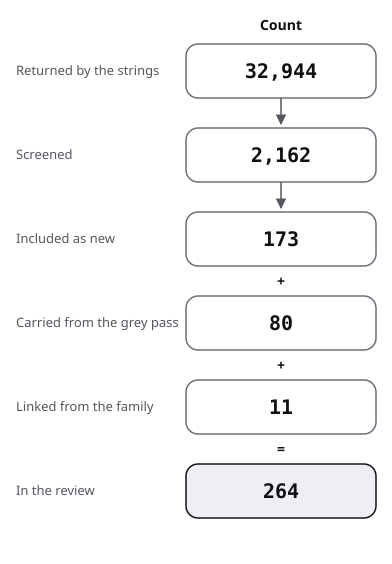

# Sources: the pool of both passes, its flow and its quality

The pool of the review, read on 2026-10-29. It gives the flow from results to sources for the grey pass and the three formal strands, then one row per work with its grade or score, the counts, and the keys.

Searches are in [protocol](protocol.md); terms in [frame](frame.md). Below 10 of 20, a grey source is an example of practice only, never support for a claim.

## Flow

| Stage | Grey pass: formal side; human side | Strand A | Strand B | Strand C | Lead screen, after the merge | Formal pass, all strands |
|---|---|---|---|---|---|---|
| Strings run | 65: 46; 19 (web 24 and 9; Q/A 22 and 10) | 24 on Semantic Scholar, 20 on arXiv; 23 counted on OpenAlex | 36 on Semantic Scholar (one failed), arXiv and OpenAlex; 6 on arXiv only; 10 author strings | 24 on three databases; 5 on arXiv only | none: 16 leads no strand had screened | 110 distinct strings: A 29, B 52, C 29 |
| Visits, and citation lists followed | 17 producer visits: 11; 6 | 4 forward seeds; backward from 3 works | 3 forward lists; backward from 3 works | 4 forward lists; backward from 3 reference lists | 1 work met in a kept one (Liang 2024c, in Wu 2026) | 11 forward; 9 backward |
| Records returned, in the databases screened | 709 string results seen: 457; 252. Of them, web results 503 (323; 180) and Q/A threads 206 (134; 72). Producer listings in other units, not summed | 3,075 | 20,257 | 9,612 | | 32,944, with repeats |
| Screened by title | 709: 457; 252 | 565 recorded; the rule allows up to 584 | 1,013 by the stated rule; 1,023 recorded | 584 by the stated rule; about 350 accounted for by what was recorded | | 2,162, with repeats |
| Opened and read | about 40 producer pages, 4 forum threads, 5 Q/A threads; 62, and 2 failed | the sections named per source | the sections named per source | of the 57 new: 16 in full or in the sections cited, 34 by abstract, 2 through another work, 5 located only | the 16 leads, as 21 rows, one not found, and Liang 2024c: the sections named per work | |
| Included as new | 80 sources in 86 rows: 43; 43, 6 scored by both | 47 | 80 | 57 | 9: 8 from the leads, and Liang 2024c; 13 rows set aside | 173 works in 184 rows: 10 works are in two or three strands; 182 with the lead screen's 9 |
| Below 10 of 20, examples only | 9: 3; 6 | | | | | |
| Linked from a family review, not screened again | 3 | 0 | 5 | 9 | | 11 works in all, with the grey pass's |
| Counts read, not scored | 7: 4; 3 | | | | | |
| Read, not scored | 1 (LZ 2026b): 1; none | | | | | |
| In the review | | | | | | 273: 182 formal (173 by the strands, 9 by the lead screen), 80 grey, 11 linked |

The figure draws the formal pass's stages, then adds the sources that joined without passing through its screening. Its included count holds the lead screen's 9, as it holds the strands' leads and recalled works.

### Formal pass

- Strand A returned 1,530 records on Semantic Scholar, 152 of them noise from F16 (unusable), 802 on arXiv and 743 citing records; OpenAlex gave counts only.
- Strand B returned 18,263 on Semantic Scholar, 9,301 of them from the acronym strings K1 and K3, which match other fields; on OpenAlex those two make 10,572. On arXiv it returned 891, plus 111 for the arXiv-only strings and 152 for the author strings; the forward lists held 840 citing works. OpenAlex counted 21,294, not screened.
- Strand C's own file gives no total; the sum here is of its protocol's counts. OpenAlex: 6,571 for the 23 strings it screened, L4's 20,120 left out as unusable; Semantic Scholar: 2,908 for R1 to C10; arXiv-only strings: 44; citing works: 89.
- Left out of strand C's sum, as outside its stated rule: the 181 arXiv results of its main strings, and the late Semantic Scholar counts of L1 to L6.
- Strand A screened 314 titles on Semantic Scholar, 172 on arXiv and 79 citing records (25, 25, 18 and 11 per seed): 565.
- Strand B screened 521 on Semantic Scholar and 281 on arXiv, plus 67 for the arXiv-only strings, 72 for the author strings and 72 citing works.
- Strand C's rule gives 584: OpenAlex 315, Semantic Scholar 164, arXiv-only 44, citing works 61.
- The screened counts are those each audit accepted. Strand A's 314 Semantic Scholar titles hold only if F16 counted 15, and its 172 arXiv titles fall short of the 191 its rule allows: titles shown per string were not logged.
- Strand B recorded 82 titles for its author strings where its rule gives 72. Strand C's recorded exclusions and inclusions account for about 350 of the 584 titles its rule gives.
- Strand A's 47: 6 existing reviews, 8 seminal works and benchmarks, 15 on measuring faithfulness, 9 on error rates and translation pipelines, 3 on benchmark defects, 6 on limits and project-level checks. Found via 43 strings (10 of them also grey leads), 3 by forward citation only, 1 by backward snowballing only.
- Strand B's 80: 65 from the strings, 5 by snowballing, 1 grey lead found by no string, 9 recalled by the reviewer and then verified.
- Strand C's 57: 25 from the strings, 7 from the grey pass's leads, 8 by snowballing (5 backward, 3 forward), 17 recalled by the reviewer and then verified on Crossref or arXiv.
- Strand C read Hanna 2024 in its author copy, found after its count of reads, which the audit moved from 15 full and 35 abstract to 16 and 34.
- The 10 works in more than one strand are Li 2024b (A, B, C); Weng 2025, Yang 2024 and Raiyan 2026 (A, C); Jiang 2023c and Ilin 2026 (A, B).
- Also Carl 2022, Commelin 2024, Guo 2026b and Massot 2024 (B, C). 184 rows less 11 repeats give 173 works.
- Strand A excluded 518 titles with repeats; reasons were noted by kind and not counted: off topic, provers scored only on supplied statements, repeats, long case studies with no faithfulness measure.
- Strand B kept no per-reason counts of its exclusions.
- Strand C, excluded by title, rounded to tens: off topic (materials science for Waterproof, medicine, security audits, finance) about 190; systems with no person studied about 60; repeats across strings about 40.
- Existing reviews found: strand A 6, and two benchmark audits acting as reviews; strand B 7, two of them held; strand C 6 on the person's side, plus 2 held. All are in [review](review.md), section 0.

### Lead screen, after the merge

- Sixteen grey leads had no screening decision in any strand. They were screened on 2026-10-29, after the merge, by the rule of [protocol](protocol.md), section 8; section 4 there says how.
- Identified, the 16 leads make 21 rows, since Lurch's papers make four and Koepke's preprints three. The sixteenth lead is the namesake met while identifying Meta's ATLAS.
- Kept, 8: Kung 2026, Wu 2026, Kondylidou 2026, Carter 2013, Carl 2020b, Cramer 2013, Rammal 2026 and Liu 2025d. Set aside, 13 rows, one of them not found: the section below, Leads screened after the merge, set aside.
- One more work was met in a kept one and read in full: Liang 2024c, in Wu 2026, section 2.2. The formal works number 182: 173 by the strands and 9 by the lead screen.
- Every kept number was then checked against its source text by the maintainer.

### Grey pass

- Formal side, excluded after reading: 2 forum threads (opinion, no practice) and 1 forum thread passed to the human side (LZ 2026b). Also 1 Q/A thread with no answer, and 1 blog post with no loop content (a Lean companion to a textbook).
- Formal side, excluded by title: papers (to the formal leads), news coverage of readable primary pages, duplicates; not reachable: the Isar reference manual and the Isabelle programming tutorial (server timeout).
- Human side, excluded after reading: off the loop, 8 pages (such as essays on the value of mathematics with no workflow in them), and one foundations thread. Failed: the audit site and one forum topic.
- Human side, excluded by title: news rewrites, mirrors and aggregators (about 25); Vale-in-CI pages held by document-model (3). It passed 34 formal leads on, screened by the formal pass ([protocol](protocol.md), section 4).
- Producer listings scanned: on the formal side, the forum archive, 24,928 titles filtered by keyword, 126 matched. On the human side, blogs of 60 and 83 titles; a microblog of 1,000 statuses, 32 matched; the forum, 117 titles matched; 11 repositories; 2 indexes.
- Tao's blog, the Xena blog, the forum archive and GitHub were visited by both sides.

## Formal sources, graded

"Strand" names the strands that included the work. "Found via" gives each strand's route, by the string ids of [protocol](protocol.md), section 4. There, "lead" means named by the grey pass, and "memory" or "recalled" means named by the reviewer and verified before use. A work in two strands keeps the grade of the strand that read more of it, named in its row. The strand "lead screen" marks the nine works included by the screen after the merge; their "Found via" says where the lead was met.

| Key | Strand | Kind | Found via | Grade, and what was read | Used in |
|---|---|---|---|---|---|
| Adams 2016 | C | method proposal | L9; forward from Wiedijk 2012 | convention; abstract | frame; protocol; review Q5 |
| Aitken 1998 | B | empirical study of users, journal | R1; backward from Ringer 2019 | measured, descriptive; through Ringer 2019, 7.1.3 (secondary) | protocol; review Q3 |
| Aitken 2000 | B | error taxonomy tested experimentally, journal | backward from Ringer 2019 | measured, descriptive; full text, through the university | protocol; review Q3 |
| Ammanamanchi 2026 | A | benchmark audit, ICML (2026) | F1, lead | measured, descriptive (static checks over five benchmarks); sections 1 to 4 | protocol; review 0; review Q2; review disagreements; state-of-the-art; position; against |
| Avigad 2019 | C | teaching report | C10; backward from Thoma 2022 | located only; paywalled | protocol |
| Avigad 2024 | C | essay | memory | convention; section 13 read | review Q4; against |
| Azerbayev 2023 | A | benchmark, preprint | F1, F2, F10 | measured, judged by a human expert; sections 1, 2, 4.1, 5 | protocol; review Q2; state-of-the-art; position; against |
| Bancerek 2017 | B | history with usage data, journal | F7, F29 | convention; abstract | review Q1 |
| Barendregt 2005 | C | survey essay | memory | convention; abstract | review Q5 |
| Barik 2017 | B | eye tracking, 56 participants, conference | F23 | measured; abstract (secondary) | review Q3 |
| Bartzia 2026 | C | a priori analysis of six assistants | backward from Tran Minh 2025 and Ouvrier-Buffet 2026 | convention; abstract | protocol; review Q4; against |
| Bastounis 2026 | A | argument, preprint | F4, F8 | argument from computability; abstract and section titles | review Q2; state-of-the-art; against |
| Becker 2016 | B | controlled study, conference | F23 | measured; abstract (secondary) | review Q3; state-of-the-art |
| Becker 2019 | B | survey, working group report | R3; F23 | survey; full text, through the university | frame; protocol; review 0; position |
| Becker 2024 | B | blueprint as paper, preprint | F1 | convention, a case report; abstract (secondary) | review Q1 |
| Beckert 2014 | B | focus groups, workshop | R1, R4, F26; backward from Ringer 2019 | measured, qualitative; setup section; its finding is Beckert 2015's, through Ringer 2019 | protocol; review Q3 |
| Binder 2026 | B | tool, preprint | F5, F6 | convention; abstract | review Q1 |
| Blanchette 2016 | B | survey, journal | R1; F31 | survey; abstract and introduction | frame; protocol; review 0 |
| Bolan 2025 | B | project report, preprint | F13; grey lead | measured, descriptive; abstract (secondary) | protocol; review Q1 |
| Bottoni 2025 | C | preprint, comparison of volunteers | arXiv string A2 | supported with caveat: five volunteers; full text read | review Q4; state-of-the-art; against; baseline |
| Browning 2026 | A | dataset, AI-MATH@NeurIPS (2026) | R1 | measured, descriptive (50 statements, manual review then model audit); sections 2.4, 2.5, 4 | review Q2; review disagreements; state-of-the-art; against; baseline |
| Buçinca 2021 | C | controlled experiment, N = 199 | memory | measured; abstract (secondary) | review Q5; state-of-the-art; position |
| Böhne 2018 | C | method paper | backward from Tran Minh 2025; C1 | convention; abstract | protocol; review Q4 |
| Carl 2020 | B | method, preprint | F3, F10; A7 | convention; abstract | review Q1 |
| Carl 2020b | lead screen | method, preprint | a grey lead (Q1) | convention: a method, unevaluated; full text read | protocol; review Q1; review Q3 |
| Carl 2022 | B, C | classroom deployment, questionnaire, workshop | B: F10; grey lead. C: C6; lead | measured, descriptive; full text read (strand C; strand B read section 5) | review Q1; review Q4; review Q5; state-of-the-art; position; against |
| Carl 2024 | B | method, workshop | F4, F10 | supported with caveat; abstract | review Q1 |
| Carneiro 2024 | C | preprint, independent checker | lead | measured, the owner's run; abstract (secondary) | protocol; review Q5; state-of-the-art |
| Carter 2013 | lead screen | owners' classroom tests, workshop | a grey lead (Q1), Lurch's papers | measured, descriptive: the owners' survey, sample sizes not given; sections 2 and 3 read | protocol; review Q1; review Q4 |
| Chen 2025 | A | paper, ICLR (2026) | F4, A-F7, A-F15 | measured, 859 expert-annotated items; sections 1, 4.5 | protocol; review Q2; review disagreements; state-of-the-art; position; against; baseline |
| Chen 2026b | B | platform, preprint | F12; grey lead | convention, owners' account; abstract | review Q1; against |
| Chung 2026 | B | method with benchmark, preprint | F1; forward citations of Jiang 2023c | measured; abstract (secondary) | protocol; review Q1; review disagreements; state-of-the-art; against |
| Collins 2024 | C | interactive evaluation | memory; L8 | measured, descriptive; results and appendices read | review Q5; state-of-the-art; position; baseline |
| Collins 2026 | C | preprint, randomised-order user study and survey | arXiv string A4 | measured, one study of 7 people; results and methods read | review Q4; review Q5; review disagreements; state-of-the-art; position; against |
| Commelin 2024 | B, C | essay, journal | B: recalled lead. C: memory | convention; abstract | protocol; review Q1; review Q4 |
| Commelin 2026 | C | preprint, position paper | lead | convention; section 2 read | protocol; review Q4 |
| Corbineau 2008 | B | system paper, conference | F8 | not graded; title and venue only | review Q1; against |
| Coscoy 1995 | B | method, conference | recalled lead | not graded; title and venue only | protocol; review Q3 |
| Cramer 2010 | B | system paper, workshop | F3, F4, F10 | not graded; title and venue only | protocol; review Q1 |
| Cramer 2013 | lead screen | doctoral dissertation | a grey lead (Q1) | convention: system and theory, argued; section 7.7 read, full text searched | protocol; review Q1 |
| Dai 2026 | A | preprint | F2, F5, A-F17 | measured on ProofNet# and miniF2F-test; sections 1, 2, 5.1 | review Q2; review Q3; state-of-the-art; position; against |
| De Lon 2021 | B | system paper, conference | F2, F3 | convention; section 1 | review Q1; state-of-the-art |
| De Toffoli 2024 | C | essay | C8 | convention; abstract | review Q4 |
| Deng 2026 | B | method with ablation, preprint | X5 | measured; abstract (secondary) | review Q3; state-of-the-art; against |
| Denny 2014 | B | controlled study, conference | F23; recalled lead | measured, null; abstract (secondary) | review Q3; state-of-the-art; against |
| Denny 2020 | B | randomised experiment, n > 700, conference | forward citations of Becker 2019 | measured; abstract (secondary) | protocol; review Q3; state-of-the-art |
| Denny 2021 | B | three experiments, conference | forward citations of Becker 2019 | measured; abstract (secondary) | protocol; review Q3 |
| Eremondi 2019 | B | method, journal | recalled lead | convention; abstract | protocol; review Q3 |
| Fan 2025 | C | randomised experiment, N = 117 | L5 | measured; abstract (secondary) | review Q5; state-of-the-art; against |
| Firsching 2026 | A | benchmark, preprint | F3, F20, lead | measured, descriptive (fixed misformalizations); sections 1 to 4, appendix A | frame; protocol; review Q2; review disagreements; state-of-the-art; against |
| First 2023 | B | method with benchmark and ablation, conference | F20, F21, F22 | measured; introduction and evaluation (RQ2, Figure 5); Table 4 by its audit | protocol; review answer; review Q3; state-of-the-art; position; against |
| Ganesalingam 2017 | B | system with an informal reader test, journal | A8; recalled lead | measured, informal; section 3 of the preprint | protocol; review Q3 |
| Gao 2025 | A | paper, ICLR (2025) | F18 | measured with a model judge; sections 1, 3.1.1 | protocol; review Q2; against |
| Gleirscher 2023 | C | SWOT review | forward from Wiedijk 2012 and Adams 2016 | convention; abstract | protocol; review 0 |
| Gloeckle 2026 | B | case report, preprint | F1 | convention, owners' account; abstract (secondary) | review Q1; against |
| Goddard 2012 | C | systematic review | memory | supported with caveat: healthcare; abstract (secondary) | frame; protocol; review 0; position |
| Gonthier 2013 | C | formalization report | memory | measured, descriptive; conclusion read | review Q4; review Q5; state-of-the-art |
| Gopinathan 2023 | B | symbolic repair with evaluation, journal | F20 | supported with caveat; abstract (secondary) | review Q3 |
| Grabowski 2010 | B | manual, journal | F7 | convention; abstract | review Q1 |
| Gui 2026 | A | preprint | F3, F4, lead | measured; abstract | protocol; review Q2 |
| Guo 2026b | B, C | classroom user study, 23 sessions, preprint | B: X6. C: arXiv-only A3 | measured, descriptive; full text read (strand C; strand B read sections 5, 7 and 8) | frame; review answer; review Q2; review Q3; review Q4; review Q5; review ahead; state-of-the-art; position; against; baseline |
| Hales 2017 | C | formalization report | backward from Tran Minh 2025 | measured, descriptive; sections 1 and 7 read | protocol; review Q4; review Q5; state-of-the-art |
| Han 2026 | A | benchmark, EMNLP (2026) | forward, Azerbayev 2023 and Poiroux 2025 | measured, 178 problems, two expert labellers; sections 1, 4, appendices F and G | protocol; review Q2; state-of-the-art; against |
| Hanna 2021 | C | discussion paper | backward from Tran Minh 2025 | convention; through Tran Minh 2025 (secondary); paywalled | protocol; review 0; against |
| Hanna 2024 | C | exploratory study of three students | forward from Thoma 2022; C2 | measured, qualitative; author copy, 3.2.2 and conclusion; three mathematics majors who could program | protocol; review Q4 |
| Harrison 1998 | B | essay, conference | F5, F14 | convention; abstract | frame; review Q1 |
| Harrison 2006 | C | kernel self-verification | forward from Pollack 1997 | located only; paywalled | protocol; review Q5 |
| Hattori 2025 | B | method with comparison, conference | F28; grey lead | supported with caveat; abstract | review Q3 |
| Hentschel 2016 | B | paired experiment, 21 participants, conference | recalled lead | measured; full text, through the university | protocol; review Q3; state-of-the-art |
| Hu 2025 | B | method with benchmark, preprint | forward citations of Jiang 2023c | supported with caveat; abstract | protocol; review Q1 |
| Hubert 2025 | A | Nature | F1 | measured, expert A/B evaluation of the formalizer; Methods | review Q2; review Q5; state-of-the-art; against |
| Iannone 2023 | C | questionnaire and interviews | C2, C4; forward from Thoma 2022 | measured, descriptive; abstract (secondary) | protocol; review Q4; review Q5; against |
| Iannone 2025a | C | magazine article | C2, C4; lead | located only: the publisher's page asked for a browser check | protocol |
| Iannone 2025b | C | task-based interviews, two cases | C4; forward from Thoma 2022 | measured, qualitative; full text read | protocol; review Q4; review Q5; against |
| Ilin 2026 | A, B | expert-review case study, preprint | A: R1, R2. B: R6 | supported with caveat, one qualitative expert review; abstract | review Q2; review Q3; state-of-the-art; against |
| Ishii 2014 | B | user test, 40 students, workshop | F25 | measured, descriptive; abstract (secondary) | review Q3 |
| Jiang 2023c | A, B | method with benchmark and ablation, ICLR (2023) | A: U3, F9. B: F8, F9, F28 | measured; Table 1 and section 4 read (strand B; strand A read the abstract) | protocol; review answer; review Q1; review Q2; state-of-the-art; against |
| Kerjean 2022 | C | teaching report | backward from Ouvrier-Buffet 2026 | measured, qualitative; through Ouvrier-Buffet 2026 (secondary) | protocol; review Q4; against |
| Kim 2026b | A | paper, VerifAI-2 workshop at ICLR (2026) | F8 | measured, 303 logic problems; abstract | against |
| Klowden 2026 | C | preprint, essay | lead | convention; abstract | protocol; review Q4 |
| Knobelsdorf 2017 | C | qualitative classroom study | memory | measured, qualitative; abstract; paywalled | protocol; review Q4 |
| Kondylidou 2026 | lead screen | tool with measurements, IJCAR (2026) | a lead met in LZ 2025c | measured, on proof length only (1,431 ETP problems); the technical report read | protocol; review Q3; review Q4 |
| Kosmyna 2025 | C | preprint, experiment | memory | measured, not peer reviewed; abstract (secondary) | review Q5; against |
| Koutsoukou-Argyraki 2020 | C | experience report | C8 | convention; abstract | review Q4 |
| Krishnamurthi 2026 | B | controlled ablation with an agent, preprint | F25 | measured, for agents; abstract | review Q3; against |
| Kuhn 2014 | B | survey, journal | R2 | survey; abstract and appendix entries | frame; protocol; review 0 |
| Kung 2026 | lead screen | agentic framework with benchmark and ablations, preprint | a grey lead (Q2) | measured, on the 12 problems of Putnam (2025) and the authors' Lean-IMO-Bench of 60, with the authors' own model family; sections 3 to 5 read | protocol; review answer; review Q1; review Q3; state-of-the-art; against |
| Lee 2025 | C | survey of 319 workers | memory | measured, descriptive; abstract (secondary) | review Q5 |
| Leinonen 2023 | B | expert rating, conference | F23, F24 | measured; section 4, Table 1 | protocol; review Q3; state-of-the-art; position; against |
| Li 2024b | A, B, C | survey, preprint | A: R1, R2. B: R6. C: R4; arXiv-only A1 | review, no pooling; sections 3.1 and 5 (strand A; B searched the full text, C read the abstract) | protocol; review 0; position; against |
| Li 2024c | A | paper, NeurIPS (2024) | F1, F2, F7 | measured on MATH and miniF2F; section 1 | review Q2 |
| Liang 2024c | lead screen | retrospective comparison with human reviews, and a user study, NEJM AI (2024) | met in Wu 2026, section 2.2 | measured: overlap with human reviewers' comments on 3,096 Nature-family and 1,709 ICLR papers, against the overlap between two reviewers; the user study measured, descriptive, its participants self-selected; full text read (arXiv v1) | protocol; review answer; review Q3; review disagreements; state-of-the-art; position; against |
| Lin 2025 | A | preprint | F9, F11 | method with counts; sections 1, 3.1 | protocol; review Q2 |
| Lin 2025b | B | method with benchmark and ablation, preprint | F27; forward citations of First 2023 | measured; abstract and section 3.5 | protocol; review answer; review Q2; review Q3; review disagreements; state-of-the-art; position |
| Liu 2025b | A | paper, ICLR (2025) | backward, Poiroux 2025 | measured, 200 samples; numbers read in Poiroux 2025, appendix A.5 (secondary) | frame; protocol; review Q2 |
| Liu 2025c | A | paper, AI4Math@ICML (2025) | F2, F4 | method; abstract | review Q2 |
| Liu 2025d | lead screen | translator with a human check, NeurIPS (2025) | met while identifying Meta's ATLAS, its namesake | measured, on ProofNet: people checked outputs a model judge passed; section 4.2.1 and appendix B read | protocol; review Q2 |
| Lu 2024 | B | error study and method, conference | recalled lead | measured; abstract (secondary) | protocol; review Q3; against |
| Lu 2025 | A | paper, ICLR (2025) | F6, F7, forward | measured, synthetic misaligned pairs and a human comparison; sections 1, 4.2 to 4.4 | protocol; review Q2; against; baseline |
| Marceau 2011 | B | human-factors study, conference | recalled lead | measured, descriptive; abstract | protocol; review Q3 |
| Massot 2024 | B, C | design paper with classroom use, ITP (2024) | B: F4; grey lead. C: lead | convention, owner's report; full text read (strand C; strand B read the introduction and the section on assistance) | frame; protocol; review Q1; review Q4; review Q5; against |
| Matichuk 2015 | C | empirical study of proof size | L7 | measured, descriptive; abstract (secondary); paywalled | protocol; review Q5 |
| Mei 2026 | A | preprint | R1, F3, forward | measured on three labelled datasets, 1,189 pairs (1,810 with RLM25's reference pairs); sections 4.4, 5.1 | protocol; review Q2; review Q5; state-of-the-art |
| Mensfelt 2025 | A | framework paper, NeLaMKRR@KR (2025) | R1, R2 | argument; abstract | frame; protocol; review 0 |
| Mihaylova 2026 | B | course data, preprint | F23, F24 | measured, observational; abstract (secondary) | review Q3; against |
| Min 2026 | A | position paper, ICML (2026) | R1, A-R1 | argument; abstract | protocol; review 0; review Q2; position |
| Mohammad 2026 | A | preprint | F4, F5 | measured on its own benchmark; sections 1, 2, 11.3, 12 | review Q2; state-of-the-art; against; baseline |
| Moraru 2026 | B | crowdsourced experiment, N = 103, preprint | F24; X4 | measured, null; abstract (secondary) | review answer; review Q3; review disagreements; state-of-the-art; position; against |
| Murphy 2024 | A | paper, ICML (2024) | F2, F6, A-F7 | measured on LeanEuclid; section 1 | review Q2; state-of-the-art; against |
| Nipkow 2012 | C | teaching report | C1, C10 | located only; paywalled | protocol |
| Ochigame 2024 | C | essay | lead (author named) | convention; abstract | review Q4; against |
| Ospanov 2025 | A | benchmark review, preprint | R1, F17 | measured, human evaluation of two translators (three at one sample); sections 1, 2, 3 | protocol; review 0; review Q2; review disagreements; state-of-the-art; position; against |
| Ospanov 2025b | B | method with benchmark, conference | F20, F21 | measured; abstract (secondary) | review Q3 |
| Otte 2026 | C | preprint, quasi-experiment | lead | supported with caveat; full text read | frame; review Q4; state-of-the-art; position; against; baseline |
| Ouvrier-Buffet 2026 | C | systematic review, working paper | R1, R2 | supported with caveat: nine works; method and synthesis read | protocol; review 0; review Q4; state-of-the-art; position; against |
| Parasuraman 2010 | C | integrative review | memory | supported with caveat; abstract (secondary) | protocol; review 0; state-of-the-art; position |
| Patel 2025 | B | system with own benchmark, preprint | F30; X6 | measured, on its own benchmark; abstract (secondary) | review Q3; against |
| Peng 2025 | A | preprint | F16, F7 | measured on its own 500 pairs; sections 1, 3.1 | protocol; against |
| Perháč 2025 | B | classroom tool report, workshop | F22; X5 | measured, descriptive; abstract | review Q3 |
| Perry 2023 | C | controlled user study | memory | measured; abstract (secondary) | review Q5 |
| Petrov 2025 | C | preprint, human-graded evaluation | memory | measured on USAMO (2025); abstract (secondary) by the strand; sections 2.1 to 2.3 and Table 1 by its audit | review Q5; against |
| Petrov 2025b | C | preprint, benchmark judged by a model | L6, L8 | measured on BrokenMath, judged by a model; abstract (secondary) by the strand; sections 3.1, 3.2 and Figure 2 by its audit | review Q5; state-of-the-art; baseline |
| Pettit 2017 | B | multi-semester study, conference | R3, F23 | measured, null; abstract (secondary) | review Q3; state-of-the-art; against |
| Pierce 2009 | C | invited talk | C1 | convention; abstract; paywalled | protocol |
| Pit-Claudel 2020 | B | tool, conference | F5, F14 | convention; abstract | review Q1 |
| Poiroux 2025 | A | paper, EMNLP (2025) | F1, F2, F15, U4 | measured, 3,752 annotated pairs; sections 1, 3.1, 3.2, A.5 | frame; protocol; review Q2; state-of-the-art; position; against; baseline |
| Poiroux 2025b | B | benchmark, conference | F1, F12 | measured; abstract (secondary) by the strand; section 4 and Figure 1 by its audit | review Q1; state-of-the-art; against |
| Pollack 1997 | C | report, seminal | memory | convention, argued; abstract | protocol; review Q5; against |
| Prather 2017 | B | mixed methods, 31 students, conference | recalled lead | measured; abstract (secondary) | protocol; review Q3; against |
| Pąk 2014 | B | method and proof, journal | X1 | convention; abstract | review Q1; against |
| Raiyan 2026 | A, C | integrated survey, preprint | A: R1, R4. C: arXiv-only A1; C8 | review; abstract | protocol; review 0; position |
| Rammal 2026 | lead screen | formalization at scale with model judges and one book reviewed by experts, preprint | a grey lead (Meta's ATLAS) | measured, descriptive: the owners' model judges, one book checked by experts, no agreement rate; sections 3 and 5, appendices D and G read | protocol; review Q1; review Q2; review Q5; against |
| Ranta 2026 | B | position, preprint | F11 | convention; abstract | review Q3 |
| Rav 1999 | C | philosophy | memory | convention, argued; abstract; paywalled | protocol; review Q5; state-of-the-art; against |
| Ringer 2019 | B | survey, journal | R5; A1 | survey; sections 5.1.2, 7.1, 7.2 in full | frame; protocol; review 0; review Q1; review Q3; state-of-the-art; position; against |
| Ringer 2020 | B | field logs of 8 users, conference | recalled lead | measured, descriptive; section 1 of the authors' copy | protocol; review Q3 |
| Ringer 2021 | B | symbolic repair with case studies, conference | F20; A1 | supported with caveat; abstract (secondary) | review Q3 |
| Salmon 2025 | B | rated explanations, preprint | F23, F24; grey lead | measured; abstract | protocol; review Q3 |
| Santos 2023 | B | expert rating, conference | F24; forward citations of Becker 2019 | measured; abstract | protocol; review Q3 |
| Santos 2024 | B | within-subjects experiment, n = 106, conference | F23, F24; grey lead | measured; abstract (secondary) and sections 1 and 4 | protocol; review answer; review Q3; review disagreements; state-of-the-art; position; against; baseline |
| Shen 2026 | A | preprint | forward, Poiroux 2025 | method; abstract | protocol; review Q2 |
| Song 2024 | B | tool with replay evaluation, workshop | grey lead | measured, on a replay; abstract and section 5 | review Q3; against |
| Szegedy 2020 | A | position paper, CICM (2020) | R1, F1 | argument; title and venue only | review Q2 |
| Tanswell 2015 | C | philosophy | L3 | convention, argued; abstract; paywalled | protocol; review Q5; state-of-the-art; against |
| Taylor 2024b | B | deployment, 2,565 students, conference | F24; grey lead | measured, descriptive; abstract (secondary) | protocol; review Q3; against |
| Thakur 2024 | B | method with benchmark, preprint | recalled lead | measured; abstract | protocol; review Q3 |
| Thoma 2022 | C | comparison of self-selected groups | C2, C4; lead | supported with caveat; full text read | protocol; review Q4; state-of-the-art; position; against; baseline |
| Tsoukalas 2024 | A | benchmark, NeurIPS (2024) Datasets and Benchmarks | F11, F13 | descriptive; abstract | protocol; review Q2; review disagreements |
| Tymoczko 1979 | C | philosophy, seminal | memory | located only; paywalled | protocol; review Q5 |
| Varambally 2025 | B | method with benchmark, preprint | forward citations of Jiang 2023c; F27 | measured; abstract (secondary) by the strand; Table 1 and Figure 3 by its audit | protocol; review Q1; review disagreements; state-of-the-art; against |
| Venturim 2026 | A | paper, MATH-AI (2026) workshop | forward, Poiroux 2025 | method; abstract | protocol; review Q2 |
| Verchinine 2007 | B | system paper, conference | F2 | convention; abstract and section 1 | review Q1 |
| Wang 2018 | A | paper, CICM (2018) | F18, U2 | measured on synthetic informal Mizar text; abstract | protocol; review Q2 |
| Wang 2020b | A | paper, CPP (2020) | F1, U2 | not graded; abstract, which reports no result | review Q2 |
| Wang 2024b | B | randomised trial, 8,762 students, conference | forward citations of Becker 2019 | measured; full text, through the university | protocol; review answer; review Q3; state-of-the-art; against; baseline |
| Wang 2025 | A | preprint | F9, F13 | method; appendix C.2.3 | protocol; review Q2; state-of-the-art |
| Wang 2026 | B | dataset and method, workshop | F20, F27 | measured; abstract (secondary) | review Q3 |
| Wemmenhove 2024 | C | system paper with classroom use | lead; forward from Thoma 2022 | convention, owners' report; abstract | protocol; review Q4; against |
| Weng 2025 | A, C | survey, preprint | A: R1, F6. C: arXiv-only A1 | review of methods, no pooling; sections 1 and 4 (strand A; C read the abstract) | protocol; review 0; position |
| Wenzel 2002 | B | comparison, journal | F6, F8 | not graded; title and venue only | review Q1 |
| Widjojo 2023 | B | rated comparison, preprint | F23; X4 | measured; abstract | review Q3 |
| Wiedijk 2000 | C | poster paper with measurements | C9 (Semantic Scholar) | measured, descriptive; abstract and the author's page | frame; review Q5; state-of-the-art |
| Wiedijk 2004 | B | method, conference | F8 | not graded; title and venue only | review Q1 |
| Wiedijk 2012 | C | paper with examples | memory; forward from Pollack 1997 | supported with caveat; abstract | frame; protocol; review Q5; state-of-the-art |
| Wiedijk 2012b | B | method, journal | F4, F5, F14; A6 | convention; abstract | frame; review Q1 |
| Wu 2022 | A | paper, NeurIPS (2022) | F1, F9, U1, U3 | measured, 150 statements judged by the authors; sections 1, 4.3, 4.4 | frame; protocol; review Q2; against |
| Wu 2025b | A | paper, AAAI (2026) | F12, F19 | measured with BEq; section 1 | protocol; review Q2 |
| Wu 2026 | lead screen | case study of the author's own tool, preprint | a grey lead (Q3, W7) | supported with caveat: one owner's case study on 20 of his own papers, matches judged by a model; full text read (arXiv v2) | protocol; review answer; review Q3; review disagreements; state-of-the-art; position; against |
| Xin 2024 | A | preprint | F9, F14, F18 | method with counts; sections 1, 3.2 | review Q2 |
| Xin 2024b | B | method with benchmark, preprint | F27 | measured; abstract (secondary) by the strand; Tables 1 and 2 by its audit | review Q3 |
| Xu 2025 | B | language design with benchmark, conference | F6 | measured, for models; abstract (secondary) | review answer; review Q1; state-of-the-art; against |
| Yanahama 2026 | B | tool evaluation, preprint | F12; grey lead | measured, descriptive; abstract (secondary) | review Q1; state-of-the-art; against; baseline |
| Yang 2024 | A, C | position paper, preprint | A: R3, F1. C: R4 | argument; sections 4.2 and 5.3 (strand A; C read the abstract) | protocol; review 0; position; against |
| Ying 2024 | A | dataset, preprint | F12, F14 | measured by sampled human checks; sections 4, 5 | review Q2 |
| Yu 2025b | A | benchmark, technical report | F1, F12 | measured; section 1 | review Q2 |
| Yu 2025c | A | preprint | F6 | measured on Gaokao-Formal; section 1 | review Q2; against |
| Zhai 2024 | C | systematic review | R3 | supported with caveat: 14 articles; methods read | frame; protocol; review 0; position; against |
| Zhang 2025 | A | preprint | F2, A-F7 | measured on miniF2F and ProofNet; sections 3.1.1, 3.2.1, 5 | review Q2 |
| Zhang 2026 | A | preprint (v4) | F2, F4, lead | measured, 227 statements, 59 audited by people; sections 1, 2 | protocol; review Q2; review Q3; review disagreements; state-of-the-art; position; against; baseline |
| Zheng 2022 | A | benchmark, ICLR (2022) | F9, F13 | descriptive; abstract | review Q2 |
| Zheng 2023 | B | method with benchmark, journal | F22; X4; forward citations of First 2023 | measured; abstract (secondary) by the strand; the results table by its audit | protocol; review Q3 |
| Zhu 2026b | B | tool and case study, conference | F1, F12; grey lead (the ITP (2026) paper 25) | supported with caveat; abstract | protocol; review Q1 |

## Linked from a family review, not screened again

| Key | Held by | Met by | Used in |
|---|---|---|---|
| Bastani 2025 | reader-ergonomics-learning, exercise-sets | strand C | frame; review Q5; state-of-the-art |
| Fuller 2014 | reader-ergonomics and reader-ergonomics-academic | strand C | frame; review Q4; against |
| Kalyuga 2003 | reader-ergonomics, learning-science | strand C | frame; review Q4 |
| Kamoi 2024 | reader-ergonomics, llm-readers | strand B | frame; protocol; review 0; position; against |
| Lessing 2025 | reader-ergonomics-academic, mathematical-writing | strand C | frame; protocol; review 0 |
| Stylianides 2024 | reader-ergonomics-academic, mathematical-writing | strand C | frame; protocol; review 0 |
| Tran Minh 2025 | reader-ergonomics-academic, mathematical-writing; strand C read it in full | strands B and C | frame; protocol; review 0; position; against |
| Uskuplu 2026 | reader-ergonomics-academic, mathematical-writing | strand B | review Q1 |
| Wenzel 1999 | reader-ergonomics-academic, mathematical-writing (Isar) | strand B; the grey pass's formal side | protocol; review Q1 |
| Tao 2023 | reader-ergonomics-academic, mathematical-writing (the PFR blueprint tour), score 15 there | the grey pass, both sides | frame |
| Mathlib 2026 | reader-ergonomics-academic, mathematical-writing (documentation style), score 12 there | the grey pass, human side | frame |

- Massot 2026, Hales 2026, Scholze 2021 and Tao 2023m are sources of the grey pass, in its table below; the strands cited them under the same keys.

## Met by a strand, not in the pool

Works one strand met and handed to another, which did not include them; what was read is said, and nothing here supports a claim.

| Work | Met by | What was read, with any number |
|---|---|---|
| FormalRx, arXiv 2607.04655 | strand A, for B | abstract: diagnostic feedback on autoformalization errors, a 28-category taxonomy, error localization and correction, a model trained on 56,287 annotated pairs |
| verifier feedback for provers: arXiv 2610.22698, 2604.18587, 2510.06857 | strand A, for B | titles only |
| LeanMarathon, arXiv 2606.05400 | strand A, for B; set aside by A as a long case study | abstract: an evolving blueprint kept as one Lean file, with agents that construct, audit, prove and repair it |
| Hazel Prover, arXiv 2608.23309 | strand B, for C | abstract: transfer to paper proofs failed in a first design that gave too much help, and improved in a second |
| the Coq Community Survey of 2022, doi 10.1007/s10817-025-09720-1 | strand C, for B | abstract (secondary): 466 responses, Journal of Automated Reasoning (2025) |
| Student-designed resources for Lean with a model and retrieval, ZDM (2026), doi 10.1007/s11858-026-01808-1 | strand C, for B; a citer of Thoma 2022 | abstract (secondary): five students |
| Keenan and Omar (2024), learner-centred design criteria for classroom proof assistants, HATRA (2024) | strand C, for B | through Tran Minh 2025: criteria including feedback quality, error resilience and hint production |
| the Sequent Calculus Trainer (Ehle, Hundeshagen, Lange; EPTCS 267, in 2018), doi 10.4204/eptcs.267.2 | strand C, for B | abstract |
| ProofBuddy, EPTCS 382 (2023), doi 10.4204/eptcs.382.1 | strand C, for B | abstract: an Isabelle front end that logs student interactions, with a preliminary usability study |
| conversational against embedded model feedback for proof learning (2026), doi 10.1007/978-3-032-29763-1_41 | strand C, for B | no abstract reachable |
| Frieder and others (2023), Mathematical capabilities of ChatGPT, arXiv 2301.13867 | strand C, for A | met in screening, not read |
| Faithful formalization of Elements proofs, arXiv 2608.15432; MathlibPR, arXiv 2605.07147; IndiMathBench, arXiv 2512.00997 | strand B, for A | not read |
| Beginners' quest to formalize mathematics, arXiv 2106.12351; Tutte's theorem as an educational project, arXiv 2504.18146; From lecture notes to Lean, arXiv 2607.27298 | strand B, for C | not read |

- LeanTutor (Patel 2025) also has the arXiv id 2601.17473, the same paper.

## Leads screened after the merge, set aside

The 13 rows the lead screen of 2026-10-29 set aside, after the merge ([protocol](protocol.md), section 4): each work as identified, where its lead was met, and the reason with what was read. Nothing here supports a claim.

| Work | Met in | Reason, and what was read |
|---|---|---|
| Li (2026), Astrolabe: a content-addressable hypergraph for semantic knowledge management, arXiv 2604.10435 | the grey pass, Q1 | a tool with no evaluation: a data model and a prototype plugin linking LaTeX and Lean atoms by typed edges; its section 4 leaves its use for autoformalization as an open empirical question. Dependency graphs are held by Massot 2026 and Zhu 2026b |
| Kinyon (2019), Proof simplification and automated theorem proving, Philosophical Transactions of the Royal Society A 377(2140), 20180034; arXiv 1808.04251 | LZ 2025c | off the loop: a method for shortening Prover9 proofs by hints, measured by step count and shown on one worked example from loop theory, with no evaluation and no proof assistant or person (sections 1 and 4). His answer to Tao's challenge, a 24-step Prover9 proof, is known here only through Kondylidou 2026 (section 8, secondary) |
| Petković Komel, Rawson, Suda (2025), Case study: verified Vampire proofs in the LambdaPi-calculus modulo, arXiv 2503.15541 (v2) | LZ 2025c | off topic: it certifies a first-order prover's output (8,178 TPTP problems, all proofs checked by Dedukti v2.7, section 6); trust in the proof assistant, the printed statement and the person is untouched. Independent re-checking is held by Carneiro 2024 and Blanchette 2016 |
| Carter, Monks (2013), Lurch: a word processor built on OpenMath that can check mathematical reasoning, OpenMath Workshop (2013), CEUR-WS 1010, paper 23 | the grey pass, Q1, Lurch's papers | a tool with no evaluation: goals, OpenMath implementation and validation engine (abstract) |
| Carter, Monks (2017), A web-based toolkit for mathematical word processing applications with semantics, CICM (2017), LNCS, 272-291, doi 10.1007/978-3-319-62075-6_19 | the same | title and venue only: a toolkit paper, with no abstract on Crossref or OpenAlex |
| From formal to expository (Carter, Monks), the paper the grey pass named | the same | not found: two phrasings on Crossref, three on OpenAlex, and an author search on arXiv |
| Carl (2020), Number theory and axiomatic geometry in the Diproche system, ThEdu'20, EPTCS 328, 56-78, doi 10.4204/EPTCS.328.4; arXiv 2006.01794 | the grey pass, Q1 | covered by Carl 2020, 2022 and 2024: the system's architecture and its number theory and geometry, with no evaluation with students (full text searched) |
| Cramer, Koepke, Kühlwein, Schröder (2010), Premise selection in the Naproche system, IJCAR (2010), LNCS, 434-440, doi 10.1007/978-3-642-14203-1_37 | the grey pass, Q1, Koepke's preprints | off topic: axiom selection for the provers inside the checker (abstract, truncated on the publisher's page) |
| "The Naproche system", not uniquely identified. Nearest: Cramer, Koepke, Schröder (2011), Parsing and disambiguation of symbolic mathematics in the Naproche system, CICM (2011), doi 10.1007/978-3-642-22673-1_13; and Cramer, The Naproche system: proof-checking mathematical texts in controlled natural language (OpenAlex, dated 2016, volume 2014) | the same | covered by Cramer 2013, the full account of the same system. The Cramer article was not opened: its repository failed a certificate check, which was not bypassed |
| Frerix, Koepke (2018), CEUR-WS 2307; Koepke (2019), CEUR-WS 2634; De Lon, Koepke, Lorenzen (2020), CICM (2020); De Lon and others (2021), Beautiful formalizations in Isabelle/Naproche, CICM (2021); De Lon, Koepke, Lorenzen (2021), the mutilated checkerboard, ITP (2021); Koepke (2025), perfectoid rings, ITP (2025) | the same, the rest on natural proof checking | system descriptions and formalization showcases with no measure on a writer or reader. Full text searched for the two CEUR papers, of which Frerix and Koepke's paper only plans a usability study with students; abstracts read for the two ITP papers; title and venue only for the two CICM chapters. Held: De Lon 2021, Naproche 2026 |
| Urban (2026), 130k lines of formal topology in two weeks: simple and cheap autoformalization for everyone? arXiv 2601.03298 (v1); Munkres in Megalodon | Hales 2026 | a long-horizon case study with no measure of faithfulness, which strand A excludes ([protocol](protocol.md), section 8). Its kind is held by Gloeckle 2026; its failure mode, agents writing stub or special-case statements (section 6, item 1), is measured better by Rammal 2026. Read at the screen and not verified: the Megalodon statement shown for Tietze part (a) has no bound on the extension, weaker than Munkres 35.1(a) (section 11) |
| Bloom (2021), On a density conjecture about unit fractions, with Appendix B by Bloom and Mehta on the Lean formalization; arXiv 2112.03726 (v2); Journal of the European Mathematical Society 27(11), 4563-4589, doi 10.4171/jems/1456 | the grey pass | the formalization of a single theorem, which strand B excludes ([protocol](protocol.md), section 8). Its practice is held: a blueprint written before Lean (Appendix B.3) by Massot 2026 and Becker 2024; the coercion trap in 1/n (Appendix B.1) by Alexeev 2025 and Paulson 2026 |
| Yang, Swope, Gu, Chalamala, Song, Yu, Godil, Prenger, Anandkumar (2023), LeanDojo: theorem proving with retrieval-augmented language models, NeurIPS (2023) Datasets and Benchmarks; arXiv 2306.15626 | Tao 2023m | set aside as evidence: a prover on supplied statements, which strand A excludes. The key LeanDojo 2026 is the Lean Copilot README of the same organisation, not this paper; the "1,990 LeanDojo theorems" of Deng 2026's rows name its benchmark |

## Cited, not in the pool

| Key | Why cited | Used in |
|---|---|---|
| Beckert 2015 | the focus-group finding that strand B read through Ringer 2019, 7.1.3, belongs to this sibling paper of Beckert 2014; not read | review Q3 |

## Grey sources, scored

Subtotals A to T are the eight groups of criteria, in the order of [protocol](protocol.md), section 9, which also holds each side's scoring rules. Route codes are each side's own, in its section of the protocol.
A source scored by both sides keeps the score of the side that read more of it, and gives the other side's in its row.

| Key | Tier, kind | Side and route | Score (A / M / O / D / P / N / I / T) | Used in |
|---|---|---|---|---|
| Adamczewski 2026 | 2, project documentation and run data | human: P5; W4 | 15 (2.5 / 5.5 / 3 / 1 / 0.5 / 2 / 0 / 0.5) | frame; protocol; review Q2; review Q3; baseline |
| Alexeev 2025 | 3, guest blog post | human: P1; W2 | 15 (2.5 / 5.5 / 3 / 1 / 1 / 2 / 0 / 0) | frame; protocol; review Q1; review Q2 |
| Anthropic 2026c | 2, company research page | formal: G9 | 13.5 (3 / 3.5 / 1.5 / 1 / 1 / 2 / 1 / 0.5) | protocol; review Q1; review Q2 |
| Avigad 2026 | 3, guest blog post | formal: P | 15.5 (4 / 3.5 / 3 / 1 / 1 / 2 / 1 / 0) | protocol; review 0; review Q1; review Q2; review Q3; review Q5; position |
| Axiom 2026 | 2, company research page | formal: G21 | 11.5 (2.5 / 3 / 1.5 / 1 / 0.5 / 1.5 / 1 / 0.5) | protocol; review Q2; review Q4 |
| Buzzard 2024 | 3, blog | human: P1 | 15.5 (3 / 5 / 3.5 / 1 / 1 / 1.5 / 0.5 / 0) | review Q4 |
| Buzzard 2025 | 3, blog | human: P1 | 12.5 (3 / 4 / 2 / 1 / 1 / 1.5 / 0 / 0) | review Q2; baseline |
| Buzzard 2026a | 3, blog | both; formal: P; human: P1 | 16.5 (3 / 5.5 / 3.5 / 1 / 0.5 / 2 / 1 / 0), human side, kept: both read the post; the human side cites two of its sections (The code base, What this work is), the formal side one; formal side 16 (4 / 3.5 / 3.5 / 1 / 1 / 2 / 1 / 0) | protocol; review Q2; review Q5; against |
| Buzzard 2026b | 3, blog | formal: P | 15 (4 / 4 / 3 / 1 / 0.5 / 2 / 0.5 / 0) | protocol; review Q1; review Q2; review Q5; review disagreements |
| Buzzard 2026c | 3, blog | human: P1 | 13.5 (3 / 3.5 / 3 / 1 / 1 / 1 / 1 / 0) | review Q4 |
| Buzzard 2026d | 3, blog | human: P1 | 15 (3 / 4.5 / 2.5 / 1 / 1 / 2 / 1 / 0) | review Q2 |
| CMU L3 2025 | 2, repository README | formal: P | 12.5 (3.5 / 2.5 / 2.5 / 1 / 0.5 / 1.5 / 0.5 / 0.5) | frame; protocol; review Q3 |
| DeepSeek 2025 | 2, model card | formal: P | 12 (3 / 3.5 / 1.5 / 0.5 / 1 / 1 / 1 / 0.5) | protocol; review Q2; review disagreements |
| Dressler 2026 | 2, repository README | formal: G18 | 10.5 (1.5 / 2.5 / 2.5 / 0.5 / 0.5 / 1.5 / 1 / 0.5) | protocol; review Q3; state-of-the-art |
| Erdős DB 2026 | 2, project documentation | human: P5; W5 | 16 (3 / 4.5 / 3.5 / 1 / 1 / 1.5 / 1 / 0.5) | frame; protocol; review Q1; review Q4 |
| Erdős-wiki 2026 | 2, project wiki | human: P5 | 16 (2.5 / 5 / 3.5 / 1 / 1 / 1.5 / 1 / 0.5) | frame; review Q2 |
| Gadgil 2026 | 2, repository README | formal: P | 11.5 (3 / 2.5 / 2.5 / 0.5 / 0.5 / 1.5 / 0.5 / 0.5) | protocol; review Q2 |
| GasStationManager 2026 | 2, repository README | formal: P | 11 (1.5 / 3 / 2.5 / 0.5 / 1 / 1.5 / 0.5 / 0.5) | protocol; review Q3 |
| Goedel-LM 2025 | 2, model card | formal: P | 12 (3 / 3.5 / 2 / 0.5 / 1 / 1 / 0.5 / 0.5) | frame; protocol; review Q2; review Q3; review disagreements |
| Google 2025 | 2, company blog about its own tool | human: W7 | 12.5 (3.5 / 3.5 / 1.5 / 1 / 0.5 / 1.5 / 0.5 / 0.5) | frame; protocol; review Q3; review disagreements; position; against |
| Google DeepMind 2026 | 2, project documentation | both; formal: G19; human: P5; W2 | 14.5 (3.5 / 3.5 / 3 / 0.5 / 1 / 1.5 / 1 / 0.5), formal side, kept: the formal side read the README and the contributing guide, the human side the README; human side 14 (3.5 / 4 / 2.5 / 0 / 1 / 1.5 / 1 / 0.5) | frame; protocol; review Q1; review Q2; state-of-the-art |
| Hales 2026 | 3, guest blog post | both; formal: P, tag pages; human: P2 | 15 (4 / 3.5 / 3 / 1 / 1 / 1.5 / 1 / 0), formal side, kept: the formal side cites three of its sections, the human side one; human side 16 (3 / 5 / 3.5 / 1 / 1 / 1.5 / 1 / 0) | frame; protocol; review 0; review Q2; review Q5; baseline |
| Harmonic 2024 | 2, company news page | formal: G10 | 12 (2.5 / 3 / 1.5 / 1 / 1 / 1.5 / 1 / 0.5) | protocol; review Q2 |
| Isabelle 2026 | 2, project site | formal: P | 11.5 (4 / 2 / 2.5 / 0 / 0.5 / 1 / 1 / 0.5) | frame; protocol; review Q1; state-of-the-art |
| Kirov 2026a | 3, blog | human: P6, from Tao's Mathstodon | 13 (1 / 5.5 / 3 / 1 / 1 / 1.5 / 0 / 0) | review Q1; review Q4; review disagreements; position; against |
| Kirov 2026b | 3, blog | human: P6 | 13.5 (1 / 5.5 / 3 / 1 / 1 / 2 / 0 / 0) | protocol; review Q1 |
| Lean-community 2026 | 2, tool documentation | formal: P | 12 (3 / 3 / 3 / 0 / 0.5 / 1 / 1 / 0.5) | protocol; review Q3 |
| Lean FRO 2025 | 2, release notes | formal: G4 | 14.5 (4 / 3 / 3.5 / 1 / 0.5 / 1.5 / 0.5 / 0.5) | frame; protocol; review Q3; state-of-the-art; baseline |
| Lean FRO 2026a | 2, tool documentation | both; formal: P, link in Tao 2026f; human: P5; LZ 2025a | 14 (3.5 / 4.5 / 3 / 0 / 0.5 / 1.5 / 0.5 / 0.5), human side, kept: both read the README; the human side cites two of its sections (Deprecation, Definition Holes), the formal side one; formal side 17 (4 / 5 / 3.5 / 0.5 / 0.5 / 2 / 1 / 0.5) | frame; protocol; review answer; review Q1; review Q2; state-of-the-art; position; baseline |
| Lean FRO 2026b | 2, release notes | formal: P | 15 (4 / 3.5 / 3.5 / 1 / 0.5 / 1.5 / 0.5 / 0.5) | review Q1 |
| Lean FRO 2026c | 2, language reference | formal: G4 | 15 (4 / 4 / 3.5 / 0.5 / 0.5 / 1.5 / 0.5 / 0.5) | review Q3; state-of-the-art |
| Lean FRO 2026d | 2, language reference | formal: G15 | 14 (4 / 3 / 3.5 / 0.5 / 0.5 / 1 / 1 / 0.5) | frame; protocol; review Q3; baseline |
| LeanDojo 2026 | 2, repository README | formal: G7 | 12.5 (3.5 / 2.5 / 2.5 / 0.5 / 1 / 1 / 1 / 0.5) | protocol; review Q3 |
| Lurch 2026 | 2, project site | formal: G17 | 6.5 (2 / 1 / 2 / 0 / 0 / 1 / 0 / 0.5) | protocol; review Q1 (example only) |
| LZ 2025a | 3, forum thread | human: P4 | 15 (3 / 4.5 / 3.5 / 1 / 1 / 1.5 / 0.5 / 0) | frame; review Q2 |
| LZ 2025b | 3, forum thread | human: P4; also met by the formal side, not scored | 9.5 (2.5 / 2 / 2 / 1 / 0.5 / 0.5 / 1 / 0) | frame; review Q5 (example only) |
| LZ 2025c | 3, forum thread | human: P4 | 14.5 (3 / 4 / 3.5 / 1 / 1 / 1.5 / 0.5 / 0) | frame; review Q4 |
| LZ 2025d | 3, forum thread | human: P4 | 9.5 (1.5 / 3 / 2 / 1 / 0.5 / 1 / 0.5 / 0) | protocol; review Q1 (example only) |
| LZ 2025e | 3, forum thread | human: P4 | 13.5 (2.5 / 4 / 3.5 / 1 / 1 / 1.5 / 0 / 0) | review Q2 |
| LZ 2025f | 3, forum thread | human: P4 | 13.5 (3 / 3.5 / 3 / 1 / 1 / 1 / 1 / 0) | review Q1; review Q3; review Q4 |
| LZ 2025g | 3, forum thread | human: P4 | 6.5 (1 / 2 / 1.5 / 1 / 0 / 0.5 / 0.5 / 0) | protocol; review Q2 (example only) |
| LZ 2025h | 3, forum thread | human: P4 | 7 (1.5 / 1 / 2 / 1 / 1 / 0.5 / 0 / 0) | protocol; review Q3 (example only) |
| LZ 2026a | 3, forum thread | human: P4 | 14 (3 / 4 / 3 / 1 / 1 / 1.5 / 0.5 / 0) | review Q1; review Q2 |
| Massot 2026 | 2, carried, repository | both; formal: P, re-read; human: linked | 13.5 there (3.5 / 3.5 / 3 / 0.5 / 0.5 / 1 / 1 / 0.5), carried by the formal side; the human side links it, not rescored | frame; protocol; review Q1; state-of-the-art; baseline |
| Massot 2026b | 2, tool documentation | both; formal: G5; human: P5 | 15.5 (4 / 3.5 / 3 / 0.5 / 1 / 2 / 1 / 0.5), formal side, kept: the formal side read the README, examples and configuration guide, the human side the README; human side 10 (3 / 2.5 / 2 / 0 / 0.5 / 1 / 0.5 / 0.5) | frame; protocol; review Q1; review Q3; state-of-the-art |
| Math Inc 2025 | 2, company page | formal: G14 | 10.5 (2.5 / 2.5 / 1 / 0.5 / 0.5 / 2 / 1 / 0.5) | frame; protocol; review Q1; review Q2 |
| Mathlib Initiative 2026 | 2, README and template of a standard | formal: P, link in Tao 2026f | 15 (3.5 / 4 / 3.5 / 0 / 1 / 2 / 0.5 / 0.5) | frame; protocol; review answer; review Q1; baseline |
| MathOverflow 2026 | 2, Q/A thread | formal: Q/A `q=Lean formalization AI` | 13 (1.5 / 3.5 / 3 / 1 / 1 / 1.5 / 1 / 0.5) | protocol; review Q1; review Q5; baseline |
| Mistral 2026 | 2, company news page | formal: G20 | 11 (2.5 / 3 / 1 / 1 / 0.5 / 1.5 / 1 / 0.5) | protocol; review Q2; review Q3 |
| Naproche 2026 | 2, project site and tutorial | formal: P | 13.5 (3.5 / 3.5 / 3 / 0.5 / 0.5 / 1.5 / 0.5 / 0.5) | frame; protocol; review Q1; review Q3; state-of-the-art |
| Numina 2025 | 2, model card | formal: G2 | 7.5 (2.5 / 1 / 2 / 0 / 0 / 1 / 0.5 / 0.5) | frame; protocol; review Q2 (example only) |
| Palomar 2026 | 2, registry pages | formal: P | 16 (3.5 / 5 / 3 / 0.5 / 1 / 2 / 0.5 / 0.5) | frame; protocol; review Q1; review Q2; review Q5; review disagreements; state-of-the-art; position; against; baseline |
| PASE 2022 | 2, Q/A thread | formal: Q/A `q=Isar readable` | 11 (0.5 / 3.5 / 3 / 1 / 0.5 / 1.5 / 0.5 / 0.5) | protocol; review Q1 |
| PASE 2022b | 2, Q/A thread | human: P7 `title=formalization` | 11.5 (0.5 / 4 / 3 / 1 / 1 / 1 / 0.5 / 0.5) | review Q4 |
| PASE 2024 | 2, Q/A thread | formal: Q/A `q=blueprint` | 11 (0.5 / 3.5 / 3 / 1 / 1 / 1 / 0.5 / 0.5) | review Q1 |
| PASE 2026 | 2, Q/A thread | formal: Q/A `q=autoformalization` | 12.5 (1 / 4.5 / 2.5 / 1 / 1 / 2 / 0 / 0.5) | protocol; review Q2 |
| Paulson 2026 | 3, blog | human: P6, from Kirov's blog | 13.5 (3 / 4 / 3.5 / 1 / 1 / 1 / 0 / 0) | frame; review Q1; review Q2; baseline |
| PNT-plus 2026 | 2, project documentation | human: P5 | 16 (3 / 5 / 3.5 / 0.5 / 1 / 2 / 0.5 / 0.5) | frame; review Q1; review Q3; review Q5; position; baseline |
| PostHog 2026 | 2, company handbook | human: W8 | 9 (2 / 3 / 2 / 0 / 0.5 / 1 / 0 / 0.5) | frame; protocol; review Q3 (example only) |
| Rivin 2026 | 3, gist | formal: G10 | 9 (1.5 / 3 / 1.5 / 1 / 0.5 / 1.5 / 0 / 0) | protocol; review Q2 (example only) |
| Scholze 2021 | 3, guest blog post | human: P1 | 16.5 (3 / 5 / 4 / 1 / 1 / 2 / 0.5 / 0) | frame; review Q4 |
| StepFun 2025 | 2, model card | formal: G2 | 10.5 (2.5 / 2.5 / 2 / 0.5 / 1 / 1 / 0.5 / 0.5) | protocol; review Q2 |
| STOC 2026 | 2, organisers' page | human: W7; LZ 2025h | 11 (3 / 3 / 2.5 / 0.5 / 0 / 1 / 0.5 / 0.5) | frame; protocol; review Q3; review disagreements; against |
| Tanswell 2026 | 2, talk abstract | human: W9 | 9 (2.5 / 1.5 / 2 / 1 / 0.5 / 1 / 0 / 0.5) | frame; protocol; review Q2 (example only) |
| Tao 2023m | 3, microblog thread | human: P3 | 15.5 (3 / 4.5 / 3.5 / 1 / 1 / 1.5 / 1 / 0) | review Q3; review Q4 |
| Tao 2024 | 3, blog | formal: G8b | 15.5 (4 / 4 / 3 / 1 / 1 / 1.5 / 1 / 0) | frame; protocol; review Q1 |
| Tao 2025a | 3, microblog post | human: P3 | 14 (3 / 3.5 / 3.5 / 1 / 1 / 1 / 1 / 0) | review Q4 |
| Tao 2025b | 3, microblog thread | human: P3 | 15 (3 / 4 / 3.5 / 1 / 1 / 1.5 / 1 / 0) | frame; review Q1; review Q2 |
| Tao 2025c | 3, microblog thread | human: P3 | 14 (3 / 4.5 / 3.5 / 1 / 0.5 / 1 / 0.5 / 0) | frame; review Q1; review Q5; against |
| Tao 2025d | 3, blog | human: P2 | 15 (3 / 5 / 3.5 / 1 / 1 / 1 / 0.5 / 0) | frame; review Q1; review Q5 |
| Tao 2026e | 3, blog | both; formal: P, tag pages; human: P2 | 16 (4 / 4.5 / 3.5 / 1 / 1 / 1.5 / 0.5 / 0), formal side, kept: the formal side names the paragraph on AI use and the task sizes; the human side names no part; human side 14 (3 / 4.5 / 3.5 / 1 / 1 / 1 / 0 / 0) | frame; protocol; review Q1; review Q2; review Q3; review Q5; baseline |
| Tao 2026f | 3, blog | formal: P, tag pages | 15.5 (4 / 4 / 3 / 1 / 1 / 2 / 0.5 / 0) | frame; protocol; review answer |
| Tao 2026g | 3, microblog post | human: P3 | 11.5 (3 / 3 / 3 / 1 / 0 / 1 / 0.5 / 0) | review Q3 |
| Tao 2026h | 3, microblog post | human: P3 | 11 (3 / 2.5 / 3 / 1 / 0.5 / 0.5 / 0.5 / 0) | review Q1 |
| Tao 2026i | 3, microblog thread | human: P3 | 14.5 (3 / 4 / 3.5 / 1 / 1 / 1.5 / 0.5 / 0) | frame; review Q1; review Q5; review disagreements; against |
| Tao 2026j | 3, blog | human: P2 | 14 (3 / 3.5 / 3.5 / 1 / 1 / 1 / 1 / 0) | frame; review Q4 |
| Tao 2026k | 3, microblog thread | human: P3 | 14.5 (3 / 4 / 3.5 / 1 / 1 / 1.5 / 0.5 / 0) | review Q2; review Q3 |
| TUe 2026 | 2, university project page | formal: G13 | 12 (3 / 3.5 / 3.5 / 0 / 0.5 / 1 / 0 / 0.5) | protocol; review Q1; review Q3 |
| Vergo 2026 | 2, forum thread | formal: P, forum archive | 11 (1.5 / 2.5 / 3 / 1 / 1 / 1.5 / 0 / 0.5) | frame; protocol; review Q1 |
| Zhu 2026 | 2, repository README | formal: G12 | 13 (3 / 3 / 3 / 0.5 / 1 / 1.5 / 0.5 / 0.5) | frame; protocol; review Q1; baseline |

## Counts, not scored

Read by the reviewers on 2026-10-29 through public interfaces; descriptive, and each one's caveat is in [review](review.md).

| Key | What was counted | Side | Used in |
|---|---|---|---|
| GitHub 2026e | public repository metadata (stars, last push) of the repositories named in review.md, through the unauthenticated API: 23 repositories and one repository search, and LeanDojo's stars | formal; LeanDojo by the human side | review Q1; review Q3; state-of-the-art; against |
| GitHub 2026f | Formal Conjectures items by the labels misformalization and ai-audit, and their states | human; checked again at the audit, when the pull requests had moved from 5,053 to 5,054 | protocol; review Q2; review disagreements; state-of-the-art; against; baseline |
| GitHub 2026g | PNT+ pull requests with the ai label against the rest, by state | human | review Q1 |
| Erdős-wiki 2026, counted | rows of the AI contributions wiki of the Erdős problems database by section, outcome, Lean and variant, frozen at 2026-06-30 | human | review Q2 |
| PyPI 2026 | recent downloads of `leanblueprint` and `lean-lsp-mcp` from the public statistics API | formal | review Q1; review Q3; state-of-the-art; against |
| Palomar 2026b | registry-wide totals from the registry's public data API: 845 results from 660 projects at the formal side's read, 847 from 661 at the audit later that day | formal | protocol; review Q1; state-of-the-art |
| Mathlib 2026b | the mathlib statistics page: definitions, theorems, contributors | formal | frame; review Q1 |

## Read, not scored

| Key | What | Used in |
|---|---|---|
| LZ 2026b | a forum thread read by the formal side and passed to the human side's questions; cited as an example of practice, never as support | protocol; review Q2; review Q5 |

## Keys

- One key per work, across both sides of the grey pass, the three strands of the formal pass, and the family's six bibliographies; a work already in the family keeps its key.
- A key used in the family for another work takes the next free letter. Draft, Sketch, and Prove is Jiang 2023c, since the same key with the letter b names a work of reader-ergonomics-software-design. The strands had taken it before the merge; no key was renamed at the merge.
- Grey keys that now have a formal paper of their own, under another key: Google DeepMind 2026 and Firsching 2026; Buzzard 2026b and Browning 2026.
- Also StepFun 2025 and Wu 2025b; Numina 2025 and Wang 2025.
- Also Zhu 2026 and Zhu 2026b; LeanDojo 2026 and Song 2024; Massot 2026b and Massot 2024; Goedel-LM 2025 and Lin 2025b.
- The cards of DeepSeek 2025 and Goedel-LM 2025 describe later versions than Xin 2024 and Lin 2025, so these stay separate works.
- At the lead screen, three keys took the next free letter, since the family holds the earlier ones for other works: Carl 2020b, Liang 2024c and Liu 2025d.

## Kinds of claim

| Kind | Sources |
|---|---|
| an owner about its own tool or result | Harmonic 2024; Math Inc 2025; Anthropic 2026c; Mistral 2026; Axiom 2026; DeepSeek 2025; Goedel-LM 2025; StepFun 2025; Numina 2025; Google 2025 (a survey of its users); Adamczewski 2026 (counts of its own audit); Google DeepMind 2026; Lean FRO 2026a; Palomar 2026 (its own judge); Massot 2026b (its aim); TUe 2026 (its feedback) |
| a practitioner's estimate | Tao 2025c (six hours by hand); Kirov 2026a (ten times); Tao 2026i (hours against weeks) |
| checked by someone other than the owner | Buzzard 2026a (compiled the FLT proof and ran comparator) |
| counted by a program on a public record | GitHub 2026e to 2026h; PyPI 2026; Palomar 2026b; Mathlib 2026b; the Erdős DB 2026 statistics; the 56 trivial proofs compiled in Adamczewski 2026 |
| measured in a controlled study | none, on either side |

## Result of the grading and the scoring

- Formal, the 182 works by their grade: measured 68, controlled studies and benchmarks with a stated protocol; measured, descriptive or qualitative 33; supported with caveat 16.
- Also convention, argument or review 54; not graded or located only 11.
- The lead screen's nine are among them. Measured, 4: Kondylidou 2026, Kung 2026, Liang 2024c and Liu 2025d; measured, descriptive, 2: Carter 2013 and Rammal 2026.
- Of the nine also: supported with caveat, 1: Wu 2026; convention, 2: Carl 2020b and Cramer 2013.
- The grades come from what each strand read, and were checked against it by the audits ([protocol](protocol.md), section 10). The lead screen's come from what it read, and its numbers were checked against their sources.

- 80 grey sources: tier 1, 0; tier 2, 44; tier 3, 36. No book, standard or thesis on the loop was found.
- Per side, before the merge: formal, 43 (tier 2, 35; tier 3, 8); human, 43 (27 tier 3 blogs, posts and threads above 10; 10 tier 2 documents above 10; 6 below 10).
- 9 fall below 10 and are examples only: Lurch 2026, Numina 2025 and Rivin 2026 (formal side); LZ 2025b, LZ 2025d, LZ 2025g, LZ 2025h, PostHog 2026 and Tanswell 2026 (human side).
- The highest: 16.5 for first-hand case reports with their numbers, Scholze 2021 and Buzzard 2026a. Then 16 for Palomar 2026, Tao 2026e, and project rules that are enforced, PNT-plus 2026, Erdős DB 2026 and Erdős-wiki 2026.
- The comparator's documentation scored 17 on the formal side, its highest, and 14 on the human side; 14 is kept, by the rule above.
- On the formal side, company pages score 10.5 to 13.5, held down by objectivity, as each reports its own result. On the human side, Google 2025 is its owner's claim and scores lowest on objectivity.
- The six sources both sides scored differ by 0.5 to 5.5 points, a mean absolute difference of 2.1 of 20, the formal side 1.6 points higher on average.
- They differ most on methodology (0.92) and authority (0.75), least on outlet tier (0). The sides' authority rules differ (protocol section 9), and the two reviewers read apart, so this is no blind second rating.
- Reputation, votes and views of Q/A threads, and all counts, are those of 2026-10-29.
