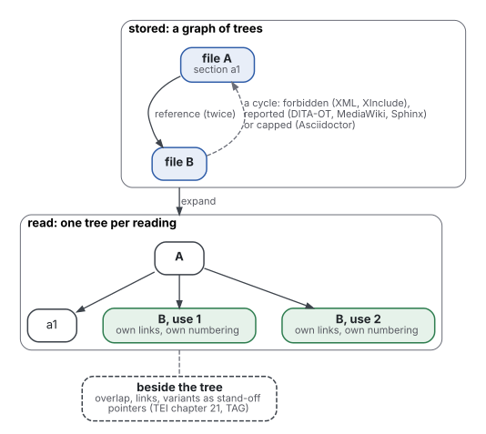
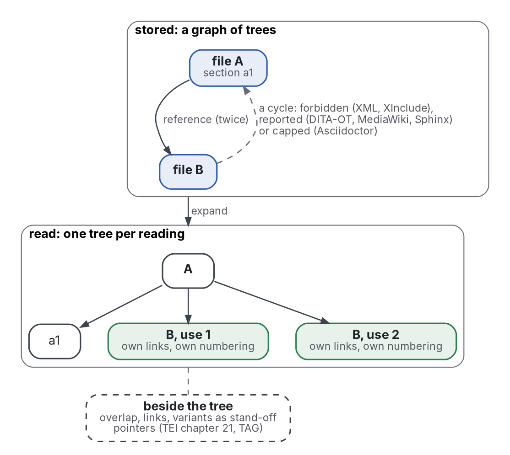

# Position

Each "not known" below is a statement about this search, not about the world.

## Against the existing reviews

- Andersen 2015 and Batova 2014 review component content management from practice and translation; neither treats the stored tree, its recursion or its cycles.
- DeRose 2004 and Marinelli 2008 review overlap; they compare encodings, not reuse or checking.
- Murata 2005 classifies schema languages; Zhang 2012 finds weak evidence for design patterns, in code only (also reviewed in reader-ergonomics-software-design, evidence/architecture-design).
- This search did not find a review that joins a recursive content model, reuse by reference and cycle checking for documents.
- This review adds: a comparison of how 14 systems treat a cycle through a reference; corpus numbers on recursion in real documents; and 36 scored grey sources.

## Known

- Document standards put recursion in the type and keep the instance a finite tree (Bray 2008; Walsh 2019; TEI 2026).
- Two standards offer a capped form beside the recursive one: five numbered levels in DocBook, seven in TEI.
- Recursion is common in schemas and rare and shallow in instances. 58% of DTDs hold recursive elements (Choi 2002, secondary); 99% of web documents have fewer than 8 levels, and 15% use recursion (Mignet 2003, secondary).
- Text has structures that one hierarchy cannot hold; every version of OHCO met a counterexample (Renear 1996).
- Where reuse is not enforced, copies are common: mean clone coverage 13.6% over 28 specifications (Juergens 2010).
- Single sourcing is adopted with costs. In 2008, half of 276 respondents used single sourcing or content management; half of the users reported significant downsides, and about 1 in 10 had seen a failure (Dayton 2010, secondary).
- Systems that allow references forbid, report or cap cycles, or leave them undefined; none read keeps a self-containing unit (state-of-the-art.md).

## Not known

- Whether readers understand a reused fragment as well as one written for its place; no reader study was found.
- Whether reuse by reference keeps documentation more consistent than copies, measured over time; Juergens 2010 counts copies and estimates cost.
- How often overlap occurs in ordinary documentation, as opposed to literary and Biblical texts.
- The recall of structure and prose checkers on documentation.
- Whether a capped section (five or seven levels) or an unbounded one serves readers better: depth in view belongs to [progressive-disclosure](../progressive-disclosure/position.md).

## Where practice runs ahead of the evidence

- DITA's reuse by reference was standardised (OASIS 2010; OASIS 2015) without a published measure of its effect on consistency or readers, in this search.
- Prose linters gather thousands of stars each (state-of-the-art.md); the only effect size found for automated writing feedback is on students (Fleckenstein 2023).
- Descriptive markup was argued to lower authors' cognitive demands (Coombs 1987) and texts to be OHCOs (DeRose 1990), both without measurement.
- The single-parent rule in Notion came from permission design, not from readers (Notion 2021, the owner's account).

## Where evidence is ignored by practice

- Translators report that segmented content loses context (Batova 2014), yet reuse guidance in the standards read addresses validity, not context.
- Copies are common in specifications (Juergens 2010) and inconsistent copies cause faults in code ([file-structure](https://github.com/Tewf/reader-ergonomics/blob/adb53c52fa8eefe0e621e520365157bbbcad1a1a/evidence/file-structure/against.md)), yet the most adopted format read, CommonMark, has no reuse mechanism in its specification (CommonMark 2024).

## Self-reference: a tree or a cycle

- **A template needs the recursive type, not the self-containing instance.** A topic type whose children are topics gives trees of any finite depth; no model read needs a node that contains itself.
- Document models forbid the second in three ways, from strongest to weakest:
  - by syntax: proper nesting makes a contained element a proper part of its container (Bray 2008, 2.1);
  - by a rule on references: no recursive entity (Bray 2008, 4.1), no include within its own chain (Marsh 2006, 4.2.7);
  - by the processor: report the loop (DITA-OT 2026b; MediaWiki 2026b; Sphinx 2026) or cap the depth (Asciidoctor 2026; MediaWiki 2026a).
- Grade: convention, from standards; the count of systems is descriptive. No study measured readers on either side.

## Graphs: is the tree only the storage, and the graph the meaning

Graphviz source

- **The standards read invert the question.** What is stored is a graph of trees: files that include or reference other files, each a tree. What one reading gets is a tree: the references expanded for that place.
- A unit used by two parents is allowed only as a reference, never as a node nested twice (Marsh 2006; OASIS 2015; MediaWiki 2026a).
- Whatever depends on position then needs a rule per use. DITA's `@copy-to` gives each use its own links and navigation (OASIS 2015); Sphinx picks one parent (Sphinx 2026); Notion keeps one parent for permissions (Notion 2021).
- Meaning that crosses the hierarchy is a graph held beside the tree: overlap, links and variants as stand-off pointers or a hypergraph (Renear 1996; TEI 2026, chapter 21; Haentjens Dekker 2017).
- DITA keeps the links between topics in maps rather than in the topics, to keep each topic reusable, and allows nested topics only with special care (OASIS 2015, 2.2.1.6).
- Graphs of summaries for a model as reader (Edge 2024) are reviewed in [progressive-disclosure](../progressive-disclosure/review.md); here they bear only on storage.
- So the evidence allows: one containment tree per reading, a reference graph that must stay acyclic, and cross-links held apart. It does not show that either view helps human readers.

## What this repository adds

Candidate rules for the topic, each a hypothesis graded convention, untested:

- A topic's children are topics; an instance never contains itself.
- A topic has one containing parent; every other use is a reference, resolved into a tree when read.
- The reference graph is acyclic; a check reports a cycle, with a depth cap as a backstop.
- A reused topic must be valid in each place it is used (the DITA rule, OASIS 2015), and carries what its reader needs without its first context.
- Relations that cross the tree (overlap, links) are pointers beside the tree, not nesting.
- It does not claim a new result or the state of the art.
