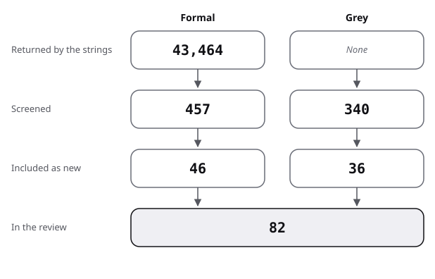

# Sources: the pool, the flow and the scores

This file is the document-model pool: the flow from hits to sources, then each source with its quality. Searches: [protocol](protocol.md); terms are in [frame](frame.md).

## Flow

| Stage | Formal | Grey |
|---|---|---|
| Returned by the strings | 43,464 | not recorded |
| Screened | 457 | 340 |
| Included as new | 46 | 36 |
| In the review | 46 | 36 |

- Formal:
  - 43,464 records were returned: Semantic Scholar 43,178 and arXiv 286.
  - Six noise strings account for 39,879 of them (F11, F26, F32, F34 on Semantic Scholar; F11 and A2 on arXiv); without them, 3,585.
  - 457 were screened by title: 433 from the strings, with repeats, and 24 from forward snowballing.
  - 46 were included, 6 of them first by snowballing and 2 by handoff from the sibling reviews (Priestley 2001 was also found by F8).
- Grey:
  - The web search showed 88 results over four strings; 36 producer pages were visited, 3 of them by handoff; the Q/A strings returned 214 records, and 2 threads came by handoff.
  - 340 were screened (88 web results, 36 producer pages, 216 Q/A records).
  - 36 were included: 25 from the web and 11 Q/A threads. No grey source was carried from an earlier pass.
- Formal exclusions, counted by title and rounded to tens:
  - repeats across strings: 40;
  - other fields (chemistry, medicine, geology, climate, physics) and user-interface frameworks: 250;
  - XML query, storage and database mapping with no bearing on the document model: 60;
  - language-model benchmarks and unrelated software topics: 50;
  - relevant but not read, located only: 6.
    - Maiwald 2019 (real JSON schemas), Oumaziz 2017 (documentation reuse in Java libraries, only the slides reachable), Prechelt 2001 (a patterns experiment);
    - a 1983 test of the Writer's Workbench, and a 2015 book on digital scholarly editing;
    - a 2001 paper on transclusions in J.UCS, whose DOI did not resolve on Crossref.
- Grey exclusions, rounded:
  - web results that repeat a known source, vendor and forum pages, blog posts on the HTML outline: 80;
  - producer pages that were a second page of one source, or refused automated access (3 ISO pages): 14;
  - Q/A records not included after reading the title or the thread: 205, among them 28 Angular and Vue uses of "transclusion".
- Existing reviews found: 11, listed in review.md strand 0.

The figure draws the stages of the table for the document model.

## Formal sources

"narrative lead" means a work named in the brief or recalled before the search, verified before use.

| Key | Kind | Found via | Quality | Used in |
|---|---|---|---|---|
| Andersen 2015 | formal | F7 | integrative review; abstract through a library page | review 0; position |
| Batova 2014 | formal | F7 | integrative review of 60 articles; abstract and method read | review 0; position; against |
| Batova 2017 | formal | F7 | systematic review; title and venue only | review 0 |
| Clark 2016 | formal | F6 | integrative review; title and venue only | review 0 |
| DeRose 2004 | formal | narrative lead; F26 | review of overlap solutions; read | review 0, 2; state-of-the-art |
| Marinelli 2008 | formal | F3 | comparison of formats; title and venue only | review 0; position |
| Murata 2005 | formal | F18 | formal taxonomy; abstract | review 0, 5; position |
| Zhang 2012 | formal | F13 | systematic review, 11 experiments; abstract | review 0; position; against |
| Ampatzoglou 2013 | formal | F13 | mapping study; title and venue only | review 0 |
| Bafandeh Mayvan 2017 | formal | F13 | mapping study; title and venue only | review 0 |
| Fleckenstein 2023 | formal | F25 | measured, meta-analysis of 20 studies; abstract (secondary) | review 0, 5; state-of-the-art; position; against; baseline |
| Goldfarb 1981 | formal | snowball, Renear 1996 | title and venue only | review 1 |
| Coombs 1987 | formal | narrative lead; F20 | argument; full text read in an archived copy | review 1, 3; position; baseline |
| DeRose 1990 | formal | narrative lead; snowball | argument; read through Renear 1996 | review 1; position; baseline |
| Hoare 1975 | formal | narrative lead | title and venue only | frame; review 1 |
| Barnard 1988 | formal | snowball, Renear 1996 | title and venue; content through Renear 1996 | frame; review 2 |
| Renear 1996 | formal | narrative lead; F1 | argument from counterexamples; full text read (archived final version) | review 1, 2; state-of-the-art; position; against; baseline |
| Huitfeldt 1994 | formal | narrative lead | title and venue only | review 2 |
| Buzzetti 2002 | formal | narrative lead | title and venue only | review 2 |
| Sperberg-McQueen 2004 | formal | narrative lead; F3 | data structure; title and venue only | frame; review 2 |
| Peroni 2009 | formal | F3 | data model; title and venue only | frame; review 2 |
| Di Iorio 2011 | formal | F3 | data model; title and venue only | review 2 |
| Schmidt 2009 | formal | F2 | data structure; title and venue only | frame; review 2 |
| Schmidt 2010 | formal | narrative lead; forward snowball | critique; abstract | review 2; against |
| Haentjens Dekker 2017 | formal | forward snowball | data model; abstract read on the proceedings page | frame; review 2; position; against |
| Nelson 1965 | formal | narrative lead | proposal; read in a reprint | frame; review 3 |
| Nelson 1995 | formal | F4 | title and venue only | review 3 |
| Nelson 1999 | formal | narrative lead; F27 | design account; read in the author's copy | frame; review 3 |
| Priestley 2001 | formal | F8; handoff from information-typing | title and venue only | frame; review 3 |
| Rockley 2002 | formal | narrative lead | title and venue only | review 3 |
| Sapienza 2007 | formal | narrative lead | title and venue only | review 3 |
| Dayton 2010 | formal | narrative lead | measured, descriptive, survey of 276; abstract (archived) | review 3; state-of-the-art; position; against; baseline |
| Batova 2018 | formal | F7 | qualitative, one company over 12 months; abstract | review 3; against |
| Juergens 2010 | formal | F14 | measured, descriptive, 28 specifications; full text read | frame; review 3, 5; state-of-the-art; position; against; baseline |
| Luciv 2018 | formal | F30 | measured, descriptive, 19 projects; abstract | frame; review 3; against; baseline |
| Nosál 2016 | formal | web lookup from F29 | measured, descriptive, 5 projects; full text read | review 3; against |
| Johnson 2020 | formal | F4 (arXiv) | measured, descriptive, preprint; abstract | review 3; state-of-the-art; against |
| Calder 1990 | formal | narrative lead | title and venue only | review 3 |
| Choi 2002 | formal | snowball, Mlýnková 2006 | measured, descriptive; secondary | review 5; position; against |
| Mignet 2003 | formal | snowball, Mlýnková 2006 | measured, descriptive; secondary | review 5; state-of-the-art; position; against |
| Bex 2004 | formal | F19 | title and venue only | review 5 |
| Mlýnková 2006 | formal | snowball, during F9 | measured, descriptive, over 20 GB of XML; technical report read | review 5; state-of-the-art; against |
| Martens 2006 | formal | F9 | theory with a survey of real schemas; abstract | review 5; position; against |
| Grijzenhout 2011 | formal | F22 | measured, descriptive, 180,000 files; abstract (secondary) | frame; review 5; state-of-the-art; against; baseline |
| Macdonald 1982 | formal | F23 | title and venue only | review 5 |
| Edge 2024 | formal | handoff from progressive-disclosure | measured on one corpus class, preprint; abstract | position |

## Grey sources, scored

Subtotals as in the [evidence README](../README.md#method).

| Key | Kind | Found via | Quality (total, then subtotals) | Used in |
|---|---|---|---|---|
| Bray 2008 | grey tier 1 | P | 18 of 20 (4 / 4.5 / 3.5 / 1 / 1 / 2 / 1 / 1) | frame; review 1, 3, 4; state-of-the-art; position |
| Marsh 2006 | grey tier 1 | P | 16.5 of 20 (4 / 4.5 / 3.5 / 1 / 1 / 1 / 0.5 / 1) | frame; review 3, 4; state-of-the-art; position; baseline |
| Wright 2022 | grey tier 1 | P | 17 of 20 (3.5 / 4.5 / 3.5 / 1 / 1 / 1.5 / 1 / 1) | review 4; state-of-the-art |
| OASIS 2015 | grey tier 1 | G1, G4; handoff | 17 of 20 (4 / 4.5 / 3 / 1 / 1 / 1.5 / 1 / 1) | review 1, 3; state-of-the-art; position; against; baseline |
| OASIS 2010 | grey tier 1 | P | 15.5 of 20 (4 / 4 / 3 / 1 / 0.5 / 1 / 1 / 1) | review 3, 4; state-of-the-art; position |
| DITA-OT 2026b | grey tier 2 | G2 | 12.5 of 20 (3 / 3.5 / 3.5 / 0 / 0.5 / 1 / 0.5 / 0.5) | frame; review 4; state-of-the-art; position; baseline |
| Walsh 2019 | grey tier 1 | P | 14.5 of 20 (3.5 / 3.5 / 3.5 / 1 / 0.5 / 1 / 0.5 / 1) | frame; review 1, 4; state-of-the-art; position; baseline |
| TEI 2026 | grey tier 1 | P | 18.5 of 20 (4 / 5 / 4 / 1 / 1 / 1.5 / 1 / 1) | frame; review 1, 2, 4; state-of-the-art; position; against |
| CommonMark 2024 | grey tier 2 | P | 15 of 20 (3 / 4 / 3.5 / 1 / 1 / 1 / 1 / 0.5) | review 1; state-of-the-art; position; baseline |
| Clark 2001 | grey tier 1 | P | 17 of 20 (4 / 4.5 / 3.5 / 1 / 1 / 1.5 / 0.5 / 1) | review 5; baseline |
| Schematron 2026 | grey tier 2 | P | 9 of 20 (2.5 / 2 / 2 / 0.5 / 0.5 / 0.5 / 0.5 / 0.5) | review 5 (example only) |
| Sphinx 2026 | grey tier 2 | P | 13 of 20 (3 / 3 / 3.5 / 1 / 0 / 1 / 1 / 0.5) | review 3, 4; state-of-the-art; position |
| Asciidoctor 2026 | grey tier 2 | P | 12 of 20 (3 / 2.5 / 3.5 / 0 / 0.5 / 1 / 1 / 0.5) | review 4; state-of-the-art; position |
| MediaWiki 2026a | grey tier 2 | P | 13.5 of 20 (3.5 / 3 / 3.5 / 0.5 / 0.5 / 1 / 1 / 0.5) | review 4; state-of-the-art; position |
| MediaWiki 2026b | grey tier 2 | P | 11 of 20 (3 / 2 / 3.5 / 0 / 0 / 1 / 1 / 0.5) | frame; review 4; state-of-the-art; position |
| WHATWG 2022 | grey tier 2 | G3 | 16 of 20 (3.5 / 4 / 3.5 / 1 / 1 / 1.5 / 1 / 0.5) | review 1; state-of-the-art; position; against |
| Notion 2021 | grey tier 3 | P | 11.5 of 20 (3 / 3.5 / 2 / 1 / 0 / 1.5 / 0.5 / 0) | review 1, 3; state-of-the-art; position; against |
| ProseMirror 2026 | grey tier 2 | P | 12.5 of 20 (3 / 3.5 / 3.5 / 0 / 0.5 / 1 / 0.5 / 0.5) | review 1, 3, 4, 5; state-of-the-art |
| mdast 2026 | grey tier 2 | P | 13 of 20 (2.5 / 3.5 / 3.5 / 1 / 0.5 / 0.5 / 1 / 0.5) | review 1 |
| Pandoc 2026 | grey tier 2 | P | 13 of 20 (3.5 / 3 / 3.5 / 1 / 0 / 0.5 / 1 / 0.5) | review 1 |
| Wikipedia 2026d | grey tier 2 | P | 11 of 20 (1.5 / 2.5 / 3 / 1 / 1 / 0.5 / 1 / 0.5) | review 1; against |
| Gamma 1995 | grey tier 1 | narrative lead; P | 11 of 20 (4 / 1 / 1 / 1 / 0 / 2 / 1 / 1); book not read, only its table of contents and a secondary page; the lead said 1994, the publisher, Open Library and Wikipedia's citation give 1995 | frame; review 1 |
| Winer 2007 | grey tier 2 | handoff from progressive-disclosure | 13 of 20 (3 / 3.5 / 3 / 1 / 0 / 1 / 1 / 0.5) | review 1, 3; state-of-the-art |
| Orgmode 2026 | grey tier 2 | handoff from progressive-disclosure | 12 of 20 (2.5 / 3.5 / 3.5 / 0 / 0.5 / 0.5 / 1 / 0.5) | review 1 |
| Logseq 2023 | grey tier 2 | handoff from progressive-disclosure | 12 of 20 (2.5 / 2.5 / 3 / 1 / 0.5 / 1 / 1 / 0.5) | review 3; state-of-the-art |
| WSE 2011a | grey tier 2 (Q/A) | NM3 | 11 of 20 (1.5 / 3 / 3 / 1 / 0.5 / 1 / 0.5 / 0.5) | review 6 |
| WSE 2014a | grey tier 2 (Q/A) | NM8; also in information-typing | 11 of 20 (2 / 3 / 4 / 1 / 0 / 0.5 / 0 / 0.5) | review 6; against |
| WSE 2018b | grey tier 2 (Q/A) | NM8, NM12; also in information-typing | 12 of 20 (1 / 3.5 / 4 / 1 / 1 / 1 / 0 / 0.5) | frame; review 6; against |
| WSE 2018g | grey tier 2 (Q/A) | NM13 | 13 of 20 (1 / 4 / 4 / 1 / 0 / 2 / 0.5 / 0.5) | review 6; against |
| WSE 2018f | grey tier 2 (Q/A) | NM3 | 11 of 20 (0.5 / 4 / 3.5 / 1 / 0.5 / 1 / 0 / 0.5) | review 6 |
| SESE 2014f | grey tier 2 (Q/A) | NM7 | 11.5 of 20 (2 / 2.5 / 4 / 1 / 0.5 / 0.5 / 0.5 / 0.5) | review 1 |
| SESE 2022c | grey tier 2 (Q/A) | NM7 | 14.5 of 20 (2.5 / 4 / 4 / 1 / 1 / 1.5 / 0 / 0.5) | review 3, 6; against |
| SO 2009g | grey tier 2 (Q/A) | NM11 | 15 of 20 (1.5 / 5.5 / 4 / 1 / 1 / 1 / 0.5 / 0.5) | review 5, 6 |
| SO 2011d | grey tier 2 (Q/A) | NM11 | 14.5 of 20 (1.5 / 5 / 4 / 1 / 1 / 1.5 / 0 / 0.5) | review 4, 6; state-of-the-art; against |
| SO 2015b | grey tier 2 (Q/A) | handoff from information-typing | 11.5 of 20 (2 / 3 / 3.5 / 1 / 0.5 / 1 / 0 / 0.5); the second rater gave 9.5, so it stays an example of practice | review 6 (example only) |
| SO 2016b | grey tier 2 (Q/A) | handoff from information-typing | 13.5 of 20 (1.5 / 4.5 / 4 / 1 / 0.5 / 1.5 / 0 / 0.5), the score information-typing gave | review 1 |

GitHub 2026d is the reviewer's count of public repository metadata, not a source, so it is not scored.

## Result of the scoring

- 36 grey sources scored: 25 from the web and 11 Q/A threads. One falls below 10 of 20: Schematron 2026, used only for its own claim about its edition.
- By tier: 9 tier 1 (standards and two books) and 15 tier 2 (project documentation, community specifications, a pull request, a wiki page). Then 1 tier 3 (a company post), and 11 Q/A threads at tier 2.
- The highest scores go to standards: TEI 2026 (18.5), Bray 2008 (18), Wright 2022, OASIS 2015 and Clark 2001 (17).
- Gamma 1995 scores 11 with its unseen parts at 0; it supports only the pattern's intent and the case-study title.
- Two threads are shared with information-typing under the same keys (WSE 2014a, WSE 2018b); SO 2016b keeps the score information-typing gave it.
