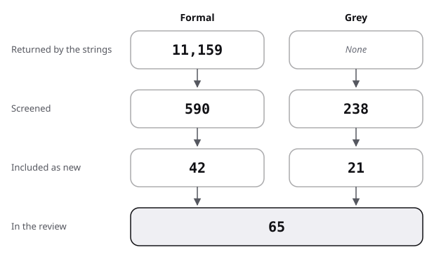

# Sources: the pool, the flow and the scores

This file is the information-typing pool: the flow from hits to sources, then each source with its quality. Searches: [protocol](protocol.md).

## Flow

| Stage | Formal | Grey |
|---|---|---|
| Returned by the strings | 11,159 | not recorded |
| Screened | 590 | 238 |
| Included as new | 42 | 21 |
| Carried, read again | 1 | 1 |
| In the review | 43 | 22 |

- Formal:
  - 11,159 records were returned (Semantic Scholar 10,979 over 31 strings; arXiv 180 over 9 strings).
  - 590 were screened by title, with repeats across strings.
  - 42 were included as new; Kintsch 1978 was carried from reader-ergonomics and read again first-hand.
  - About 548 were excluded, for the reasons below.
- Grey:
  - The web strings returned about 47 results and the producer visits 12; the Q/A strings 179 records. No total is recorded for the web.
  - 238 were screened (59 web, 179 Q/A).
  - 21 were included as new (9 web, 12 Q/A threads); Horn 1969 was carried and read first-hand for the first time.
- In the review: 65 sources, 43 formal and 22 grey. DITA-OT 2026 is the reviewer's own count of a public repository, not a source, and is not scored.

- Formal exclusions, counted by title and rounded to tens:
  - repeats across strings: 60;
  - another field using the same words (genetics, physics, image annotation, topic models, crisis tweets): 330;
  - school writing and second-language teaching with no reading or typing claim: 90;
  - reuse, single-sourcing and content management without types (document-model): 30;
  - relevant but not reached or not opened, located only: 10 (Clark 2016, Harrison 2005, Horn 1992, Schmitz 2017, Dixon 2009, Yayli 2011, Mustafa 1995). Also: the Berkenkotter and Huckin book, a 2013 review of the Sydney School book.
- The categories above account for 520 of the 548 formal exclusions; 28 were excluded without a recorded reason.
- Grey exclusions, rounded:
  - known sources seen again: 10;
  - not about typed units: 25;
  - pages found but not read (one vendor page timed out; drafts of DITA 2.0): 5;
  - Q/A records not included after reading the title or the thread: 167, repeats across the 14 strings included.
- Added by snowballing: Mandler 1977, Rumelhart 1975 and Stein 1975 were reached again from Kintsch 1978; Bogaerds-Hazenberg 2023 from Bogaerds-Hazenberg 2020.
- Existing reviews found: 8; 7 are in review.md strand 0, and Clark 2016 was located only.

The figure draws the stages of the table for information typing.

## Formal sources

Grade vocabulary as in the README. "lead" means named in the commissioning brief and verified here; "carried" means the key comes from another repository's bibliography.

| Key | Kind | Found via | Quality | Used in |
|---|---|---|---|---|
| Kintsch 1978 | formal | carried (reader-ergonomics) | theory; two sections read first-hand | frame; review 1; state-of-the-art; position |
| Rumelhart 1975 | formal | F8 | theory, title and venue only | frame; review 1 |
| Mandler 1977 | formal | lead; F8 | measured, children and adults, ERIC abstract | frame; review 1 |
| Thorndyke 1977 | formal | lead | measured, two experiments, ERIC abstract | frame; review 1 |
| Stein 1975 | formal (research report) | lead | measured, 48 children, ERIC abstract (secondary) | frame; review 1 |
| Mandler 1978 | formal | F8; F31 | title and venue only | review 1 |
| Black 1979 | formal | lead; F8 | critique, abstract | review 1, 6; state-of-the-art; against |
| Trabasso 1985 | formal | F8 | title and venue only | frame; review 1; against |
| Kintsch 1982 | formal | F28 | measured, ERIC abstract | review 4; state-of-the-art; baseline |
| Meyer 2001 | formal | lead | measured, adults, three groups, ERIC abstract | frame; review 5 |
| Hebert 2016 | formal | F10 | meta-analysis, 45 studies, ERIC abstract (secondary) | review 0, 5; baseline |
| Pyle 2017 | formal | F10 | meta-analysis, 19 studies, abstract (secondary) | review 0; against |
| Bogaerds-Hazenberg 2020 | formal | F10 | meta-analysis, 44 studies, abstract (secondary) | review 0; against; baseline |
| Eiriksdottir 2011 | formal | F27 | narrative review, PubMed abstract | frame; review 0, 5; position |
| Andersen 2015 | formal | F18; F29 | integrative review, title and venue only here; read in document-model | frame; review 0 |
| Batova 2014 | formal | F18 | integrative review, title and venue only here; read in document-model | review 0 |
| Batova 2017 | formal | F18 | systematic review, title and venue only here; read in document-model | review 0 |
| Zwaan 1994 | formal | F26 | measured, two experiments, abstract (secondary) | frame; review 4; against |
| Triantafyllopoulos 2021 | formal | F26 | measured, three online experiments, abstract | review 4; against |
| Markevich 2025 | formal | F26 | measured, descriptive, 44 adolescents, abstract | review 4 |
| Horn 1981 | formal | F7 | title and venue only | frame; review 2 |
| Horn 1999 | formal | F3; F7 | title and venue only | review 2 |
| Fields 1981 | formal | F4 | survey, ERIC abstract | review 2 |
| Fields 1982 | formal | F3 | evaluation, title and venue only | review 2 |
| Hartley 1981 | formal | F4 | critique, abstract | review 2 |
| Jonassen 1980 | formal | F4 | measured, one comparison; journal abstract (secondary), the ERIC abstract gave no result | review 2; state-of-the-art |
| Kools 2008 | formal | F4 | measured, one text varied, abstract | review 2, 4; against; baseline |
| Priestley 2001 | formal | F2 | architecture paper, title and venue only here; read in document-model | review 3 |
| Priestley 2002 | formal | F2 | architecture paper, title and venue only | review 3 |
| Evia 2015 | formal | F2; F18 | teaching account, title and venue only | review 3 |
| Swarts 2022 | formal | F30 | measured, descriptive, corpus, abstract | review 3 |
| Heinonen 2022 | formal | F29 | exploratory user studies, three countries, abstract | review 3 |
| Bailie 2015 | formal | F2 | two case studies, title and venue only | review 6 |
| Coggio 2015 | formal | F18 | case study, title and venue only | review 6 |
| Batova 2018 | formal | F18 | qualitative, 12 months, one company, abstract | review 6; state-of-the-art; against |
| Carroll 1987 | formal | F16 | title and venue only | frame; review 4; against |
| Lazonder 1993 | formal | F17 | title and venue only | review 4; against |
| Miller 1984 | formal | F13 | theory, title and venue only | frame |
| Cheng 2007 | formal | F15 | title and venue only | frame; review 5 |
| Artemeva 2008 | formal | F14 | title and venue only | frame; review 5 |
| Brent 2011 | formal | F14 | title and venue only | frame; review 5 |
| Jimeno Yepes 2024 | formal | X1 | measured, preprint, abstract | review 7; state-of-the-art; position; baseline |
| Mortezaagha 2026 | formal | X2 | measured, preprint, 2,359 articles, abstract (secondary) | review 7; against |

## Grey sources, scored

Subtotals as in the [evidence README](../README.md#method).

| Key | Kind | Found via | Quality (total, then subtotals) | Used in |
|---|---|---|---|---|
| Horn 1969 | grey tier 1 (government report) | carried; G1 | 18.5 of 20 (4 / 6 / 2.5 / 1 / 1 / 2 / 1 / 1); the encyclopedia page once cited under this key scored 6.5 | review 2, 4; state-of-the-art; position; against; baseline |
| OASIS 2015 | grey tier 1 (standard) | P | 16.5 of 20 (4 / 4.5 / 2.5 / 1 / 1 / 1.5 / 1 / 1) | frame; review 3, 8; state-of-the-art; position; against; baseline |
| Bogaerds-Hazenberg 2023 | grey tier 1 (doctoral thesis) | snowball | 18.5 of 20 (4 / 6 / 3.5 / 1 / 1 / 1.5 / 0.5 / 1) | review 0, 5 |
| Baker 2013 | grey tier 1 (book; publisher page only) | lead; P | 10 of 20 (3.5 / 2 / 1 / 1 / 0 / 1 / 0.5 / 1); scored low for being unread | frame; review 8 |
| Baker 2018b | grey tier 1 (book; publisher page only) | lead; P | 9.5 of 20 (3.5 / 2 / 1 / 1 / 0 / 1 / 0 / 1) | frame (example only); against |
| SchemaOrg 2026 | grey tier 2 (vocabulary pages) | P | 14 of 20 (4 / 3 / 3.5 / 1 / 0.5 / 0.5 / 1 / 0.5) | frame; review 8; state-of-the-art; position |
| Kubernetes 2026b | grey tier 2 (project documentation) | P | 12 of 20 (2.5 / 3 / 3.5 / 1 / 0 / 0.5 / 1 / 0.5) | frame; review 8; state-of-the-art; position; baseline |
| Information Mapping 2026 | grey tier 2 (company page) | P | 5 of 20 (2 / 1 / 0.5 / 0 / 0 / 0.5 / 0.5 / 0.5) | frame; review 8; position; against (example only) |
| DITAWriter 2026 | grey tier 3 (informal list) | P | 13.5 of 20 (3 / 4 / 3.5 / 1 / 0.5 / 1 / 0.5 / 0) | protocol; review 8; state-of-the-art; position; baseline |
| Johnson 2013 | grey tier 3 (blog) | G3 | 13 of 20 (2 / 4.5 / 3 / 1 / 1 / 1 / 0.5 / 0) | against |
| WSE 2018a | grey tier 2 (Q/A) | TU1 | 13 of 20 (2 / 4 / 2.5 / 1 / 1 / 1.5 / 0.5 / 0.5) | frame; against |
| WSE 2018b | grey tier 2 (Q/A) | TU1 | 13 of 20 (1.5 / 4 / 3.5 / 1 / 1 / 1.5 / 0 / 0.5) | frame; review 8; against |
| WSE 2014a | grey tier 2 (Q/A) | TU1 | 11 of 20 (2 / 3 / 3.5 / 1 / 0 / 1 / 0 / 0.5) | review 8; state-of-the-art; against |
| WSE 2018c | grey tier 2 (Q/A) | TU14 | 12.5 of 20 (2 / 4 / 2.5 / 1 / 0.5 / 1.5 / 0.5 / 0.5) | review 8 |
| WSE 2018d | grey tier 2 (Q/A) | TU8 | 11 of 20 (1.5 / 3 / 3.5 / 1 / 0 / 1 / 0.5 / 0.5) | review 8 |
| WSE 2014b | grey tier 2 (Q/A) | TU8 | 10 of 20 (0.5 / 4 / 3 / 1 / 0 / 1 / 0 / 0.5) | review 8 |
| WSE 2020a | grey tier 2 (Q/A) | TU12 | 8.5 of 20 (1 / 2 / 3 / 1 / 0 / 1 / 0 / 0.5) | frame; review 8; position; against (example only) |
| WSE 2022a | grey tier 2 (Q/A) | TU12 | 11 of 20 (0.5 / 4.5 / 3 / 1 / 0.5 / 1 / 0 / 0.5) | frame; review 8 |
| SO 2013a | grey tier 2 (Q/A) | TU11 | 12.5 of 20 (1.5 / 4 / 3.5 / 1 / 0.5 / 1.5 / 0 / 0.5) | review 8; against |
| SO 2016b | grey tier 2 (Q/A) | TU2 | 13.5 of 20 (1.5 / 4.5 / 4 / 1 / 0.5 / 1.5 / 0 / 0.5) | review 8 |
| SO 2019a | grey tier 2 (Q/A) | TU11 | 8 of 20 (0.5 / 3 / 2.5 / 1 / 0 / 0.5 / 0 / 0.5) | review 8 (example only) |
| UXSE 2014a | grey tier 2 (Q/A) | TU13 | 11.5 of 20 (1 / 3 / 4 / 1 / 0.5 / 1 / 0.5 / 0.5) | review 8 |

## Result of the scoring

- 22 grey sources scored: 10 from the web and 12 Q/A threads. 4 fall below 10 of 20: Information Mapping 2026, Baker 2018b, WSE 2020a and SO 2019a. They appear only as examples of practice.
- Baker 2013 and WSE 2014b sit at exactly 10 and stay in; Baker 2013 is used only for what its publisher lists.
- The highest scores go to the 1969 report itself (Horn 1969), a doctoral thesis (Bogaerds-Hazenberg 2023) and the DITA standard (OASIS 2015).
- Horn 1969 rose from 6.5 to 18.5 because the report, not an encyclopedia page about it, was read; the change was sent to the repositories that cite Horn 1969.
- Linked, not reviewed again: Meyer 1975 (top-level structure, reviewed in psycholinguistics); Red Hat 2026b and GitLab 2026 (topic types and modules, reviewed in documentation).
