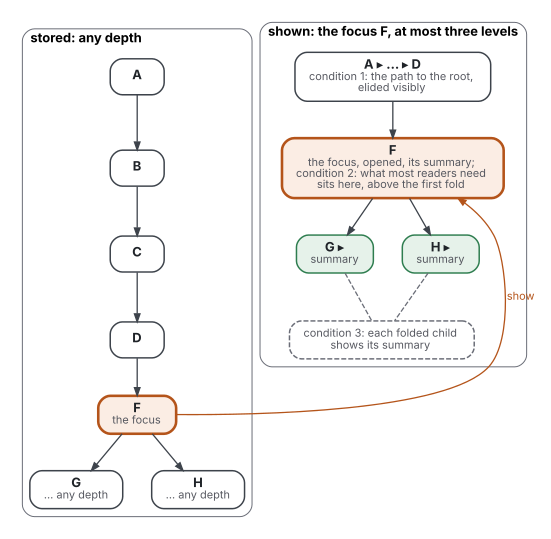

# Position

Each "not known" below is a statement about this search, not about the world. Terms are defined in [frame](frame.md).

## Against the existing reviews

- Cockburn 2009 reviews interfaces for focus and context, mostly on maps, graphs, menus and code; it holds one reading study with comprehension measured (Hornbæk 2003), beside a web-browser study and a document-navigation study.
- Chen 1996 and Dillon 1998 review hypertext against linear text, not folded text within one document.
- Brusilovsky 2001 names stretchtext as an adaptation technology, without a test of it.
- This review adds: layered documents, outliners, and trees of summaries read by models, beside the interface studies; and the question of depth in storage against depth in view, which none of them asks.

## Known

- A fisheye of a tree keeps the ancestral line and nearby nodes, and its size grows with the logarithm of a regular tree, not its size (Furnas 1986).
- Expandable contents beat a fully expanded list for finding items in a large three-level tree on five of nine tasks, lost on the easiest, and did not differ on three (Chimera 1994).
- Shrinking text by importance sped essay work by about 16% with grades no better than linear text; an overview beside the full text gave the best essays (Hornbæk 2003, pp. 140 to 142).
- Readers of a layered document answer less accurately on topics left out of its first layer; the authors infer that few went past it, without logging opens (McDonald 2009).
- Hierarchical links beat network links for novices finding facts (Mohageg 1992, p. 359); hierarchy with some cross-links can beat both (McDonald 1998, pp. 22 to 23).
- No interface for focus and context wins on every task (Cockburn 2009).
- For model readers, one level of disclosure is enough and a second can harm (He 2026); summary trees add little over passages in their original order for strong readers (Laitenberger 2025).

## The repository's question: unbounded in storage, capped in view?

- **What the evidence allows:** yes, as a design, with three conditions. It is supported with caveat, not measured.

- The figure reads left to right: the same tree, stored in full on the left, shown capped on the right, where the focus F is drawn again.
- Why it is allowed:
  - nothing found shows a cost of depth in storage that the reader does not see;
  - the fisheye result gives a bounded view of any tree: the focus, its children, its siblings and its ancestral line (Furnas 1986);
  - the measured interfaces that worked show two or three levels at once (Chimera 1994; menus in file-structure, linked);
  - outliners already store any depth and zoom into one bullet as the new root (practice, counts in state-of-the-art.md).
- Condition 1: the ancestral line must be shown, or elided visibly, since a capped view cannot hold all ancestors of a deep node (state-of-the-art.md, lower bounds). Breadcrumbs are the practice name.
- Condition 2: what most readers need must sit above the cap, because folded and layered content is read less (McDonald 2009; Wikimedia 2016; GOV.UK 2026b).
- Condition 3: each folded node must carry a summary that stands for it, so the reader can judge whether to open it.
- It is the levels effect turned into a rule ([psycholinguistics](https://github.com/Tewf/reader-ergonomics/blob/03cfbc9dd1d243aa86f8ba3168abc61be2bab19f/evidence/psycholinguistics/review.md)).
- Folded views were slowed when a chapter title did not predict its contents (Chimera 1994); folding without a name hides more than it shows (SESE 2014e).
- What is not allowed: claiming the cap of three levels is measured for documents. It is a convention borrowed from menus and outlines.
- For a model reader, the cap is one level of disclosure, not three (He 2026); this is one study, a preprint.

## Not known

- Whether depth in storage matters to a reader once depth in view is capped: no study varies one with the other fixed.
- Whether readers keep their bearings in a tree deeper than about five levels when only three show at once.
- Whether a summary per node improves which branches a reader opens, measured on the reader.
- Whether outliners help readers, as opposed to writers: no study of reading an outline in an outliner was found.
- Whether fold-by-default helps or hurts comprehension on mobile, beyond reading time (Wikimedia 2016 measured time, not understanding).
- Whether trees of summaries help models with long contexts beyond the benchmarks tested (QASPER, QuALITY, NarrativeQA, ∞Bench).

## Where practice runs ahead of the evidence

- Accordions and `details` are standard components (WHATWG 2026; GOV.UK 2026a); their effect on understanding was not measured in any source found.
- Outliners store and show unbounded depth with fold and zoom, with downloads above a million for one plugin (Obsidian 2026); no reading study found.
- Summary trees for retrieval are popular (GraphRAG and PageIndex counts); the controlled comparisons favour simpler order-keeping retrieval (Laitenberger 2025) or one level of disclosure (He 2026).
- The limit of two disclosure levels (Nielsen 2006b) and the rule against an accordion inside another (GOV.UK 2026a) come without published data.

## Where evidence is ignored by practice

- Nested accordions appear in practice (UXSE 2014b), and practitioners package whole books as skills (He 2026, section 1); GOV.UK 2026a advises against the second level and He 2026 measured its harm.
- Privacy commissioners recommended layered notices (McDonald 2009, section 2.2) before that study found readers rarely left the first layer.
- Practice folds by default on mobile; Wikimedia 2016 found readers read more when sections were open.

## What this repository adds

- A reading of the depth question from the reader's side, with the three conditions above as candidate rules, each graded convention, untested until compared (baseline.md):
  - every node opens with a summary that stands for it when folded ([overview first](https://github.com/Tewf/reader-ergonomics/blob/03cfbc9dd1d243aa86f8ba3168abc61be2bab19f/principles/document/overview-first.md));
  - a view shows at most three levels and always the path to the root;
  - what most readers need is never below the first fold.
- It does not claim a new result or the state of the art.
