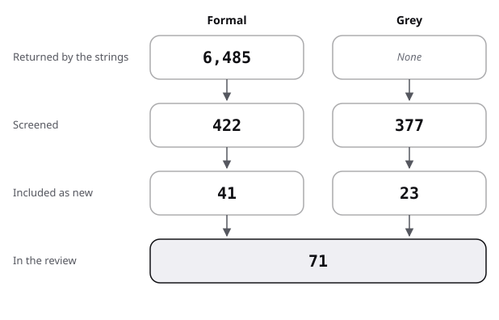

# Sources: the pool, the flow and the scores

This file is the recursive-depth pool: the flow from hits to sources, then each source with its quality. Searches: [protocol](protocol.md); terms in [frame](frame.md).

## Flow

| Stage | Formal | Grey |
|---|---|---|
| Returned by the strings | 6,485 | not recorded (Q/A 318) |
| Screened | 422 | 377 |
| Included as new | 41 | 23 |
| Carried from linked reviews | 6 | 1 |
| In the review | 47 | 24 |

- Formal:
  - 6,485 records were returned: Semantic Scholar 6,374 and arXiv 111. The two unusable "outliner" counts (F13) are left out.
  - 422 were screened by title (382 Semantic Scholar, 40 arXiv), with repeats across strings.
  - 41 were included as new: 23 from the strings, 11 from leads named in the brief and checked, 4 by backward snowballing, 3 by handoff from typed-units.
  - Excluded, by title, rounded to tens: repeats across strings 40; off topic (medicine, physics, images, maps, biology) 260.
  - Also excluded: systems or techniques with no reader study 60; model pipelines not about reading a document tree 40.
- Grey:
  - The web strings showed 45 links and the producer visits 14 pages; the Q/A strings returned 318 threads. Engine totals were not recorded.
  - 377 were screened (27 for G1, 18 for G2, 14 visits, 318 threads).
  - 23 were included as new: 8 from the web and 12 threads, scored here; 3 by handoff from typed-units (one blog, two threads). Two public counts (GitHub 2026c, Obsidian 2026) are the reviewer's measurements and are not scored.
  - Excluded: Q/A threads not included after the title or the thread, 306; tickets, fan and catalogue pages, 41.
  - Also excluded: pages with no data or unreachable (two Web Almanac chapters, two 404 pages, one paywalled guideline), 5.
- Existing reviews found: 7, placed in review.md strand 0.

The figure draws the stages of the table for recursive depth.

## Formal sources

"lead" means named in the brief or recalled, then verified against Crossref or arXiv before use.

| Key | Kind | Found via | Quality | Used in |
|---|---|---|---|---|
| Cockburn 2009 | formal | F6, F8; lead | review, read in full | review 0, 4; state-of-the-art; position; against; baseline |
| Chen 1996 | formal | lead | meta-analysis of 23 experiments, abstract (secondary) | review 0, 3; state-of-the-art; against |
| Dillon 1998 | formal | R1 | review, abstract | review 0; against |
| Brusilovsky 2001 | formal | R1, R2 | survey, relevant sections read | review 0; frame; against |
| Knutov 2009 | formal | R2 | survey, title only | review 0 |
| Lam 2011 | formal | R3 | synthesis of studies, title only | review 0 |
| DeStefano 2007 | formal, carried | held by learning-science | review of 38 studies | review 0, 3 |
| Furnas 1986 | formal | F7; lead | measured, one experiment of 20 subjects, full text | frame; review 1, 2, 5; state-of-the-art; position; against |
| Engelbart 1968 | formal | snowball, Furnas 1986 | title and venue only | review 1 |
| Bederson 1994 | formal | lead | system, title only | frame; review 1 |
| Robertson 1993 | formal | F7, F10 | system, title and Cockburn 2009 | review 1 |
| Carroll 1984 | formal | lead | measured, abstract | frame; review 1 |
| Egan 1989 | formal | lead; snowball, Chimera 1994 | measured, abstract (secondary) | review 2; state-of-the-art |
| Chimera 1994 | formal | F16 | measured, 41 novices, technical report version read | frame; review 2, 5; state-of-the-art; position; against; baseline |
| Hornbæk 2003 | formal | F10 | measured, through Cockburn 2009 (secondary) | review 2; state-of-the-art; position; against; baseline |
| Höök 1997 | formal | F1, F20 | measured, abstract (secondary) | review 2 |
| McDonald 2009 | formal | F21 | measured, 749 adults, authors' version read | frame; review 2; state-of-the-art; position; against; baseline |
| Springer 2020 | formal | F4 | measured, four studies, abstract | review 2 |
| Zellweger 2000 | formal | lead | located only | review 2 |
| Boyle 1994 | formal | lead | located only | review 2 |
| Mohageg 1992 | formal | lead | measured, abstract (secondary) | frame; review 3; state-of-the-art; position; against |
| McDonald 1998 | formal | lead | measured, abstract (secondary) | frame; review 3; position; against; baseline |
| McDonald 1996 | formal | F11, F12 | located only | review 3 |
| Calisir 2003 | formal | F11 | located only | review 3 |
| Potelle 2003 | formal | lead | located only | review 3 |
| Amadieu 2009 | formal, carried | held by learning-science and reading-order | measured, one study | review 3 |
| Hornbæk 2002 | formal | F9 | measured, 32 subjects, abstract | frame; review 4; state-of-the-art; against; baseline |
| Jakobsen 2006 | formal | F24 | measured, through Cockburn 2009 (secondary) | review 4; state-of-the-art |
| Nekrasovski 2006 | formal | snowball, Cockburn 2009 | measured, through Cockburn 2009 (secondary) | review 4; against |
| Plaisant 2002 | formal | snowball, Cockburn 2009 | measured, through Cockburn 2009 (secondary) | review 4 |
| Baudisch 2002 | formal | F6, F8 | measured, through Cockburn 2009 (secondary) | review 4 |
| Kiger 1984 | formal, carried | held by file-structure | measured, menus | review 5 |
| Larson 1998 | formal, carried | held by file-structure | measured, web sites | review 5 |
| Conklin 1987 | formal, carried | held by typography-and-layout | survey | frame |
| Wu 2021 | formal | F17, A1 | abstract (secondary); its scores read in Sarthi 2024 | frame; review 6 |
| Sarthi 2024 | formal | F18, A3; lead | measured on benchmarks, full text | frame; review 6; state-of-the-art; against; baseline |
| Chen 2023 | formal | lead | measured on benchmarks, abstract | review 6 |
| Chang 2024 | formal | lead | measured, 100 books, abstract (secondary) | review 6; against |
| Edge 2024 | formal | snowball, He 2026 | measured on one corpus class, abstract | review 6 |
| Laitenberger 2025 | formal | A3 | measured on three benchmarks, EMNLP (2025), full text | review 6; state-of-the-art; position; against; baseline |
| Jayraj 2026 | formal | F18, A3 | measured, preprint, abstract (secondary) | review 6; against |
| He 2026 | formal | F5 | measured on ∞Bench, preprint, full text | frame; review 5, 6; state-of-the-art; position; against; baseline |
| Otter 2000 | formal | F12 | title only | baseline |
| Heinonen 2022 | formal | handoff, typed-units | exploratory user studies, three countries, abstract (secondary) | review 2 |
| Swarts 2022 | formal | handoff, typed-units | measured, descriptive, corpus, abstract | review 5 |
| Mortezaagha 2026 | formal | handoff, typed-units | measured, 2,359 articles, preprint, abstract (secondary) | review 6 |
| Garousi 2019 | formal, carried | method | guidelines | protocol |

## Grey sources, scored

Subtotals as in the [evidence README](../README.md#method).

| Key | Kind | Found via | Quality (total, then subtotals) | Used in |
|---|---|---|---|---|
| Nielsen 2006b | grey tier 2 | P | 12.5 of 20 (4 / 3.5 / 1 / 1 / 0.5 / 1 / 1 / 0.5) | frame; review 1, 5, 7; state-of-the-art; position; against |
| GOV.UK 2026a | grey tier 1 | P | 17 of 20 (4 / 5 / 3.5 / 1 / 0.5 / 1 / 1 / 1) | review 7; state-of-the-art; position |
| GOV.UK 2026b | grey tier 1 | P | 16 of 20 (4 / 4.5 / 3.5 / 1 / 0.5 / 0.5 / 1 / 1) | review 7; state-of-the-art; position |
| W3C 2026b | grey tier 1 | P | 14.5 of 20 (4 / 4 / 3.5 / 0 / 0.5 / 0.5 / 1 / 1) | review 7 |
| WHATWG 2026 | grey tier 1 | P | 15.5 of 20 (4 / 4 / 3.5 / 1 / 0.5 / 0.5 / 1 / 1) | frame; review 7; state-of-the-art; position |
| Wikimedia 2016 | grey tier 2 | G1 | 17 of 20 (3.5 / 5.5 / 3.5 / 1 / 0.5 / 2 / 0.5 / 0.5) | review 7; state-of-the-art; position; against; baseline |
| Wikipedia 2026c | grey tier 2 | G2 | 11 of 20 (0.5 / 3.5 / 3.5 / 1 / 1 / 0.5 / 0.5 / 0.5) | frame; review 1 |
| VectifyAI 2026 | grey tier 2 | P | 9 of 20 (2 / 3.5 / 0.5 / 0.5 / 0.5 / 0.5 / 1 / 0.5) | review 7; state-of-the-art; against (example only) |
| Wang 2023 | grey tier 2, carried | held by typography-and-layout | 9 of 20 there | review 7; against (example only) |
| UXSE 2010 | grey tier 2 | RD2 | 14 of 20 (2 / 4.5 / 3.5 / 1 / 0 / 1.5 / 1 / 0.5) | review 7 |
| UXSE 2012a | grey tier 2 | RD1 | 14.5 of 20 (1.5 / 5 / 3.5 / 1 / 0.5 / 1.5 / 1 / 0.5) | review 7 |
| UXSE 2012b | grey tier 2 | RD15 | 12 of 20 (1.5 / 4 / 3 / 1 / 0.5 / 1 / 0.5 / 0.5) | review 7; against |
| UXSE 2014b | grey tier 2 | RD6 | 10 of 20 (1 / 3 / 3 / 1 / 0 / 1 / 0.5 / 0.5) | review 7; position |
| UXSE 2015 | grey tier 2 | RD14 | 11 of 20 (1 / 4 / 3 / 1 / 0 / 1.5 / 0 / 0.5) | review 7 |
| UXSE 2016 | grey tier 2 | RD16 | 8 of 20 (0.5 / 2.5 / 2.5 / 1 / 0 / 0.5 / 0.5 / 0.5) | review 7 (example only) |
| UXSE 2018a | grey tier 2 | RD5 | 9.5 of 20 (0.5 / 3.5 / 3 / 1 / 0 / 1 / 0 / 0.5) | review 7 (example only) |
| WSE 2013 | grey tier 2 | RD9 | 11 of 20 (0.5 / 4 / 3.5 / 1 / 0.5 / 1 / 0 / 0.5) | review 7; baseline |
| WSE 2018e | grey tier 2 | RD9 | 13 of 20 (2 / 4.5 / 3.5 / 1 / 0.5 / 1 / 0 / 0.5) | review 7 |
| SESE 2011o | grey tier 2 | RD11 | 15 of 20 (2.5 / 4.5 / 3.5 / 1 / 0.5 / 1.5 / 1 / 0.5) | review 7; against |
| SESE 2011r | grey tier 2 | RD12 | 13 of 20 (0.5 / 4.5 / 3.5 / 1 / 0.5 / 1.5 / 1 / 0.5) | review 7 |
| SESE 2014e | grey tier 2 | RD12 | 14 of 20 (2 / 4.5 / 3.5 / 1 / 0.5 / 1.5 / 0.5 / 0.5) | review 7; position; against |
| Johnson 2013 | grey tier 3 | handoff, typed-units | 13 of 20 there (2 / 4.5 / 3 / 1 / 1 / 1 / 0.5 / 0) | review 2 |
| WSE 2018c | grey tier 2 | handoff, typed-units | 12.5 of 20 there (2 / 4 / 2.5 / 1 / 0.5 / 1.5 / 0.5 / 0.5) | review 7 |
| UXSE 2018b | grey tier 2 | handoff, typed-units | 8.5 of 20 (0.5 / 3 / 2.5 / 1 / 0.5 / 0.5 / 0 / 0.5) | review 7 (example only) |

Counts, not scored: GitHub 2026c (stars and topic counts) and Obsidian 2026 (plugin downloads), both read on 2026-10-29, used in state-of-the-art.md.

## Result of the scoring

- 21 grey sources scored here: 8 from the web, 13 Q/A threads; 2 more keep their typed-units scores. 4 fall below 10: VectifyAI 2026, UXSE 2016, UXSE 2018a, UXSE 2018b. With the carried Wang 2023, 5 are examples only.
- UXSE 2014b sits exactly at 10 and stays in.
- The highest scores go to a government design system (GOV.UK 2026a) and a research wiki page with data (Wikimedia 2016).
- A Q/A thread scores 0.5 on authority for the site, plus 1 for a top answerer at or above 20,000 reputation, or 0.5 at or above 5,000.
- Impact is 1 at 20,000 views or 30 votes, 0.5 at 3,000 views or 10 votes.
- Reputation, votes and views are those of 2026-10-29.
